<!-- TOC --><a name="sql-postgresql-notes"></a>
# SQL & PostgreSQL notes

<!-- TOC start (generated with https://github.com/derlin/bitdowntoc) -->

- [SQL & PostgreSQL notes](#sql-postgresql-notes)
   * [Basic definitions](#basic-definitions)
   * [Database structure](#database-structure)
   * [Creating and deleting a database](#creating-and-deleting-a-database)
   * [Working with Postgres using PSQL CLI command](#working-with-postgres-using-psql-cli-command)
   * [Creating a table with CREATE TABLE](#creating-a-table-with-create-table)
      + [Keywords](#keywords)
      + [Identifiers](#identifiers)
      + [Data types](#data-types)
   * [Deleting a table using DROP TABLE](#deleting-a-table-using-drop-table)
   * [Inserting records into a table with INSERT INTO](#inserting-records-into-a-table-with-insert-into)
      + [Inserting multiple records](#inserting-multiple-records)
   * [Updating records](#updating-records)
   * [Retrieving data from tables using SELECT FROM](#retrieving-data-from-tables-using-select-from)
      + [Retrieving specific columns](#retrieving-specific-columns)
      + [Performing calculations on retrieved columns](#performing-calculations-on-retrieved-columns)
      + [Renaming retrieved columns ](#renaming-retrieved-columns)
      + [Operators on retrieved strings ](#operators-on-retrieved-strings)
   * [Filtering records with WHERE](#filtering-records-with-where)
      + [Comparison operators within a WHERE clause](#comparison-operators-within-a-where-clause)
      + [Compound WHERE clauses](#compound-where-clauses)
      + [Calculations in WHERE clauses](#calculations-in-where-clauses)
   * [Updating rows using UPDATE](#updating-rows-using-update)
   * [Deleting rows using DELETE FROM](#deleting-rows-using-delete-from)
   * [Very basics of designing a database ](#very-basics-of-designing-a-database)
      + [Types of relationships](#types-of-relationships)
         - [One to Many](#one-to-many)
         - [Many to One](#many-to-one)
         - [One to One](#one-to-one)
         - [Many to Many](#many-to-many)
   * [Primary and foreign keys](#primary-and-foreign-keys)
      + [Creating primary keys](#creating-primary-keys)
      + [Creating foreign keys](#creating-foreign-keys)
      + [Queries on associated data](#queries-on-associated-data)
      + [Constraints on foreign keys during INSERTIONS](#constraints-on-foreign-keys-during-insertions)
      + [Constraints on foreign keys during DELETIONS](#constraints-on-foreign-keys-during-deletions)
   * [Joins](#joins)
      + [Four types of joins](#four-types-of-joins)
      + [Joins with WHERE clauses](#joins-with-where-clauses)
      + [Three way joins](#three-way-joins)
   * [Grouping and aggregations](#grouping-and-aggregations)
      + [Combining GROUP BY and aggregates](#combining-group-by-and-aggregates)
      + [A gotcha! with COUNT](#a-gotcha-with-count)
      + [GROUP BY with JOINs](#group-by-with-joins)
      + [Filter out groups by HAVING](#filter-out-groups-by-having)
   * [Sorting rows using ORDER BY](#sorting-rows-using-order-by)
      + [Ordering by by multiple columns](#ordering-by-by-multiple-columns)
   * [Offset and limits](#offset-and-limits)
   * [Selecting distinct values with DISTINCT](#selecting-distinct-values-with-distinct)
   * [Utility operations and keywords](#utility-operations-and-keywords)
   * [Writing subqueries](#writing-subqueries)
      + [Understanding the shape of query results to simplify subqueries](#understanding-the-shape-of-query-results-to-simplify-subqueries)
      + [SELECT can only use subqueries returning a single value](#select-can-only-use-subqueries-returning-a-single-value)
      + [FROM can only use subqueries compatible with outer constructs](#from-can-only-use-subqueries-compatible-with-outer-constructs)
      + [JOIN can only use subqueries compatible with ON criteria](#join-can-only-use-subqueries-compatible-with-on-criteria)
      + [Subqueries that can be used in WHERE depend on the operator](#subqueries-that-can-be-used-in-where-depend-on-the-operator)
         - [ALL and SOME operators inside a WHERE clause](#all-and-some-operators-inside-a-where-clause)
      + [Correlated subqueries](#correlated-subqueries)
         - [A SELECT without a FROM](#a-select-without-a-from)
   * [Using sets in SQL queries](#using-sets-in-sql-queries)
   * [Order of execution of a SELECT statement](#order-of-execution-of-a-select-statement)
   * [PostgreSQL local installation](#postgresql-local-installation)
      + [pgAdmin on macOS](#pgadmin-on-macos)
   * [Structure of a Postgres server](#structure-of-a-postgres-server)
   * [Fast rules for storing numbers](#fast-rules-for-storing-numbers)
   * [Storing text ](#storing-text)
   * [Storing booleans](#storing-booleans)
   * [Storing date and time values](#storing-date-and-time-values)
   * [Row level validations or constraints](#row-level-validations-or-constraints)
      + [Is the value defined?](#is-the-value-defined)
      + [Do we have a default value?](#do-we-have-a-default-value)
      + [Is the value unique?](#is-the-value-unique)
         - [Adding multicolumn uniqueness](#adding-multicolumn-uniqueness)
      + [Dropping a constraint](#dropping-a-constraint)
      + [Is value passing conditional checks?](#is-value-passing-conditional-checks)
         - [Multicolumn checks](#multicolumn-checks)
   * [Typecasting values](#typecasting-values)
   * [App vs database validations](#app-vs-database-validations)
   * [Database design ](#database-design)
      + [Database schema design tools](#database-schema-design-tools)
   * [Understanding the Internals of PostgreSQL](#understanding-the-internals-of-postgresql)
   * [Database Indexes and Query Optimization](#database-indexes-and-query-optimization)
      + [Full Table Scans: Execution Mechanics and Performance Costs](#full-table-scans-execution-mechanics-and-performance-costs)
      + [Database Indexes: Mental Model and Direct Block Access](#database-indexes-mental-model-and-direct-block-access)
      + [How an Index Works: Sorting, B-Tree Construction, and CTID Pointers](#how-an-index-works-sorting-b-tree-construction-and-ctid-pointers)
      + [Creating, Naming, and Dropping Indexes](#creating-naming-and-dropping-indexes)
      + [Benchmarking Queries: EXPLAIN ANALYZE and Index Performance](#benchmarking-queries-explain-analyze-and-index-performance)
      + [The Trade-offs of Indexes: Storage Overhead and Write Latency](#the-trade-offs-of-indexes-storage-overhead-and-write-latency)
      + [PostgreSQL Index Types: B-Tree and Specialized Variants](#postgresql-index-types-b-tree-and-specialized-variants)
      + [Automatically Generated Indexes: Primary Keys and Unique Constraints](#automatically-generated-indexes-primary-keys-and-unique-constraints)
      + [Deep Dive: Physical Storage and Anatomy of B-Tree Indexes with Pageinspect](#deep-dive-physical-storage-and-anatomy-of-b-tree-indexes-with-pageinspect)
   * [Query Tuning Basics](#query-tuning-basics)
   * [Advanced Query Tuning](#advanced-query-tuning)
   * [Recursive Common Table Expressions (CTEs)](#recursive-common-table-expressions-ctes)
   * [Simplifying Queries with Views](#simplifying-queries-with-views)
   * [Materialized Views and Query Caching](#materialized-views-and-query-caching)


<!-- TOC end -->


<!-- TOC --><a name="basic-definitions"></a>
## Basic definitions

**Database**: A tool to store information. We take some amount of data from some source, put it inside of a database where it gets persisted either in memory or on disk. Postgres is one type of database.

**Client**: We use a client to connect to a database. A client can be any piece of software, so it might even be some API server you put together. There can be different types of clients.

**SQL**: Structured Query Language or SQL is how we interact with a database when we connect to it. SQL is kind of like a programming language. It tells our database some information that we want to put inside of it that we want to retrieve, update or delete (CRUD operations).

**SQL != PostgreSQL**
* SQL is a language used to interact with Databases while Postgres is a database system as a whole
* SQL is based on the **ANSI standard** which means that the core features like UPDATE, INSERT, DELETE, etc are all the same across the various SQL flavours such as MySQL, PostgreSQL, SQL Server, etc.
* SQL is used with other databases too with slight differences in the way it is defined. However, knowing basic SQL helps you work with most database systems such as Postgres, SQL server, MySQL, and so on

<!-- TOC --><a name="database-structure"></a>
## Database structure

**Table**: A table is something that sits inside of our database that is going to store a collection of records (Ex: Cities). A table may contain many records. Each row in a table corresponds to a single record.

**Columns**: Inside a table, we may have many different columns and each column is going to store some information about a very specific property of some record. Ex: Store the name of the country, its population and so on. ***Column data type***: Finally, we say that each of those different columns are going to store a very different specific kind or type of information. Ex: Name is a string, population a number, etc.

| name (VARCHAR) | population (INT) | area (FLOAT) |
| -------------- | ---------------- | ------------ |
| New York       | 8419600          | 783.8        |
| Tokyo          | 13929286         | 2194.1       |
| Paris          | 2140526          | 105.4        |
| Mumbai         | 12442373         | 603.4        |
| Sydney         | 5312163          | 12367.7      |


**Start a PostgreSQL server after installation**: 

Use the `psql` command on CLI to get into the database system

## Creating and deleting a database

**Create database**: 

```SQL
CREATE DATABASE database_name;
```

**Delete a database**: 

```SQL
DROP DATABASE database_name;
```

It is important to note that you cannot drop a database if there are active connections to it. 
You must ensure no users or applications are connected to the database before attempting to drop it. You can also add IF EXISTS to prevent errors if the database does not exist:

```SQL
DROP DATABASE IF EXISTS database_name;
```

**List the databases**: 

`\l` or `\list ` command inside the database system i.e `psql` env

## Working with Postgres using PSQL CLI command

To create and use a PostgreSQL database with `psql` (Refer to local postgres installation section for `psql` installation), follow these steps:

1. Connect to **PostgreSQL server** using `psql`:

```bash
psql -U postgres
```
This logs you into the default postgres user shell where you can run SQL commands.

2. Create a new database with the `CREATE DATABASE` command:

```bash
CREATE DATABASE dbname;
```
Replace dbname with your desired database name. This command creates a database by cloning the default template template1.

3. List all databases to confirm creation:

```bash
\l
```
Your new database should appear in the list.

4. Connect to your newly created database to start using it:

```bash
\c dbname
```
After this, you can run SQL queries and create tables inside this database.

**Optional**: Create tables, insert data, etc., using SQL statements:

```SQL
CREATE TABLE tablename (
  column1 datatype constraints,
  column2 datatype constraints,
  ...
);
```

Alternatively, you can create a database from the command line (outside psql) using:
```bash
createdb dbname
```
Summary:
- Use `psql -U username` to enter the PostgreSQL shell.
- Use `CREATE DATABASE dbname;` to create a database.
- Use `\l` to list databases and `\c dbname` to connect to a database.
- Use SQL commands inside the database to create tables and manage data.
- This method assumes you have the necessary privileges to create databases and users in PostgreSQL.​

<!-- TOC --><a name="creating-a-table-with-create-table"></a>
## Creating a table with CREATE TABLE

Use the `CREATE TABLE` syntax with name and arguments containing a comma (`,`) separated list of column names and data types for it.

```sql
CREATE TABLE cities (
  name VARCHAR(50),
  country VARCHAR(50),
  population INTEGER,
  area INTEGER
);
```

**Note**: The semicolon (`;`) at the end is very important in SQL. Do not forget to append it to your statement!

<!-- TOC --><a name="keywords"></a>
### Keywords

SQL has keywords that are reserved for instructions. Ex: `CREATE`, `TABLE`, `SELECT`, etc. These are always written in UPPERCASE as per convention.

<!-- TOC --><a name="identifiers"></a>
### Identifiers

SQL has identifiers for what we want the database to "act on". These can be names for tables, columns, etc. These are always written in lowercase as per convention.

<!-- TOC --><a name="data-types"></a>
### Data types

String data types in PostgreSQL are generally listed as `VARCHAR` followed by the *maximum* length of characters in parentheses (`()`). It stands for "variable character".

For an `INTEGER` type, the range is ~-2billion to ~+2billion.

Table explaining the various data types:
| Data Type        | Example Value           | Description                             |
| ---------------- | ----------------------- | --------------------------------------- |
| INTEGER          | 1234                    | Whole numbers for basic counting        |
| BIGINT           | 9876543210              | Large whole numbers, often used for IDs |
| SERIAL           | auto-increment (1,2)    | Auto-incrementing integer for keys      |
| VARCHAR(n)       | 'New York'              | Variable-length character string        |
| TEXT             | 'Description text'      | Large arbitrary-length text             |
| BOOLEAN          | TRUE                    | True/false logical values               |
| DATE             | '2025-11-06'            | Stores calendar dates                   |
| TIMESTAMP        | '2025-11-06 19:44'      | Date and time (no timezone info)        |
| NUMERIC(p,s)     | 123456.78               | High-precision numeric values           |
| REAL             | 3.14159                 | Single precision floating-point numbers |
| DOUBLE PRECISION | 2.718281828459          | Double precision floating-point numbers |
| BYTEA            | \\xDEADBEEF             | Binary data (blobs, files)              |
| UUID             | 'a0eebc99-9c0b-4ef8...' | Universally unique identifiers          |
| JSON             | '{"a":1,"b":2}'         | Structured data in JSON format          |

<!-- TOC --><a name="deleting-a-table-using-drop-table"></a>
## Deleting a table using DROP TABLE

Use the `DROP` command to delete a table and its entire contents

Ex:
```SQL
DROP TABLE photos;

-- DROP successful!
-- DROP complete
```

<!-- TOC --><a name="inserting-records-into-a-table-with-insert-into"></a>
## Inserting records into a table with INSERT INTO

Use the `INSERT INTO` command syntax. It needs a table name followed by arguments for column names. This in turn is followed by `VALUE` and an argument list containing values for the listed columns.

```SQL
INSERT INTO cities (name, country, population, area)
VALUES ('Tokyo', 'Japan', 38505000, 8223);
```

**Note**: The order of values inserted must match the the column order. Else, it could result in an error or worse, a mess where the column values do not correspond to the column name (Ex: Japan for name and Tokyo for country)

<!-- TOC --><a name="inserting-multiple-records"></a>
### Inserting multiple records

Use the same  `INSERT INTO` command but the arguments to  `VALUES` can contain multiple records enclosed in parentheses (`()`) and separated by a comma (`,`) like shown below:
```SQL
INSERT INTO cities (name, country, population, area)
VALUES 
	('Delhi', 'India', 28125000, 8223),
	('Shanghai', 'China', 22125000, 4015),
	('Sao Paulo', 'Brazil', 20935000, 3043);
```

<!-- TOC --><a name="updating-records"></a>
## Updating records

Use the `UPDATE` command.
Syntax: `UPDATE <table> SET <column>=<value> WHERE <condition>`

We will learn about `WHERE` later. For now, it is just a condition applied on the rows which results in only those rows that pass/satisfy it.

```SQL
-- Update all products that have no price defined to a default value
UPDATE products
SET price = 99999
WHERE price IS NULL; -- Make sure to use `IS` instead of `=` in WHERE of an UPDATE

-- In a WHERE of a SELECT, we can use `=` (See next section)
```

<!-- TOC --><a name="retrieving-data-from-tables-using-select-from"></a>
## Retrieving data from tables using SELECT FROM

Use the `SELECT` statements to query from a table.

```SQL
SELECT * FROM cities;

-- name	country	population	area
-- Tokyo	Japan	38505000	8223
-- Delhi	India	28125000	8223
-- Shanghai	China	22125000	4015
-- Sao Paulo	Brazil	20935000	3043
```

**Note**:
1. `*` is a wildcard for selecting all the columns in a table
2. `--` is a comment in SQL. We are using that to display examples results of the `SELECT` operation

<!-- TOC --><a name="retrieving-specific-columns"></a>
### Retrieving specific columns

We can replace `*` with a comma (`,`) separated list of columns. 

The order of the columns do not matter and the results will be listed in the order specified.

```SQL
SELECT name, population FROM cities;

-- name	population
-- Tokyo	38505000
-- Delhi	28125000
-- Shanghai	22125000
-- Sao Paulo	20935000
```

**Note**: We can also repeat the same column name multiple times (Ex: `name, name, name`) but there are very rare cases where that would be useful.

<!-- TOC --><a name="performing-calculations-on-retrieved-columns"></a>
### Performing calculations on retrieved columns

It is possible to use certain operators on or between columns within a `SELECT` command in order to process the data further.

Example of calculating the population density by dividing the population column by the area column:
```SQL
SELECT name, population / area FROM cities;

-- name	?column?
-- Tokyo	4682
-- Delhi	3420
-- Shanghai	5510
-- Sao Paulo	6879
```

**Note**: Common arithmetic operators include `+`, `-`, `*`, `/`, `^` (exponent), `|/` (square root), `@` (absolute value), and `%` (remainder).

<!-- TOC --><a name="renaming-retrieved-columns"></a>
### Renaming retrieved columns 

We can rename columns in a `SELECT` statement using the `AS` keyword. It is especially useful on calculated / processed columns.

Examples:
```SQL
SELECT name, population AS city_population 
FROM cities;

-- name	city_population
-- Tokyo	38505000
-- Delhi	28125000
-- Shanghai	22125000
-- Sao Paulo	20935000
```

```SQL
SELECT name, population / area AS population_density 
FROM cities;

-- name	population_density
-- Tokyo	4682
-- Delhi	3420
-- Shanghai	5510
-- Sao Paulo	6879
```

<!-- TOC --><a name="operators-on-retrieved-strings"></a>
### Operators on retrieved strings 

Apart from numerical i.e arithmetic operators, we have operators & functions for string values.
The common string operators are:
1. `||` : Join two strings. **Note**: we might need to add a space (`' '`) literal in between for formatting
2. `CONCAT()`: Join two strings
3. `LOWER()`: Gives a lowercase string
4. `LENGTH()`: Gives the number of characters in a string
5. `UPPER()`: Gives an uppercase string

**Note**: It is better to give a name the column generated from these operations using the `AS` keyword

```SQL
SELECT name || country AS location
FROM cities;

-- location
-- TokyoJapan
-- DelhiIndia
-- ShanghaiChina
-- Sao PauloBrazil
```

```SQL
SELECT name || ', ' || country AS location
FROM cities;

-- location
-- Tokyo, Japan
-- Delhi, India
-- Shanghai, China
-- Sao Paulo, Brazil
```

Functions can be ***nested***! 
```SQL
SELECT CONCAT(UPPER(name), ', ', UPPER(country)) AS location
FROM cities;

-- location
-- TOKYO, JAPAN
-- DELHI, INDIA
-- SHANGHAI, CHINA
-- SAO PAULO, BRAZIL
```

<!-- TOC --><a name="filtering-records-with-where"></a>
## Filtering records with WHERE

Use the `WHERE` clause and its criteria/condition inside a `SELECT` statement.

:warning: **It is important to know the order of execution of a WHERE clause.**
10. First, the `FROM` clause considers the whole table
11. Next, the `WHERE` clause is applied on the above result 
12. Lastly, the `SELECT` operation selects the columns on the above result

Hence, `FROM` to `WHERE` to `SELECT` is how we can conceptualise the order of execution! 

Example:
```SQL
SELECT name, area
FROM cities WHERE area > 4000;

-- name	area
-- Tokyo	8223
-- Delhi	8223
-- Shanghai	4015
```

Here is the flow of execution:
```SQL
-- 1. FROM is applied
-- name	country	population	area
-- Tokyo	Japan	38505000	8223
-- Delhi	India	28125000	8223
-- Shanghai	China	22125000	4015
-- Sao Paulo	Brazil	20935000	3043

-- 2. WHERE is applied
-- name	country	population	area
-- Tokyo	Japan	38505000	8223
-- Delhi	India	28125000	8223
-- Shanghai	China	22125000	4015

-- 3. SELECT is applied
-- name	area
-- Tokyo	8223
-- Delhi	8223
-- Shanghai	4015
```

<!-- TOC --><a name="comparison-operators-within-a-where-clause"></a>
### Comparison operators within a WHERE clause

We can add conditions on columns in a WHERE clause. The list of comparison operators within a `WHERE` clause are:
1. `=` 
2. `>`
3. `<`
4. `>=`
5. `<=`
6. `<>` or `!=` to check for inequality i.e are values not equal?
7. `IN` to check if a value is in a given list (Also use parentheses `()` for the list)
8. `NOT IN` to check if a value is not in a given list (Also use parentheses `()` for the list)
9. `BETWEEN` to check if a value falls in between two values (Also use the `AND` keyword)

Examples:
```SQL
SELECT name, area
FROM cities
WHERE area = 4015

-- name	area
-- Shanghai	4015
``` 
```sql
SELECT name, area
FROM cities
WHERE area BETWEEN 3000 AND 4000;

-- name	area
-- Sao Paulo	3043
```
```SQL
SELECT name, area
FROM cities
WHERE name IN ('Delhi', 'Tokyo');

-- name	area
-- Tokyo	8223
-- Delhi	8223
```
```SQL
SELECT name, area
FROM cities
WHERE AREA NOT IN (8223, 3043);

-- name	area
-- Shanghai	4015
```

<!-- TOC --><a name="compound-where-clauses"></a>
### Compound WHERE clauses

We can use the `AND` or `OR` operators to combine conditionals to form complex criteria for the `SELECT` clause.

Examples:
```SQL
SELECT
  name,
  area
FROM
  cities
WHERE
  area NOT IN (8223, 3043)
  OR name = 'Delhi';

-- name	area
-- Delhi	8223
-- Shanghai	4015
```
```SQL
SELECT
  name,
  area
FROM
  cities
WHERE
  area > 3000
  AND country = 'Japan';

-- name	area
-- Tokyo	8223
```

<!-- TOC --><a name="calculations-in-where-clauses"></a>
### Calculations in WHERE clauses

`WHERE` clause conditions need not only work on columns. It can also work on calculations on columns. Ex: It can work on `population / area`.

**Note**: When we use calculations in our WHERE clause, the mathematical operations are performed first (Ex: `/`, `+`, `*`) and only then is the comparison operator applied! :warning:

Example:
```SQL
SELECT
  name,
  population,
  area
FROM
  cities
WHERE
  population / area > 5000

-- name	population	area
-- Shanghai	22125000	4015
-- Sao Paulo	20935000	3043
```

<!-- TOC --><a name="updating-rows-using-update"></a>
## Updating rows using UPDATE

Use the `UPDATE` statement. The syntax is usually `UPDATE...SET...WHERE`.
You update a table, set its column value, only if that row's column matches a where clause.

```SQL
UPDATE cities
SET population = 39505000
WHERE name = 'Tokyo';

-- 1 row updated
```
```SQL
SELECT * FROM cities;
-- name	country	population	area
-- Delhi	India	28125000	8223
-- Shanghai	China	22125000	4015
-- Sao Paulo	Brazil	20935000	3043
-- Tokyo	Japan	39505000	8223
```

**Note**: If you intend to update only one row then make sure your `WHERE` clause does an *exact* match.

<!-- TOC --><a name="deleting-rows-using-delete-from"></a>
## Deleting rows using DELETE FROM

Use the `DELETE FROM` statement. The syntax is usually `DELETE FROM...WHERE`. 
You choose a table to delete from and specify the where clause which picks the rows to delete accordingly.

```SQL
DELETE FROM cities
WHERE name = 'Tokyo';

-- 1 row deleted
```
```SQL
SELECT * FROM cities;

-- name	country	population	area
-- Delhi	India	28125000	8223
-- Shanghai	China	22125000	4015
-- Sao Paulo	Brazil	20935000	3043
```

**Note**: If you intend to delete only one row then make sure your `WHERE` clause does an *exact* match.

<!-- TOC --><a name="very-basics-of-designing-a-database"></a>
## Very basics of designing a database 

Starting approach:
1. Identify the ***features*** of the application you want to build
	-  Google for ideas for the system you are building. It is likely that it has been built before
2. Create a ***separate table*** for each of these features. Treat them as ***resources***
3.  Identify the ***relations*** or ***ownership*** between the resources

Example:
- Instagram (photo sharing app) has users' profiles, photos, comments & likes on photos. 
- Users, Photos, Comments, & Likes can be the separate tables
- Users can like & comment on photos while following and being followed by other users (relationships).

<!-- TOC --><a name="types-of-relationships"></a>
### Types of relationships

There are 4 types of relationships between records of different tables (i.e resources)

<!-- TOC --><a name="one-to-many"></a>
#### One to Many

One record in a table has relationships with multiple records of another table.

Examples of this kind of a relationship: 
- *"A user has many photos"* (1 user mapped to N photos)
- *"A photo can have many comments"* (1 photo mapped to N comments)
- *"A company has many employees"*

<!-- TOC --><a name="many-to-one"></a>
#### Many to One

This is *actually the same as the One to Many relationship* but the ***perspective is shifted to the other resource***.

Examples of this kind of a relationship: 
- *"A photo has one user"* (N photos are mapped to 1 user)
- *"A comment has one photo"* (N comments are mapped to 1 photo)
- *"An employee works for one company"*

<!-- TOC --><a name="one-to-one"></a>
#### One to One

In this type of relationship, a record in a table has a relationship with *exactly one record* in another table

Examples of this kind of a relationship: 
- "A ship has only one captain and vice versa"
- "A company has only one CEO and vice versa"
- "A person has only one driver's license and vice versa"

<!-- TOC --><a name="many-to-many"></a>
#### Many to Many

In this type of relationship, many records in a table may have relationships with many records of another table

Examples of this kind of a relationship: 
- "Students attend many classes and a class has many students"
- "Engineers work on many tasks and a task may have many engineers working on it"
- "A movie casts many actors and each actor can act in many movies"

<!-- TOC --><a name="primary-and-foreign-keys"></a>
## Primary and foreign keys

**Primary key:** 
- The goal of this key is to *uniquely identify a row in a table*
- If we set a column (or a set of columns) as the primary key (**PK**) then that column *has to be unique for each row* in the entire table. Ex: First name cannot be a primary key of a user table
- Usually named as `id` and is generally an ordered set of *numbers* or *UUIDs* (Random UUIDs are also possible but are bad for performance if they don't have an order)

**Foreign key:**
- The goal of this key is to *relate the current record (row) with another record placed in another table* (or sometimes, even within the same table)
- We generally set up an extra column for the foreign key (**FK**) (Ex: A foreign key column in Photos table that references the user id (primary key) of the Users table)
- Usually, it is named as `xyz_id` where `xyz` references the name of another table's records
- It is exactly equal to the primary key of a record of the table it references
- **Note**: Whenever we talk about 1-1, 1-Many, Many-1, or Many-Many relationships, we always realize it using *foreign keys*!
- The foreign key can change if the relationship changes

**Important**
In One to Many / Many to One relationships, *the "many" side receives the foreign key* (The side the "many" belong to do not have a foreign key). Examples:
- A user has many photos: The Photos table will have a column (FK) referencing the user it belongs to
- A photo has many comments: The Comments table will have a column (FK) referencing the photo it belongs to

Example:
```
Comments:
id (PK) | text | user_id (FK) | photo_id (FK)

Photos:
id (PK) | url | user_id (FK)

Users:
id (PK) | username | email
```
```
Users
| id (INT, PK) | username | email            |
| ------------ | -------- | ---------------- |
| 1            | alice    | alice@mail.com   |
| 2            | bob      | bob@mail.com     |
| 3            | charlie  | charlie@mail.com |

| id (INT, PK) | url      | user_id (INT, FK→Users.id) |
| ------------ | -------- | -------------------------- |
| 1            | img1.jpg | 1                          |
| 2            | img2.jpg | 2                          |
| 3            | img3.jpg | 1                          |

| id (INT, PK) | text            | user_id (INT, FK→Users.id) | photo_id (INT, FK→Photos.id) |
| ------------ | --------------- | -------------------------- | ---------------------------- |
| 1            | Nice shot!      | 2                          | 1                            |
| 2            | Love this cafe! | 3                          | 3                            |
| 3            | Inspiring view  | 1                          | 2                            |
| 4            | Great place!    | 2                          | 3                            |
```
 
 **Auto-generated IDs**: 
- Instead of manually entering `id`s for primary keys, databases allow us to generate an ordered set of values for it automatically every time we insert a row
- In PostgreSQL, we have to use the keyword `SERIAL` during table creation to make a column *auto-incremented*
- ***We can exclude this column during insertion of records!*** as the value will be automatically populated
- **Note**: We should *not* use `SERIAL` for foreign keys since that value may vary on the relationship (Or, it is generated in another table and we simply reference it!)

<!-- TOC --><a name="creating-primary-keys"></a>
### Creating primary keys

**Primary key in PostgreSQL**: Use the **`PRIMARY KEY`** keyword for a column during table creation

Example:
```SQL
CREATE TABLE users (
  id SERIAL PRIMARY KEY,
  username VARCHAR(50)
);

INSERT INTO users (username)
VALUES
	('monahan93'),
	('pferrer'),
	('si93onis'),
	('99stroman');
```

**Note**: In the above example, we excluded the SERIAL `id` primary key value during the insertion operations since it is auto-incremented

```SQL
SELECT * FROM users;

-- id	username
-- 1	monahan93
-- 2	pferrer
-- 3	si93onis
-- 4	99stroman
```

<!-- TOC --><a name="creating-foreign-keys"></a>
### Creating foreign keys

Foreign keys are created using the **`REFERENCES`** keyword during table creation. Its argument is the table name with the column it references within parenthese (`()`). Example: `... REFERENCES <table>(<column>)`

Example:
```SQL
CREATE TABLE photos (
  id SERIAL PRIMARY KEY,
  url VARCHAR(200),
  user_id INTEGER REFERENCES users(id)
);

INSERT INTO photos (url, user_id)
VALUES
	('http://one.jpg', 4);
```
```SQL
SELECT * FROM photos;

-- id	url	         user_id
-- 1	http://one.jpg	4
```

<!-- TOC --><a name="queries-on-associated-data"></a>
### Queries on associated data

We can write queries (`SELECT`) statements using foreign keys to fetch associated data.
1. We can use the `WHERE` clause
2. We can also perform `JOIN`s (Explained later)

```SQL
SELECT * FROM photos
WHERE user_id = 4;

-- id	url	       user_id
-- 1	http://one.jpg	4
-- 7	http://256.jpg	4
```
```SQL
SELECT * FROM photos
JOIN users ON photos.user_id = users.id;

-- id	url	user_id	id	username
-- 1	http://36.jpg	1	1	monahan93
-- 1	http://25.jpg	1	1	monahan93
-- 1	http://two.jpg	1	1	monahan93
-- 2	http://754.jpg	2	2	pferrer
-- 3	http://35.jpg	3	3	si93onis
-- 4	http://256.jpg	4	4	99stroman
-- 4	http://one.jpg	4	4	99stroman
```

<!-- TOC --><a name="constraints-on-foreign-keys-during-insertions"></a>
### Constraints on foreign keys during INSERTIONS

1. Trying to insert a foreign key for a value that does not exist (Ex: photo for a user with id 1913 who does not exist in the user's table) will throw an error
2. Trying to insert `NULL` as a foreign key when you don't know the associated value is okay! Works fine in PostgreSQL

```SQL
INSERT INTO photos (url, user_id)
VALUES ('http://99.jpg', 1913);

-- insert or update on table "photos" violates foreign key constraint "photos_user_id_fkey"
```
```SQL
INSERT INTO photos (url, user_id)
VALUES ('http://99.jpg', NULL);

-- INSERT successful!
-- 1 row(s) inserted
```
```SQL
SELECT * FROM photos;

-- id	url	user_id
-- 1	http://one.jpg	4
-- 2	http://two.jpg	1
-- 3	http://25.jpg	1
-- 4	http://36.jpg	1
-- 5	http://754.jpg	2
-- 6	http://35.jpg	3
-- 7	http://256.jpg	4
-- 9	http://99.jpg	null
```

<!-- TOC --><a name="constraints-on-foreign-keys-during-deletions"></a>
### Constraints on foreign keys during DELETIONS

What should happen to the rows containing foreign keys when the referenced row in another table is deleted? Ex: If a user with id 1 is deleted from Users, what should happen to the rows in Photos that have FK user_id = 1? Should they be deleted or should the pointer be a dangling one? Policies are set in PostgreSQL that define the expected behaviour.

**Policies**: (Set during `CREATE TABLE` as an option to the Foreign Key (FK) column)
1. `ON DELETE RESTRICT`: This is the default policy for Foreign Keys (FKs). The delete operation will throw an error
2. `ON DELETE NO ACTION`: Similar to above. The delete operation will throw an error
3. `ON DELETE CASCADE`: Deletes all the associated rows in tables with the matching foreign key when the referenced row is deleted (Useful if you want to remove all associated data on delete). Ex: Deleting the discussion forum data i.e replies for a deleted post
4. `ON DELETE SET NULL`: Sets the Foreign Key field to `NULL` when the referenced row is deleted (Useful if you want to continue maintaining a resource created a user who is now removed). Ex: Continue displaying a photo or article of a user who deleted their account
5. `ON DELETE SET DEFAULT`: Sets a pre-defined default value in the Foreign Key field when the referenced row is deleted 
	- **Note**: We need to specify `DEFAULT <value>` inline but the  `REFERENCES` syntax is written separately as a `CONSTRAINT`)
	- **Note**: The default value must be a valid referenced field value i.e it must exist on the referenced table (Ex: If row from user with `user_id = 1` is deleted but the default specified for foreign key referencing it in photos is `2` then PostgreSQL attempts to set `2` as the default but will throw an error if `2` is not an existing, i.e valid, reference)

```SQL
CREATE TABLE photos (
id SERIAL PRIMARY KEY,
url VARCHAR(200),
user_id INTEGER REFERENCES users(id)
);
 
INSERT INTO photos (url, user_id)
VALUES
('http:/one.jpg', 4),
('http:/two.jpg', 1),
('http:/25.jpg', 1),
('http:/36.jpg', 1),
('http:/754.jpg', 2),
('http:/35.jpg', 3),
('http:/256.jpg', 4);

DELETE FROM users
WHERE ID = 1;

-- update or delete on table "users" violates foreign key constraint "photos_user_id_fkey" on table "photos"
```
```SQL
CREATE TABLE photos (
id SERIAL PRIMARY KEY,
url VARCHAR(200),
user_id INTEGER REFERENCES users(id) ON DELETE NO ACTION
);
 
INSERT INTO photos (url, user_id)
VALUES
('http:/one.jpg', 4),
('http:/two.jpg', 1),
('http:/25.jpg', 1),
('http:/36.jpg', 1),
('http:/754.jpg', 2),
('http:/35.jpg', 3),
('http:/256.jpg', 4);

DELETE FROM users
WHERE ID = 1;

-- update or delete on table "users" violates foreign key constraint "photos_user_id_fkey" on table "photos"
```
```SQL
CREATE TABLE photos (
id SERIAL PRIMARY KEY,
url VARCHAR(200),
user_id INTEGER REFERENCES users(id) ON DELETE CASCADE
);
 
INSERT INTO photos (url, user_id)
VALUES
('http:/one.jpg', 4),
('http:/two.jpg', 1),
('http:/25.jpg', 1),
('http:/36.jpg', 1),
('http:/754.jpg', 2),
('http:/35.jpg', 3),
('http:/256.jpg', 4);

DELETE FROM users
WHERE ID = 1;

SELECT * FROM photos;

-- id	url	user_id
-- 1	http:/one.jpg	4
-- 5	http:/754.jpg	2
-- 6	http:/35.jpg	3
-- 7	http:/256.jpg	4
```
```SQL
CREATE TABLE photos (
    id SERIAL PRIMARY KEY,
    url VARCHAR(200),
    user_id INTEGER DEFAULT 2,
    CONSTRAINT fk_user FOREIGN KEY (user_id) REFERENCES users(id) ON DELETE SET DEFAULT
);

INSERT INTO photos (url, user_id)
VALUES
('http:/one.jpg', 4),
('http:/754.jpg', 2),
('http:/35.jpg', 3),
('http:/256.jpg', 4);

DELETE FROM users
WHERE ID = 4;

SELECT * FROM photos;

-- id	url	user_id
-- 2	http:/754.jpg	2
-- 3	http:/35.jpg	3
-- 1	http:/one.jpg	2
-- 4	http:/256.jpg	2
```

<!-- TOC --><a name="joins"></a>
## Joins

**Joins**:
- Produces values by merging together rows from different related tables
- Use a join *most times* that you are asked to find data that involves multiple values
- Use the `JOIN <reference-table> ON <criteria>` syntax. Use the dot (`.`) notation inside the criteria to refer to columns from different tables (Ex: `users.id`)

How join conceptually works at a basic level:
1. Fetches all the contents, i.e rows, of the `FROM` table (left/source table)
2. Reviews the criteria of the `JOIN ON` table (right/target table)
3. Adds the rows of the right/target table to the left/source table where the criteria matches (1 row from left/source can be mapped to multiple rows of the right/target table if multiple rows match the criteria)
4. Selects the columns requested and discard the others. Presents the result

**Note**: Use the following data for the join examples that follow later in this section. Data examples:
```SQL
SELECT * FROM users;

-- id	username
-- 1	Reyna.Marvin
-- 2	Micah.Cremin
-- 3	Alfredo66
-- 4	Gerard_Mitchell42
-- 5	Frederique_Donnelly
```
```SQL
SELECT * FROM photos;

-- id	url					user_id
-- 1	https://santina.net		3
-- 2	https://alayna.net		5
-- 3	https://kailyn.name		3
-- 4	http://marjolaine.name	1
-- 5	http://chet.net			5
-- 6	http://jerrold.org		2
-- 7	https://meredith.net	4
-- 8	http://isaias.net		4
-- 9	http://dayne.com		4
-- 10	http://colten.net		2
-- 11	https://adelbert.biz	5
-- 12	http://kolby.org		1
-- 13	https://deon.biz		2
-- 14	https://marina.com		5
-- 15	http://johnson.info		1
-- 16	https://linda.info		2
-- 17	https://tyrique.info	4
-- 18	http://buddy.info		5
-- 19	https://elinore.name	2
-- 20	http://sasha.com		3
```

```SQL
SELECT * FROM comments;

-- id	contents	user_id	photo_id
-- 1	Quo velit iusto ducimus quos a incidunt nesciunt facilis.	2	4
-- 2	Non est totam.	5	5
-- 3	Fuga et iste beatae.	3	3
-- 4	Molestias tempore est.	1	5
-- 5	Est voluptatum voluptatem voluptatem est ullam quod quia in.	1	5
-- 6	Aut et similique porro ullam.	1	3
-- 7	Fugiat cupiditate consequatur sit magni at non ad omnis.	1	2
-- 8	Accusantium illo maiores et sed maiores quod natus.	2	5
-- 9	Perferendis cumque eligendi.	1	2
-- 10	Nihil quo voluptatem placeat.	5	5
-- 11	Rerum dolor sunt sint.	5	2
-- 12	Id corrupti tenetur similique reprehenderit qui sint qui nulla tenetur.	2	1
-- 13	Maiores quo quia.	1	5
-- 14	Culpa perferendis qui perferendis eligendi officia neque ex.	1	4
-- 15	Reprehenderit voluptates rerum qui veritatis ut.	1	1
-- 16	Aut ipsum porro deserunt maiores sit.	5	3
-- 17	Aut qui eum eos soluta pariatur.	1	1
-- 18	Praesentium tempora rerum necessitatibus aut.	4	3
-- 19	Magni error voluptas veniam ipsum enim.	4	2
-- 20	Et maiores libero quod aliquam sit voluptas.	2	3
-- 21	Eius ab occaecati quae eos aut enim rem.	5	4
-- 22	Et sit occaecati.	4	3
-- 23	Illum omnis et excepturi totam eum omnis.	1	5
-- 24	Nemo nihil rerum alias vel.	5	1
-- 25	Voluptas ab eius.	5	1
-- 26	Dolor soluta quisquam voluptatibus delectus.	3	5
-- 27	Consequatur neque beatae.	4	5
-- 28	Aliquid vel voluptatem.	4	5
-- 29	Maiores nulla ea non autem.	4	5
-- 30	Enim doloremque delectus.	1	4
-- 31	Facere vel assumenda.	2	5
-- 32	Fugiat dignissimos dolorum iusto fugit voluptas et.	2	1
-- 33	Sed cumque in et.	1	3
-- 34	Doloribus temporibus hic eveniet temporibus corrupti et voluptatem et sint.	5	4
-- 35	Quia dolorem officia explicabo quae.	3	1
-- 36	Ullam ad laborum totam veniam.	1	2
-- 37	Et rerum voluptas et corporis rem in hic.	2	3
-- 38	Tempora quas facere.	3	1
-- 39	Rem autem corporis earum necessitatibus dolores explicabo iste quo.	5	5
-- 40	Animi aperiam repellendus in aut eum consequatur quos.	1	2
-- 41	Enim esse magni.	4	3
-- 42	Saepe cumque qui pariatur.	4	4
-- 43	Sit dolorem ipsam nisi.	4	1
-- 44	Dolorem veniam nisi quidem.	2	5
-- 45	Porro illum perferendis nemo libero voluptatibus vel.	3	3
-- 46	Dicta enim rerum culpa a quo molestiae nam repudiandae at.	2	4
-- 47	Consequatur magnam autem voluptas deserunt.	5	1
-- 48	Incidunt cum delectus sunt tenetur et.	4	3
-- 49	Non vel eveniet sed molestiae tempora.	2	1
-- 50	Ad placeat repellat et veniam ea asperiores.	5	1
-- 51	Eum aut magni sint.	3	1
-- 52	Aperiam voluptates quis velit explicabo ipsam vero eum.	1	3
-- 53	Error nesciunt blanditiis quae quis et tempora velit repellat sint.	2	4
-- 54	Blanditiis saepe dolorem enim eos sed ea.	1	2
-- 55	Ab veritatis est.	2	2
-- 56	Vitae voluptatem voluptates vel nam.	3	1
-- 57	Neque aspernatur est non ad vitae nisi ut nobis enim.	4	3
-- 58	Debitis ut amet.	4	2
-- 59	Pariatur beatae nihil cum molestiae provident vel.	4	4
-- 60	Aperiam sunt aliquam illum impedit.	1	4
-- 61	Aut laudantium necessitatibus harum eaque.	5	3
-- 62	Debitis voluptatum nesciunt quisquam voluptatibus fugiat nostrum sed dolore quasi.	3	2
-- 63	Praesentium velit voluptatem distinctio ut voluptatum at aut.	2	2
-- 64	Voluptates nihil voluptatum quia maiores dolorum molestias occaecati.	1	4
-- 65	Quisquam modi labore.	3	2
-- 66	Fugit quia perferendis magni doloremque dicta officia dignissimos ut necessitatibus.	1	4
-- 67	Tempora ipsam aut placeat ducimus ut exercitationem quis provident.	5	3
-- 68	Expedita ducimus cum quibusdam.	5	1
-- 69	In voluptates doloribus aut ut libero possimus adipisci iste.	3	2
-- 70	Sit qui est sed accusantium quidem id voluptatum id.	1	5
-- 71	Libero eius quo consequatur laudantium reiciendis reiciendis aliquid nemo.	1	2
-- 72	Officia qui reprehenderit ut accusamus qui voluptatum at.	2	2
-- 73	Ad similique quo.	4	1
-- 74	Commodi culpa aut nobis qui illum deserunt reiciendis.	2	3
-- 75	Tenetur quam aut rerum doloribus est ipsa autem.	4	2
-- 76	Est accusamus aut nisi sit aut id non natus assumenda.	2	4
-- 77	Et sit et vel quos recusandae quo qui.	1	3
-- 78	Velit nihil voluptatem et sed.	4	4
-- 79	Sunt vitae expedita fugiat occaecati.	1	3
-- 80	Consequatur quod et ipsam in dolorem.	4	2
-- 81	Magnam voluptatum molestias vitae voluptatibus beatae nostrum sunt.	3	5
-- 82	Alias praesentium ut voluptatem alias praesentium tempora voluptas debitis.	2	5
-- 83	Ipsam cumque aut consectetur mollitia vel quod voluptates provident suscipit.	3	5
-- 84	Ad dignissimos quia aut commodi vel ut nisi.	3	3
-- 85	Fugit ut architecto doloremque neque quis.	4	5
-- 86	Repudiandae et voluptas aut in excepturi.	5	3
-- 87	Aperiam voluptatem animi.	5	1
-- 88	Et mollitia vel soluta fugiat.	4	1
-- 89	Ut nemo voluptas voluptatem voluptas.	5	2
-- 90	At aut quidem voluptatibus rem.	5	1
-- 91	Temporibus voluptates iure fuga alias minus eius.	2	3
-- 92	Non autem laboriosam consectetur officiis aut excepturi nobis commodi.	4	3
-- 93	Esse voluptatem sed deserunt ipsum eaque maxime rerum qui.	5	5
-- 94	Debitis ipsam ut pariatur molestiae ut qui aut reiciendis.	4	4
-- 95	Illo atque nihil et quod consequatur neque pariatur delectus.	3	3
-- 96	Qui et hic accusantium odio quis necessitatibus et magni.	4	2
-- 97	Debitis repellendus inventore omnis est facere aliquam.	3	3
-- 98	Occaecati eos possimus deleniti itaque aliquam accusamus.	3	4
-- 99	Molestiae officia architecto eius nesciunt.	5	4
-- 100	Minima dolorem reiciendis excepturi culpa sapiente eos deserunt ut.	3	3
```

**Join example**:
```SQL
SELECT contents, username
FROM comments
JOIN users ON comments.user_id = users.id;

-- contents					username
-- Quo...					Micah.Cremin
-- Non...					Frederique_Donnelly
-- Fuga...					Alfredo66
-- Mole...					Reyna.Marvin
... LIST GOES ON
```
How the join populates data is explained in the section on the types of joins below.

**Note**:
1. The ***order of the tables*** in JOIN matters. The results can vary (or stay the same) depending on the *type of join*
```SQL
-- THIS:
SELECT contents, username
FROM comments
JOIN users ON comments.user_id = users.id;

-- !! NEED NOT BE THE SAME AS THIS !!:
SELECT contents, username
FROM users
JOIN comments ON comments.user_id = users.id;
```
2. We must ***give context if column names collide***. Ex: If both joined users & photos tables have a column named `id` that we want to use, we need to reference them as `users.id` and `photos.id` respectively
```SQL
SELECT id			-- Should be `users.id` or `photos.id` 
					-- (Ex: `SELECT users.id AS userid)
FROM comments
JOIN users ON comments.user_id = users.id;

-- column reference "id" is ambiguous
```
3. ***Tables can be renamed using the `AS` keyword***
```SQL
SELECT p.id, username
FROM photos AS p
JOIN users ON p.user_id = users.id;
```

<!-- TOC --><a name="four-types-of-joins"></a>
### Four types of joins

There are 4 types of joins:
1. `INNER JOIN`: Returns only matching rows from both tables
	- *Real application example: When you want to fetch all photos posted by an existing user only*
2. `LEFT JOIN`: Returns all rows from A (left table), and matching rows from B (right table)
	- *Real application example: When you want to fetch all photos even if poster details are unavailable but with attributes of the user listed if one has indeed posted them*
3. `RIGHT JOIN`: Returns all rows from B (right table), and matching rows from A (left table)
	- *Real application example: When you want to fetch all photos posted by an existing user only and also even the details of users for those who have not posted any photo at all*
4. `FULL OUTER JOIN`: Returns all rows from both A (left table) and B (right table)
	- *Real application example: When you want to fetch all photos even if poster details are unavailable and also all the users even if they have not posted any photo* 

**Note**: 
- Right table (target) is the table on which you `JOIN` ... `ON`. Left (source) is the one specified in the `FROM`. That is why ORDER MATTERS in a join! (left vs right table)
- The **default** join is `INNER JOIN`. We can either write `JOIN` or `INNER JOIN` in the syntax for it!

```
SQL JOINS — Text Venn Diagram Representation
--------------------------------------------
Table A ●        Table B ○

1️⃣ INNER JOIN
   Returns only matching rows from both tables i.e overlapping rows only.
  unused A       (A ∩ B)       unused B
     ●●            ●●●○○          ○○
     ●●           ●●●●●○○         ○○
     ●●            ●●●○○          ○○
          (Only overlap of A & B)
       
2️⃣ LEFT JOIN
   Returns all rows from A, and matching rows from B.
  unused A       (A ∩ B)       unused B
                 ●●●●●○○          ○○
                ●●●●●●●○○         ○○
                 ●●●●●○○          ○○
          (All of A + overlap)

3️⃣ RIGHT JOIN
   Returns all rows from B, and matching rows from A.
  unused A         (A ∩ B)       unused B
     ●●            ●●●○○○○          
     ●●           ●●●●●○○○○         
     ●●            ●●●○○○○          
           (All of B + overlap)

4️⃣ FULL OUTER JOIN
   Returns all rows from both A and B.
  unused A       (A ∩ B)       unused B
                 ●●●●●○○○○          
                ●●●●●●●○○○○         
                 ●●●●●○○○○          
           (Everything from A and B)

LEGEND:
● = Rows from Table A
○ = Rows from Table B
Overlap (●○) = Matching rows between A and B
```

Logical steps explained: 
The order of execution is similar to a `SELECT` statement i.e `FROM` followed by a type of `JOIN` and then finally `SELECT`.
1. `INNER JOIN`:
	- First, take the whole left/source table in `FROM` (Similar to logic of a regular `SELECT`)
	- Find matching rows of right/target table (`JOIN ON`) and create combined rows in the result (*Note*: If there are N matches in target for one row in source then there are N rows in the result for that one source row)
	- Discard any row in left/source table with no matching rows in right/target table
2. `LEFT JOIN`
	- First, take the whole left/source table in `FROM` (Similar to logic of a regular `SELECT`)
	- Find matching rows of right/target table (`JOIN ON`) and create combined rows in the result (*Note*: If there are N matches in target for one row in source then there are N rows in the result for that one source row)
	- ***For any row in left/source table without a matching row in right/target table, add the row in result with `NULL` values for the right table columns***
3. `RIGHT JOIN`
	- First, take the whole left/source table in `FROM` (Similar to logic of a regular `SELECT`)
	- Find matching rows of right/target table (`JOIN ON`) and create combined rows in the result (*Note*: If there are N matches in target for one row in source then there are N rows in the result for that one source row)
	- ***For any row in right/target table without a matching row in left/source table, add the row in result with `NULL` values for the left table columns***
4. `FULL OUTER JOIN`
	- First, take the whole left/source table in `FROM` (Similar to logic of a regular `SELECT`)
	- Find matching rows of right/target table (`JOIN ON`) and create combined rows in the result (*Note*: If there are N matches in target for one row in source then there are N rows in the result for that one source row)
	- ***For any row in left/source table without a matching row in right/target table, add the row in result with `NULL` values for the right table columns***
	- ***For any row in right/target table without a matching row in left/source table, add the row in result with `NULL` values for the left table columns***

**Examples**: (Refer to the `users` and `photos` data above)
```SQL
SELECT url, username
FROM photos
JOIN users ON photos.user_id = users.id;
-- Can also use `INNER JOIN` (Same as `JOIN`)

-- url						username
-- http://johnson.info		Reyna.Marvin
-- http://kolby.org			Reyna.Marvin
-- http://marjolaine.name	Reyna.Marvin
-- https://elinore.name		Micah.Cremin
-- https://linda.info		Micah.Cremin
-- https://deon.biz			Micah.Cremin
-- http://colten.net		Micah.Cremin
-- http://jerrold.org		Micah.Cremin
-- http://sasha.com			Alfredo66
-- https://kailyn.name		Alfredo66
-- https://santina.net		Alfredo66
-- https://tyrique.info		Gerard_Mitchell42
-- http://dayne.com			Gerard_Mitchell42
-- http://isaias.net		Gerard_Mitchell42
-- https://meredith.net		Gerard_Mitchell42
-- http://buddy.info		Frederique_Donnelly
-- https://marina.com		Frederique_Donnelly
-- https://adelbert.biz		Frederique_Donnelly
-- http://chet.net			Frederique_Donnelly
-- https://alayna.net		Frederique_Donnelly
```

```SQL
INSERT INTO photos (url, user_id)
VALUES ('https://monroe.jpg', NULL);

SELECT url, username
FROM photos
LEFT JOIN users ON photos.user_id = users.id;

-- url						username
-- http://johnson.info		Reyna.Marvin
-- http://kolby.org			Reyna.Marvin
-- http://marjolaine.name	Reyna.Marvin
-- https://elinore.name		Micah.Cremin
-- https://linda.info		Micah.Cremin
-- https://deon.biz			Micah.Cremin
-- http://colten.net		Micah.Cremin
-- http://jerrold.org		Micah.Cremin
-- http://sasha.com			Alfredo66
-- https://kailyn.name		Alfredo66
-- https://santina.net		Alfredo66
-- https://tyrique.info		Gerard_Mitchell42
-- http://dayne.com			Gerard_Mitchell42
-- http://isaias.net		Gerard_Mitchell42
-- https://meredith.net		Gerard_Mitchell42
-- http://buddy.info		Frederique_Donnelly
-- https://marina.com		Frederique_Donnelly
-- https://adelbert.biz		Frederique_Donnelly
-- http://chet.net			Frederique_Donnelly
-- https://alayna.net		Frederique_Donnelly
-- https://monroe.jpg		null (Note: Null added for unmatched right table column(s))
```

```SQL
INSERT INTO users (username)
VALUES ('David');

SELECT url, username
FROM photos
RIGHT JOIN users ON photos.user_id = users.id;

-- url						username
-- http://johnson.info		Reyna.Marvin
-- http://kolby.org			Reyna.Marvin
-- http://marjolaine.name	Reyna.Marvin
-- https://elinore.name		Micah.Cremin
-- https://linda.info		Micah.Cremin
-- https://deon.biz			Micah.Cremin
-- http://colten.net		Micah.Cremin
-- http://jerrold.org		Micah.Cremin
-- http://sasha.com			Alfredo66
-- https://kailyn.name		Alfredo66
-- https://santina.net		Alfredo66
-- https://tyrique.info		Gerard_Mitchell42
-- http://dayne.com			Gerard_Mitchell42
-- http://isaias.net		Gerard_Mitchell42
-- https://meredith.net		Gerard_Mitchell42
-- http://buddy.info		Frederique_Donnelly
-- https://marina.com		Frederique_Donnelly
-- https://adelbert.biz		Frederique_Donnelly
-- http://chet.net			Frederique_Donnelly
-- https://alayna.net		Frederique_Donnelly
-- null						David (Note: Null added for unmatched left table column(s))
```

```SQL
-- INSERT INTO photos (url, user_id)
-- VALUES ('https://monroe.jpg', NULL);

-- INSERT INTO users (username)
-- VALUES ('David');

SELECT url, username
FROM photos
FULL OUTER JOIN users ON photos.user_id = users.id;

-- url						username
-- http://johnson.info		Reyna.Marvin
-- http://kolby.org			Reyna.Marvin
-- http://marjolaine.name	Reyna.Marvin
-- https://elinore.name		Micah.Cremin
-- https://linda.info		Micah.Cremin
-- https://deon.biz			Micah.Cremin
-- http://colten.net		Micah.Cremin
-- http://jerrold.org		Micah.Cremin
-- http://sasha.com			Alfredo66
-- https://kailyn.name		Alfredo66
-- https://santina.net		Alfredo66
-- https://tyrique.info		Gerard_Mitchell42
-- http://dayne.com			Gerard_Mitchell42
-- http://isaias.net		Gerard_Mitchell42
-- https://meredith.net		Gerard_Mitchell42
-- http://buddy.info		Frederique_Donnelly
-- https://marina.com		Frederique_Donnelly
-- https://adelbert.biz		Frederique_Donnelly
-- http://chet.net			Frederique_Donnelly
-- https://alayna.net		Frederique_Donnelly
-- null						David (Note: Null added for unmatched left table column(s))
-- https://monroe.jpg		null (Note: Null added for unmatched right table column(s))
```

<!-- TOC --><a name="joins-with-where-clauses"></a>
### Joins with WHERE clauses

`WHERE` clauses in `JOIN`s:
1. `WHERE` clause is always listed **AFTER** the `JOIN` statement
2. *Order of execution* is similar to that of a regular SELECT statement: `FROM` followed by a `JOIN` followed by a `WHERE` and finally `SELECT` the columns

Example: Find comments of users who commented on their own photo
```SQL
SELECT comments.user_id, photos.user_id, url, contents 
FROM comments
JOIN photos on comments.photo_id = photos.id
WHERE comments.user_id = photos.user_id;

-- user_id	user_id	url	contents
-- 5	5	http://chet.net	Non est totam.
-- 3	3	https://kailyn.name	Fuga et iste beatae.
-- 5	5	http://chet.net	Nihil quo voluptatem placeat.
-- 5	5	https://alayna.net	Rerum dolor sunt sint.
-- 1	1	http://marjolaine.name	Culpa perferendis qui perferendis eligendi officia neque ex.
-- 1	1	http://marjolaine.name	Enim doloremque delectus.
-- 3	3	https://santina.net	Quia dolorem officia explicabo quae.
-- 3	3	https://santina.net	Tempora quas facere.
-- 5	5	http://chet.net	Rem autem corporis earum necessitatibus dolores explicabo iste quo.
-- 3	3	https://kailyn.name	Porro illum perferendis nemo libero voluptatibus vel.
-- 3	3	https://santina.net	Eum aut magni sint.
-- 3	3	https://santina.net	Vitae voluptatem voluptates vel nam.
-- 1	1	http://marjolaine.name	Aperiam sunt aliquam illum impedit.
-- 1	1	http://marjolaine.name	Voluptates nihil voluptatum quia maiores dolorum molestias occaecati.
-- 1	1	http://marjolaine.name	Fugit quia perferendis magni doloremque dicta officia dignissimos ut necessitatibus.
-- 3	3	https://kailyn.name	Ad dignissimos quia aut commodi vel ut nisi.
-- 5	5	https://alayna.net	Ut nemo voluptas voluptatem voluptas.
-- 5	5	http://chet.net	Esse voluptatem sed deserunt ipsum eaque maxime rerum qui.
-- 3	3	https://kailyn.name	Illo atque nihil et quod consequatur neque pariatur delectus.
-- 3	3	https://kailyn.name	Debitis repellendus inventore omnis est facere aliquam.
-- 3	3	https://kailyn.name	Minima dolorem reiciendis excepturi culpa sapiente eos deserunt ut.
```

<!-- TOC --><a name="three-way-joins"></a>
### Three way joins

To join 3 or more tables, simply add an extra join for each new table you wish to join.
Please note the conceptual order of the execution of the statement:
1. `FROM` (left/source) table is taken as a whole
2. The first `JOIN` type is applied i.e right/target table
3. For the subsequent `JOIN` types, the left/source table is the resultant table compiled so far!
4. Apply `WHERE` clauses (if any) and finally execute the column `SELECT`.

Example: Fetching usernames, comments, and URLs where the user has commented on his/her own photo
```SQL
SELECT username, url, contents 
FROM comments
JOIN photos on comments.photo_id = photos.id
JOIN users on users.id = comments.user_id AND users.id = photos.user_id; -- Condition needs careful thought!

-- username				url				contents
-- Frederique_Donnelly	http://chet.net	Non est totam.
-- Alfredo66			https://kailyn.name	Fuga et iste beatae.
-- Frederique_Donnelly	http://chet.net	Nihil quo voluptatem placeat.
-- Frederique_Donnelly	https://alayna.net	Rerum dolor sunt sint.
-- Reyna.Marvin			http://marjolaine.name	Culpa perferendis qui perferendis eligendi officia neque ex.
-- Reyna.Marvin			http://marjolaine.name	Enim doloremque delectus.
-- Alfredo66			https://santina.net	Quia dolorem officia explicabo quae.
-- Alfredo66			https://santina.net	Tempora quas facere.
-- Frederique_Donnelly	http://chet.net	Rem autem corporis earum necessitatibus dolores explicabo iste quo.
-- Alfredo66			https://kailyn.name	Porro illum perferendis nemo libero voluptatibus vel.
-- Alfredo66			https://santina.net	Eum aut magni sint.
-- Alfredo66			https://santina.net	Vitae voluptatem voluptates vel nam.
-- Reyna.Marvin			http://marjolaine.name	Aperiam sunt aliquam illum impedit.
-- Reyna.Marvin			http://marjolaine.name	Voluptates nihil voluptatum quia maiores dolorum molestias occaecati.
-- Reyna.Marvin			http://marjolaine.name	Fugit quia perferendis magni doloremque dicta officia dignissimos ut necessitatibus.
-- Alfredo66			https://kailyn.name	Ad dignissimos quia aut commodi vel ut nisi.
-- Frederique_Donnelly	https://alayna.net	Ut nemo voluptas voluptatem voluptas.
-- Frederique_Donnelly	http://chet.net	Esse voluptatem sed deserunt ipsum eaque maxime rerum qui.
-- Alfredo66			https://kailyn.name	Illo atque nihil et quod consequatur neque pariatur delectus.
-- Alfredo66			https://kailyn.name	Debitis repellendus inventore omnis est facere aliquam.
-- Alfredo66			https://kailyn.name	Minima dolorem reiciendis excepturi culpa sapiente eos deserunt ut.
```
<!-- TOC --><a name="grouping-and-aggregations"></a>
## Grouping and aggregations

**Grouping**
- Reduces many rows down to *fewer* rows 
- Done by using the `GROUP BY` keyword
- Tip: Visualising the result is the key to using it!

**Aggregations**:
- Looks at many rows and calculates a *single value* i.e reduces many values down to *one*
- Think of words like *average*, *most/max*, *least/min*, *count*, etc. These are aggregations
- Done by *"aggregate functions"*

Imagining how `GROUP BY` works:
- *Groups are created* based on the column(s) values specified in the `GROUP BY`
- All the rows in the query are placed within each of these groups i.e the rows are categorised
- **Important!** You may query i.e `SELECT` on the resultant table **ONLY ON** either 
	- **(1) Any of the GROUP BY columns,** or 
	- **(2) Any column BUT only if you use an *aggregate function* on it**
	- *Why?* It is because there is no single value for a column to display unless it is grouped by that column or if an aggregation on it reduces it to a single value

Examples:
```SQL
SELECT user_id
FROM comments
GROUP BY user_id;

-- user_id
-- 1
-- 3
-- 5
-- 4
-- 2
```

```SQL
SELECT contents
FROM comments
GROUP BY user_id;

-- column "comments.contents" must appear in the GROUP BY clause or be used in an aggregate function

-- Why the ERROR? We are selecting a column not in group by 
-- nor having an aggregate function applied
```

Common aggregate functions list:
1. `COUNT()`: Finds the *number of values* in a group of values
2. `SUM()`: Finds the *sum* of a group of values
3. `AVG()`: Finds the *average* of a group of values 
4. `MIN()`: Finds the *minimum* of a group of values 
5. `MAX()`: Finds the *maximum* of a group of values 

**Note**: ***The ENTIRE table is ONE GROUP if there is NO grouping*** i.e No `GROUP BY`

Example: Find the max comment id value in the entire comments table
```SQL
SELECT MAX(id)
FROM comments;

-- max
-- 100
```

<!-- TOC --><a name="combining-group-by-and-aggregates"></a>
### Combining GROUP BY and aggregates

Order of execution is similar to a regular `SELECT` statement:
1. `FROM`
2. `GROUP BY` (Create that imaginary table with groups)
3. Finally, `SELECT`

Example: Find the number of comments posted by a user 
```SQL
SELECT user_id, COUNT(id) AS number_of_comments
FROM comments
GROUP BY user_id;

-- user_id	number_of_comments
-- 1			23
-- 3			17
-- 5			20
-- 4			22
-- 2			18
```

<!-- TOC --><a name="a-gotcha-with-count"></a>
### A gotcha! with COUNT

When we execute `COUNT` on a column, it ***IGNORES*** `NULL` values. Hence, if we want to include rows with `NULL` values in the count, we should use the wildcard `*` to select the entire row instead

Examples: Note that the photos table has 21 rows but one of them has user_id `NULL`
```SQL
SELECT COUNT(user_id)
FROM photos;

-- count
-- 20
```
```SQL
SELECT COUNT(*)
FROM photos;

-- count
-- 21
```

This gotcha! applies to *groups* as well: 
* While a group is created for a `NULL` column that appears in the `GROUP BY`, the `COUNT` will not include it for that group!

```SQL
SELECT user_id, COUNT(user_id)
FROM photos
GROUP BY user_id;

-- user_id	count
-- null		0
-- 3		3
-- 5		5
-- 4		4
-- 2		5
-- 1		3
```
```SQL
SELECT user_id, COUNT(*)
FROM photos
GROUP BY user_id;

-- user_id  count
-- null 	1
-- 3    	3
-- 5    	5
-- 4    	4
-- 2    	5
-- 1    	3
```

**Note**: It is recommend to use **`COUNT(*)`** usually instead of referencing any particular column

<!-- TOC --><a name="group-by-with-joins"></a>
### GROUP BY with JOINs

Similar to `WHERE`, `GROUP BY` can be used with `JOIN`s:
* `GROUP BY` is placed after the type of `JOIN`
* If a `WHERE` clause is present after the `JOIN`s, the `GROUP BY` is written after it 
* Order of execution: `FROM` to `JOIN` to `WHERE` (if any) to `GROUP BY` and finally, `SELECT`

Example: Find the number of photos posted by each user
```SQL
SELECT username, COUNT(photos.id)
FROM photos
JOIN users ON photos.user_id = users.id
GROUP BY username;

-- username	   				count
-- Reyna.Marvin	   			 3
-- Frederique_Donnelly 	    5
-- Alfredo66	   			 3
-- Micah.Cremin	    		5
-- Gerard_Mitchell42	    4
```

<!-- TOC --><a name="filter-out-groups-by-having"></a>
### Filter out groups by HAVING

`HAVING` filters out groups:
- You can ***never*** have `HAVING` ***without*** a `GROUP BY` 
- Works for both (1) *Filtering groups by simple conditions*, or (2) *Filtering by aggregate conditions*
- Order of execution: `FROM` to `JOIN` (if any) to `WHERE` (if any) to `GROUP BY` to `HAVING`  and finally, `SELECT`

**Note**: `HAVING` usually has an *"aggregate function"* inside of it i.e inside its criteria. However, this need not always be true!

Example: Selecting comments with photo id less than 3, grouping them by photo ids having a count of more than 2, and fetching the number of photos for each photo id group 
```SQL
SELECT photo_id, COUNT(*)
FROM comments
WHERE photo_id < 3
GROUP BY photo_id
HAVING COUNT(*) > 2;

-- photo_id	count
-- 1		19
-- 2		19
```

<!-- TOC --><a name="sorting-rows-using-order-by"></a>
## Sorting rows using ORDER BY

Use `ORDER BY` to sort rows:
- Default order is ascending (i.e `ASC`). You may also explicitly define it
- To order in descending order, use `DESC`
- We can order on number values as well as text (lexicographic)

```SQL
SELECT photo_id, contents
FROM comments
ORDER BY photo_id;

-- photo_id	contents
-- 1	Vitae voluptatem voluptates vel nam.
-- 1	Aperiam voluptatem animi.
-- 1	Sit dolorem ipsam nisi.
-- 1	Eum aut magni sint.
-- 1	Consequatur magnam autem voluptas deserunt.
-- 1	Id corrupti tenetur similique reprehenderit qui sint qui nulla tenetur.
-- 1	Non vel eveniet sed molestiae tempora.
-- 1	Ad placeat repellat et veniam ea asperiores.
-- 1	Reprehenderit voluptates rerum qui veritatis ut.
-- 1	At aut quidem voluptatibus rem.
-- 1	Aut qui eum eos soluta pariatur.
-- 1	Ad similique quo.
-- 1	Nemo nihil rerum alias vel.
-- 1	Voluptas ab eius.
-- 1	Expedita ducimus cum quibusdam.
-- 1	Fugiat dignissimos dolorum iusto fugit voluptas et.
-- 1	Et mollitia vel soluta fugiat.
-- 1	Quia dolorem officia explicabo quae.
-- 1	Tempora quas facere.
-- 2	Qui et hic accusantium odio quis necessitatibus et magni.
-- 2	Animi aperiam repellendus in aut eum consequatur quos.
-- 2	Debitis voluptatum nesciunt quisquam voluptatibus fugiat nostrum sed dolore quasi.
-- 2	Ab veritatis est.
-- 2	Fugiat cupiditate consequatur sit magni at non ad omnis.
-- 2	Blanditiis saepe dolorem enim eos sed ea.
-- 2	Rerum dolor sunt sint.
-- 2	Officia qui reprehenderit ut accusamus qui voluptatum at.
-- 2	Perferendis cumque eligendi.
-- 2	Ullam ad laborum totam veniam.
-- 2	Libero eius quo consequatur laudantium reiciendis reiciendis aliquid nemo.
-- 2	In voluptates doloribus aut ut libero possimus adipisci iste.
-- 2	Consequatur quod et ipsam in dolorem.
-- 2	Tenetur quam aut rerum doloribus est ipsa autem.
-- 2	Debitis ut amet.
-- 2	Quisquam modi labore.
-- 2	Praesentium velit voluptatem distinctio ut voluptatum at aut.
-- 2	Ut nemo voluptas voluptatem voluptas.
-- 2	Magni error voluptas veniam ipsum enim.
-- 3	Minima dolorem reiciendis excepturi culpa sapiente eos deserunt ut.
-- 3	Fuga et iste beatae.
-- 3	Aut et similique porro ullam.
-- 3	Aut ipsum porro deserunt maiores sit.
-- 3	Praesentium tempora rerum necessitatibus aut.
-- 3	Et maiores libero quod aliquam sit voluptas.
-- 3	Et sit occaecati.
-- 3	Sed cumque in et.
-- 3	Et rerum voluptas et corporis rem in hic.
-- 3	Enim esse magni.
-- 3	Porro illum perferendis nemo libero voluptatibus vel.
-- 3	Incidunt cum delectus sunt tenetur et.
-- 3	Aperiam voluptates quis velit explicabo ipsam vero eum.
-- 3	Neque aspernatur est non ad vitae nisi ut nobis enim.
-- 3	Aut laudantium necessitatibus harum eaque.
-- 3	Tempora ipsam aut placeat ducimus ut exercitationem quis provident.
-- 3	Commodi culpa aut nobis qui illum deserunt reiciendis.
-- 3	Et sit et vel quos recusandae quo qui.
-- 3	Sunt vitae expedita fugiat occaecati.
-- 3	Ad dignissimos quia aut commodi vel ut nisi.
-- 3	Repudiandae et voluptas aut in excepturi.
-- 3	Temporibus voluptates iure fuga alias minus eius.
-- 3	Non autem laboriosam consectetur officiis aut excepturi nobis commodi.
-- 3	Illo atque nihil et quod consequatur neque pariatur delectus.
-- 3	Debitis repellendus inventore omnis est facere aliquam.
-- 4	Voluptates nihil voluptatum quia maiores dolorum molestias occaecati.
-- 4	Fugit quia perferendis magni doloremque dicta officia dignissimos ut necessitatibus.
-- 4	Quo velit iusto ducimus quos a incidunt nesciunt facilis.
-- 4	Eius ab occaecati quae eos aut enim rem.
-- 4	Occaecati eos possimus deleniti itaque aliquam accusamus.
-- 4	Culpa perferendis qui perferendis eligendi officia neque ex.
-- 4	Est accusamus aut nisi sit aut id non natus assumenda.
-- 4	Velit nihil voluptatem et sed.
-- 4	Debitis ipsam ut pariatur molestiae ut qui aut reiciendis.
-- 4	Molestiae officia architecto eius nesciunt.
-- 4	Dicta enim rerum culpa a quo molestiae nam repudiandae at.
-- 4	Error nesciunt blanditiis quae quis et tempora velit repellat sint.
-- 4	Saepe cumque qui pariatur.
-- 4	Doloribus temporibus hic eveniet temporibus corrupti et voluptatem et sint.
-- 4	Pariatur beatae nihil cum molestiae provident vel.
-- 4	Aperiam sunt aliquam illum impedit.
-- 4	Enim doloremque delectus.
-- 5	Magnam voluptatum molestias vitae voluptatibus beatae nostrum sunt.
-- 5	Alias praesentium ut voluptatem alias praesentium tempora voluptas debitis.
-- 5	Ipsam cumque aut consectetur mollitia vel quod voluptates provident suscipit.
-- 5	Rem autem corporis earum necessitatibus dolores explicabo iste quo.
-- 5	Maiores nulla ea non autem.
-- 5	Fugit ut architecto doloremque neque quis.
-- 5	Non est totam.
-- 5	Aliquid vel voluptatem.
-- 5	Consequatur neque beatae.
-- 5	Sit qui est sed accusantium quidem id voluptatum id.
-- 5	Dolor soluta quisquam voluptatibus delectus.
-- 5	Illum omnis et excepturi totam eum omnis.
-- 5	Nihil quo voluptatem placeat.
-- 5	Est voluptatum voluptatem voluptatem est ullam quod quia in.
-- 5	Accusantium illo maiores et sed maiores quod natus.
-- 5	Facere vel assumenda.
-- 5	Esse voluptatem sed deserunt ipsum eaque maxime rerum qui.
-- 5	Dolorem veniam nisi quidem.
-- 5	Molestias tempore est.
-- 5	Maiores quo quia.
```

<!-- TOC --><a name="ordering-by-by-multiple-columns"></a>
### Ordering by by multiple columns

Provide comma (`,`) separated column names to sort them based on priority.

Syntax: `ORDER BY column1, column2 <ASC|DESC?>, column3 <ASC|DESC?>, ...`

How it works:
* `column1` is sorted first (1st weight)
* On the above sorted set, we sort again using `column2` for each `column1` value subset (2nd weight)
* On the above sorted set, we sort again using `column3` for each `column2` value subset (3rd weight)
* ... and so on.

Example: Ordering comments by photo ids from lowest to highest and sorting those again based on user id from highest to lowest:
```SQL
SELECT photo_id, user_id, contents
FROM comments
ORDER BY photo_id, user_id DESC;

-- photo_id	user_id	contents
-- 1	5	Expedita ducimus cum quibusdam.
-- 1	5	Nemo nihil rerum alias vel.
-- 1	5	Consequatur magnam autem voluptas deserunt.
-- 1	5	Voluptas ab eius.
-- 1	5	At aut quidem voluptatibus rem.
-- 1	5	Ad placeat repellat et veniam ea asperiores.
-- 1	5	Aperiam voluptatem animi.
-- 1	4	Et mollitia vel soluta fugiat.
-- 1	4	Ad similique quo.
-- 1	4	Sit dolorem ipsam nisi.
-- 1	3	Vitae voluptatem voluptates vel nam.
-- 1	3	Quia dolorem officia explicabo quae.
-- 1	3	Tempora quas facere.
-- 1	3	Eum aut magni sint.
-- 1	2	Fugiat dignissimos dolorum iusto fugit voluptas et.
-- 1	2	Id corrupti tenetur similique reprehenderit qui sint qui nulla tenetur.
-- 1	2	Non vel eveniet sed molestiae tempora.
-- 1	1	Aut qui eum eos soluta pariatur.
-- 1	1	Reprehenderit voluptates rerum qui veritatis ut.
-- 2	5	Ut nemo voluptas voluptatem voluptas.
-- 2	5	Rerum dolor sunt sint.
-- 2	4	Debitis ut amet.
-- 2	4	Magni error voluptas veniam ipsum enim.
-- 2	4	Consequatur quod et ipsam in dolorem.
-- 2	4	Qui et hic accusantium odio quis necessitatibus et magni.
-- 2	4	Tenetur quam aut rerum doloribus est ipsa autem.
-- 2	3	In voluptates doloribus aut ut libero possimus adipisci iste.
-- 2	3	Debitis voluptatum nesciunt quisquam voluptatibus fugiat nostrum sed dolore quasi.
-- 2	3	Quisquam modi labore.
-- 2	2	Officia qui reprehenderit ut accusamus qui voluptatum at.
-- 2	2	Ab veritatis est.
-- 2	2	Praesentium velit voluptatem distinctio ut voluptatum at aut.
-- 2	1	Ullam ad laborum totam veniam.
-- 2	1	Fugiat cupiditate consequatur sit magni at non ad omnis.
-- 2	1	Perferendis cumque eligendi.
-- 2	1	Libero eius quo consequatur laudantium reiciendis reiciendis aliquid nemo.
-- 2	1	Animi aperiam repellendus in aut eum consequatur quos.
-- 2	1	Blanditiis saepe dolorem enim eos sed ea.
-- 3	5	Tempora ipsam aut placeat ducimus ut exercitationem quis provident.
-- 3	5	Aut ipsum porro deserunt maiores sit.
-- 3	5	Repudiandae et voluptas aut in excepturi.
-- 3	5	Aut laudantium necessitatibus harum eaque.
-- 3	4	Praesentium tempora rerum necessitatibus aut.
-- 3	4	Incidunt cum delectus sunt tenetur et.
-- 3	4	Neque aspernatur est non ad vitae nisi ut nobis enim.
-- 3	4	Non autem laboriosam consectetur officiis aut excepturi nobis commodi.
-- 3	4	Enim esse magni.
-- 3	4	Et sit occaecati.
-- 3	3	Minima dolorem reiciendis excepturi culpa sapiente eos deserunt ut.
-- 3	3	Fuga et iste beatae.
-- 3	3	Porro illum perferendis nemo libero voluptatibus vel.
-- 3	3	Ad dignissimos quia aut commodi vel ut nisi.
-- 3	3	Illo atque nihil et quod consequatur neque pariatur delectus.
-- 3	3	Debitis repellendus inventore omnis est facere aliquam.
-- 3	2	Temporibus voluptates iure fuga alias minus eius.
-- 3	2	Et rerum voluptas et corporis rem in hic.
-- 3	2	Et maiores libero quod aliquam sit voluptas.
-- 3	2	Commodi culpa aut nobis qui illum deserunt reiciendis.
-- 3	1	Sed cumque in et.
-- 3	1	Et sit et vel quos recusandae quo qui.
-- 3	1	Aut et similique porro ullam.
-- 3	1	Sunt vitae expedita fugiat occaecati.
-- 3	1	Aperiam voluptates quis velit explicabo ipsam vero eum.
-- 4	5	Eius ab occaecati quae eos aut enim rem.
-- 4	5	Molestiae officia architecto eius nesciunt.
-- 4	5	Doloribus temporibus hic eveniet temporibus corrupti et voluptatem et sint.
-- 4	4	Velit nihil voluptatem et sed.
-- 4	4	Debitis ipsam ut pariatur molestiae ut qui aut reiciendis.
-- 4	4	Pariatur beatae nihil cum molestiae provident vel.
-- 4	4	Saepe cumque qui pariatur.
-- 4	3	Occaecati eos possimus deleniti itaque aliquam accusamus.
-- 4	2	Dicta enim rerum culpa a quo molestiae nam repudiandae at.
-- 4	2	Est accusamus aut nisi sit aut id non natus assumenda.
-- 4	2	Quo velit iusto ducimus quos a incidunt nesciunt facilis.
-- 4	2	Error nesciunt blanditiis quae quis et tempora velit repellat sint.
-- 4	1	Voluptates nihil voluptatum quia maiores dolorum molestias occaecati.
-- 4	1	Culpa perferendis qui perferendis eligendi officia neque ex.
-- 4	1	Fugit quia perferendis magni doloremque dicta officia dignissimos ut necessitatibus.
-- 4	1	Enim doloremque delectus.
-- 4	1	Aperiam sunt aliquam illum impedit.
-- 5	5	Rem autem corporis earum necessitatibus dolores explicabo iste quo.
-- 5	5	Non est totam.
-- 5	5	Nihil quo voluptatem placeat.
-- 5	5	Esse voluptatem sed deserunt ipsum eaque maxime rerum qui.
-- 5	4	Fugit ut architecto doloremque neque quis.
-- 5	4	Maiores nulla ea non autem.
-- 5	4	Aliquid vel voluptatem.
-- 5	4	Consequatur neque beatae.
-- 5	3	Dolor soluta quisquam voluptatibus delectus.
-- 5	3	Ipsam cumque aut consectetur mollitia vel quod voluptates provident suscipit.
-- 5	3	Magnam voluptatum molestias vitae voluptatibus beatae nostrum sunt.
-- 5	2	Accusantium illo maiores et sed maiores quod natus.
-- 5	2	Alias praesentium ut voluptatem alias praesentium tempora voluptas debitis.
-- 5	2	Facere vel assumenda.
-- 5	2	Dolorem veniam nisi quidem.
-- 5	1	Est voluptatum voluptatem voluptatem est ullam quod quia in.
-- 5	1	Sit qui est sed accusantium quidem id voluptatum id.
-- 5	1	Illum omnis et excepturi totam eum omnis.
-- 5	1	Maiores quo quia.
-- 5	1	Molestias tempore est.
```

<!-- TOC --><a name="offset-and-limits"></a>
## Offset and limits

**Offset**: 
- Skips a specific set of rows of the result set
- Use `OFFSET`

**Limit**:
- Limits the result set to the specified number of rows
- Use `LIMIT`

Offset and limit are usually combined together and are useful in the ***pagination of results*** sent to the client.

We write `OFFSET` and `LIMIT` ***last*** in a query i.e after other instructions. The order between the two does not matter. However, we **specify `LIMIT` before `OFFSET` by convention**

Examples:
```SQL
-- First 3 results
SELECT *
FROM users
LIMIT 3;

-- id	username
-- 1	Reyna.Marvin
-- 2	Micah.Cremin
-- 3	Alfredo66
```

```SQL
-- Select results after the first 3 rows
SELECT *
FROM users
OFFSET 3;

-- id	username
-- 4	Gerard_Mitchell42
-- 5	Frederique_Donnelly
-- 6	David
```

```SQL
-- Order results by user_id and return 5 results after skipping the first 10
SELECT *
FROM photos
ORDER BY user_id
OFFSET 10
LIMIT 5;

-- id	url	user_id
-- 1	https://santina.net	3
-- 9	http://dayne.com	4
-- 17	https://tyrique.info	4
-- 7	https://meredith.net	4
-- 8	http://isaias.net	4
```

<!-- TOC --><a name="selecting-distinct-values-with-distinct"></a>
## Selecting distinct values with DISTINCT

`DISTINCT` is an expression that provides us with distinct values for a column in a `SELECT` statement

Example: Without `DISTINCT`
```SQL
SELECT department
FROM products;

-- department
-- Toys
-- Outdoors
-- Movies
-- Industrial
-- Movies
-- Tools
-- Toys
-- Grocery
-- Books
-- Toys
...
...
```
```SQL
SELECT DISTINCT department
FROM products;

-- department
-- Tools
-- Books
-- Outdoors
-- Toys
-- Industrial
-- Grocery
-- Movies
```

We can combine it with aggregated functions too!
```SQL
-- Get a count of distinct departments
SELECT COUNT(DISTINCT department)
FROM products;

-- count
-- 21
```

**Note**:
- `DISTINCT` is similar to but not the same as `GROUP BY`
- **You can `GROUP BY` as an alternate to `DISTINCT`**
- However, **you cannot use `DISTINCT` to replace `GROUP BY`**. **Why?** Because only group by can make use of aggregate functions to take a look at values inside those different groups

<!-- TOC --><a name="utility-operations-and-keywords"></a>
## Utility operations and keywords

1. Get the greatest value in a list: Use **`GREATEST()`** 
```SQL
SELECT GREATEST(1, 200, 10, 190);

-- greatest
-- 200
```
```SQL
SELECT name, weight, GREATEST(30, 2 * weight)
FROM products
```

2. Get the least value in a list: Use **`LEAST()`** 
```SQL
SELECT LEAST(1, 200, 10, 190);

-- least
-- 200
```
```SQL
SELECT name, weight, LEAST(30, 2 * weight)
FROM products
```

3. Use **`CASE...END`** to display column values conditionally. You will also need to use `WHEN`, `THEN` and `ELSE` constructs (Like an if-else in programming)

**Note**: `CASE...END` is not used very often since our application code generally has the logic to format the text displayed to the user based on the database values

```SQL
SELECT 
	id,
  price,
  CASE
  	WHEN price > 400 THEN 'high'
    WHEN price > 200 THEN 'medium'
    ELSE 'cheap'
  END
FROM products;

-- id	price	case
-- 1	876		high
-- 2	412		high
-- 3	10		cheap
-- 4	796		high
-- 5	10		cheap
-- 6	328		medium
-- 7	989		high
-- 8	801		high
-- 9	926		high
-- 10	298		medium
-- 11	887		high
```

<!-- TOC --><a name="writing-subqueries"></a>
## Writing subqueries

Subqueries are a powerful tool in SQL
* It is essentially a query within another query
* In many places in a `SELECT` statement, we would like to work with a single or derived set of values. However, those values are not immediately available. For deriving these before the main query executes, we can write a subquery which acts as a placeholder for the single/derived set of values.
* Use parentheses `()` to write subqueries
* Subqueries can be written in many places inside a `SELECT` including `SELECT`, `FROM`, `JOIN`, `WHERE`, etc. This is what makes them flexible but also complex to understand. 
Complex example (Do not need to understand this!):
```SQL
SELECT p1.name, (SELECT COUNT(name) FROM products)
FROM (SELECT * FROM products) as p1
JOIN (SELECT * FROM products) as p2 on p1.id = p2.id
WHERE p1.id IN (SELECT id FROM products);
```

**A practical example of writing a subquery:**

**Problem**: Find all product names and prices in a product table which have values greater than the maximum value of a product in the `Toys` department

**Naive solution**: All the data I need resides inside 'products' so I can do the following...
```SQL
SELECT name, price
FROM products
WHERE price > 800; -- Assuming that this is the max value of a product in 'Toys'
```
- This is neither a correct solution since the value `800` might be the current maximum price of a 'Toys' product but this could change. 
- This is not a scalable solution either because we have perused through the table to identify `800` the maximum in 'Toys' but in a large database we cannot always visually scan it to fetch the max (impractical, not feasible)
- What is true though is that we always need the max product value of 'Toys' and we need it in an automated way

**Subquery solution**: Replace the static value with a computed value using a subquery that runs before the main query does
```SQL
SELECT name, price
FROM products
WHERE price > (SELECT MAX(price) FROM products WHERE department = 'Toys');

-- name						price
-- Incredible Granite Mouse	989
-- Practical Rubber Mouse	948
-- Handmade Rubber Chicken	959
-- Awesome Fresh Keyboard	982
-- Incredible Granite Bacon	982
-- Fantastic Fresh Chips	966
-- Small Fresh Gloves		991
```

<!-- TOC --><a name="understanding-the-shape-of-query-results-to-simplify-subqueries"></a>
### Understanding the shape of query results to simplify subqueries

Subqueries can be difficult to understand since they can appear in many places but if we understand the shape of query results, it makes it easier to work with subqueries.

**Shape 1**: Many rows, Many columns
```SQL
SELECT *
FROM products;

-- id	name	department	price	weight
-- 1	Practical Fresh Shirt	Toys	876	3
-- 2	Gorgeous Steel Towels	Outdoors	412	16
-- ... ... ...
```
```SQL
SELECT name, price
FROM products;

-- name	price
-- Practical Fresh Shirt	876
-- Gorgeous Steel Towels	412
-- ... ... ...
```

**Shape 2**: Many rows, One column
```SQL
SELECT price
FROM products;

-- price
-- 876
-- 412
-- 10
-- 796
-- ...
```

**Shape 3**: One row, One column (***Single value*** or *S**calar query***)
```SQL
SELECT price
FROM products
WHERE id = 3;

-- price
-- 10
```

<!-- TOC --><a name="select-can-only-use-subqueries-returning-a-single-value"></a>
### SELECT can only use subqueries returning a single value

Example: Listing the price of products but also comparing it with the max price in an adjacent column
```SQL
SELECT 
	name,
	price,
	(SELECT MAX(price) FROM products) AS max_price -- Returns a single value
FROM products;

-- name                   price			max_price
-- Practical Fresh Shirt	876			991
-- Gorgeous Steel Towels	412			991
```

<!-- TOC --><a name="from-can-only-use-subqueries-compatible-with-outer-constructs"></a>
### FROM can only use subqueries compatible with outer constructs

Rules
1. Subquery in FROM must be ***compatible*** with outer `SELECT`, `WHERE`, etc depending on the construct. Ex:
	- `SELECT`: The `FROM` subquery must return columns that an outer `SELECT` will use
	- `WHERE`: The `FROM` subquery must return columns that an outer `WHERE` will criteria on
2. We must always use an ***alias*** (`AS` keyword) to give the table a name

Examples:
```SQL
-- We really don't need a subquery here but this is just for explanation's sake:
SELECT price_to_weight_ratio, name
FROM (SELECT name, price / weight as price_to_weight_ratio FROM products) AS p
WHERE price_to_weight_ratio > 5;

-- price_to_weight_ratio	name
-- 292	Practical Fresh Shirt
-- 25	Gorgeous Steel Towels
-- 34	Tasty Wooden Ball
-- ... ... ...
```
```SQL
-- The FROM subquery can also return a single value as long as it is compatible with outer constructs
SELECT * 
FROM (SELECT MAX(price) FROM products) AS p;

-- max
-- 991
```

<!-- TOC --><a name="join-can-only-use-subqueries-compatible-with-on-criteria"></a>
### JOIN can only use subqueries compatible with ON criteria

Rules:
1. Use subqueries in JOIN if the columns used in the `ON` conditional are available in the subquery result
2. We must always use an ***alias*** (`AS` keyword) to give the table a name

Example:
```SQL
-- Not a useful example since we can do it with a regular join 
-- Used for explaining the mechanics of subqueries in a JOIN:
SELECT first_name
FROM users
JOIN (
  SELECT user_id
  FROM orders
  WHERE product_id = 3
) AS o 
ON o.user_id = users.id;

-- first_name
-- Luigi
-- Kaylah
-- Clara
-- Violette
-- Kathryn
```

<!-- TOC --><a name="subqueries-that-can-be-used-in-where-depend-on-the-operator"></a>
### Subqueries that can be used in WHERE depend on the operator

Operator:
1. **`IN`** or **`NOT IN`**: Can only use subqueries that return ***single-column values*** i.e many rows, one column (Ex: Only the `id` column)
2. **`>`**, **`<`**, **`>=`**, **`<=`**, **`=`**, **`<>`**, or **`!=`**: Can only use subqueries that return ***a single value*** i.e scalar query
3. **`> ALL/SOME/MANY`**, **`< ALL/SOME/MANY`**, **`>= ALL/SOME/MANY`**, **`<= ALL/SOME/MANY`**, **`= ALL/SOME/MANY`**, or **`<> ALL/SOME/MANY`**: Can only use subqueries that return ***single-column values*** i.e many rows, one column (Ex: Only the `id` column)

**Note**: *Subqueries in WHERE can also usually be written as JOIN statements*. 
- Performance-wise, they are both equivalent, but...
- Perhaps the WHERE clause is easier to comprehend

Examples:
```SQL
-- Single value subquery for ">"
SELECT name, price
FROM products
WHERE price > (
  SELECT AVG(price)
  FROM products
 );
 
-- name	price
-- Practical Fresh Shirt	876
-- Tasty Wooden Ball	796
-- Incredible Granite Mouse	989
-- Gorgeous Rubber Ball	801
-- Generic Fresh Computer	926
 ```

```SQL
-- Single column subquery for "IN"
SELECT id, product_id
FROM orders
WHERE product_id IN (
  SELECT id
  FROM products
  WHERE id > 98
);

-- id	product_id
-- 1	100
-- 2	99
-- 130	99
-- 204	100
-- 290	99
-- 406	100
-- 408	99
-- 414	100
-- 422	99
```

<!-- TOC --><a name="all-and-some-operators-inside-a-where-clause"></a>
#### ALL and SOME operators inside a WHERE clause

1. `ALL()`: Checks the condition against ALL values of  the column returned by a subquery (*i.e All the columns must pass the condition*)
2. `SOME()`: Checks the condition against SOME values of  the column returned by a subquery (*i.e at least one of the columns must pass the condition*)

Example:
```SQL
SELECT name
FROM phones
WHERE price > ALL(
    SELECT price
    FROM phones
    WHERE manufacturer = 'Samsung'
);
```
```SQL
SELECT name
FROM phones
WHERE price > SOME(
    SELECT price
    FROM phones
    WHERE manufacturer = 'Samsung'
);
```

<!-- TOC --><a name="correlated-subqueries"></a>
### Correlated subqueries

**Definition**: Correlated subqueries means we are ***referring to a row in the outer query in the inner/subquery***

**How does it work?**
1. The *outer query goes through every row of products one-by-one* at some point of processing
2. The subquery that then runs (say in the `WHERE` condition) will also follow the same logical steps of query ***- BUT! - it can get access to the current row in the outer query***
3. By ***using an alias for the outer query table*** (`AS`), it can access that row and perform operations (Ex: comparisons)

**Note**: Think of correlated subqueries as a ***double nested for-loop*** (Outside is the outer query row, inside is the subquery row)

Example: Fetching the name & price of the most expensive product in every department
```SQL
SELECT price, department, name
FROM products AS p1
WHERE p1.price = (
  SELECT MAX(price)
  FROM products AS p2
  WHERE p2.department = p1.department
); -- This subquery needs to return a single value due to the "=" in the outer WHERE clause

-- price	department	name
-- 412		Outdoors	Gorgeous Steel Towels
-- 328		Grocery		Gorgeous Concrete Towels
-- 989		Home		Incredible Granite Mouse
-- 801		Books		Gorgeous Rubber Ball
-- 945		Baby		Handcrafted Rubber Towels
-- ... ... ...
```
```SQL
-- Without using a JOIN or GROUP BY, 
-- print the number of orders for each product
SELECT name, (
  SELECT COUNT(*)
  FROM orders AS o1
  WHERE o1.product_id = p1.id
)
FROM products AS p1

-- name						count
-- Practical Fresh Shirt	7
-- Gorgeous Steel Towels	4
-- Rustic Plastic Bacon		5
-- Tasty Wooden Ball		4
-- Fantastic Soft Fish		4
-- Gorgeous Concrete Towels	12
-- ... ... ...
```

<!-- TOC --><a name="a-select-without-a-from"></a>
#### A SELECT without a FROM

**Trick**: USE `SELECT <subquery>` and you need not use a `FROM` statement

**Condition**: Subquery needs to return a *single value* (Same as the condition for writing any subquery in a SELECT clause i.e same constraint exist even for statements that use a `FROM`)

**Why?**: You will use it when you want to do some math around a result of a couple of different values combined together

Example:
```SQL
SELECT (
  SELECT MAX(price)
  FROM products
);

-- max
-- 991
```
```SQL
-- Math: Calculate the ratio between the max and the avg price of products
SELECT (
  SELECT MAX(price)
  FROM products
) / (
  SELECT AVG(price)
  FROM products
);

-- ?column?
-- 1.9870470996330680
```

<!-- TOC --><a name="using-sets-in-sql-queries"></a>
## Using sets in SQL queries

Set operations might be easier than complex query clauses when trying to combine results from multiple queries

1. `UNION`: Combines results from two separate queries
	- If the `UNION` finds identical rows then it keeps only only copy of that row in the result (Removes duplicates)

```SQL
-- Combine list of top four expensive products with the top four price to weight ratio ones
-- and remove the duplicates
(
  SELECT *
  FROM products
  ORDER BY price DESC
  LIMIT 4
)
UNION
(
  SELECT *
  FROM products
  ORDER BY price / weight DESC
  LIMIT 4
);

-- id	name	department	price	weight
-- 38	Awesome Fresh Keyboard	Home	982	30
-- 86	Refined Concrete Pants	Sports	724	2
-- 46	Incredible Granite Bacon	Music	982	9
-- 80	Small Fresh Gloves	Garden	991	8
-- 24	Small Plastic Soap	Beauty	345	1
-- 7	Incredible Granite Mouse	Home	989	2
-- 1	Practical Fresh Shirt	Toys	876	3

-- ^ Only 7 rows above. That means one duplicate row was removed
```

2. `UNION ALL`: Same as `UNION` but does ***not*** remove duplicates i.e preserves identical rows
```SQL
(
  SELECT *
  FROM products
  ORDER BY price DESC
  LIMIT 4
)
UNION ALL
(
  SELECT *
  FROM products
  ORDER BY price / weight DESC
  LIMIT 4
);

-- id	name	department	price	weight
-- 80	Small Fresh Gloves	Garden	991	8
-- 7	Incredible Granite Mouse	Home	989	2
-- 38	Awesome Fresh Keyboard	Home	982	30
-- 46	Incredible Granite Bacon	Music	982	9
-- 7	Incredible Granite Mouse	Home	989	2
-- 86	Refined Concrete Pants	Sports	724	2
-- 24	Small Plastic Soap	Beauty	345	1
-- 1	Practical Fresh Shirt	Toys	876	3

^ There are two identical rows (check for rows with id = 7)
```

**Note**: `UNION` or `UNION ALL` *work on queries that produce the same set of columns* (i.e same name and same data type)

**Other set operations:**
1. `INTERSECT`: Find common rows between two queries. Remove duplicates
2. `INTERSECT ALL`: Find common rows between two queries
3. `EXCEPT`: Find rows that are present in the first query but *not* in the second. Remove duplicates
4. `EXCEPT ALL`: Find rows that are present in the first query but *not* in the second

<!-- TOC --><a name="order-of-execution-of-a-select-statement"></a>
## Order of execution of a SELECT statement

The logical order of execution for a SQL SELECT statement differs from how queries are written—SQL processes clauses in a specific sequence internally, not from top to bottom.

**Order of Execution Steps**:
1. `FROM` / `JOIN` – Identify tables and combine data using joins.
2. `WHERE` – Filter rows before grouping.
3. `GROUP BY` – Group filtered rows as needed.
4. `HAVING` – Filter groups (after grouping).
5. `SELECT` – Project columns and expressions to result.
6. `DISTINCT` – Remove duplicate rows from results.
7. `ORDER BY` – Sort the results.
8. `LIMIT` / `OFFSET` – Restrict the number of rows returned.

**Mnemonic to help you remember**:
**"First We Go Home, See Delhi’s Old Lanes"**

- First (FROM / JOIN)
- We (WHERE)
- Go (GROUP BY)
- Home (HAVING)
- See (SELECT)
- Delhi’s (DISTINCT)
- Old (ORDER BY)
- Lanes (LIMIT / OFFSET)

<!-- TOC --><a name="postgresql-local-installation"></a>
## PostgreSQL local installation

(Mac installation guide) 

1. Check if you have PostgreSQL installed already: `psql` command
```bash
$ psql
zsh: command not found: psql # Means postgres was not installed
```

2. Install PostgreSQL via the Desktop app (Postgres.app from https://postgresapp.com/ > Downloads tab) or from Homebrew 

3. Configure the `$PATH` (See instructions on website above / check online for Homebrew installation). Restart the terminal.

4. Run `psql` command again
```bash
➜  ~ psql
psql: error: connection to server on socket "/tmp/.s.PGSQL.5432" failed: No such file or directory
	Is the server running locally and accepting connections on that socket?
```
This means that postgres was installed but no connection was possible

5. Open Postgresapp (GUI), open it and click "initialize" the first time

6. Run `psql` command again
```bash
 psql
psql (18.0 (Postgres.app))
Type "help" for help.

pushkar=#
```
Now, postgres is running locally

<!-- TOC --><a name="pgadmin-on-macos"></a>
### pgAdmin on macOS

**pgAdmin** is a very popular tool to interact with and manage your postgres system running on Mac

Download link: http://pgadmin.org/download

- Download it
- Run DMG file and add to Applications
- Open it
- Will open a website on first load and automatically set the system user password as the master password
- Check the icon on the top bar of your mac to access pgAdmin after you close it
- Click on left sidebar > servers/register > create > server: Add the database we created and started  from the postgres app when we hit "initialize"
- Provide name "localhost" in the General and Connection tabs
- Provide your system username (instead of "postgres") and hit the create button! This will log you into postgres when you login to your Mac (No password - left blank - use only for learning)
- You can see your database details by clicking on a database with your username provided above! There will also be a database named 'postgres'. These are two defaults.

**What does pgAdmin do?**
1. Tool to manage and inspect Postgres database (Web based)
2. Connect to local or remote databases
3. Can view/change just about anything in Postgres (incl. data)

<!-- TOC --><a name="structure-of-a-postgres-server"></a>
## Structure of a Postgres server

- A Postgres server has:
	- One server running
		- Each server has one or more databases
			- Each database has one or more tables

***Generally, when working with an app, all your data lives inside tables of a single database. It is easier to work within a single database for most needs.***

<!-- TOC --><a name="fast-rules-for-storing-numbers"></a>
## Fast rules for storing numbers

With many data types in PostgreSQL, it can be *confusing* what to choose!

Here are some "fast rules" to help you select the right type:

1. Storing an `id`? Choose the **`SERIAL`** data type
2. Storing a number without a decimal? Choose the **`INTEGER`** data type
3. Storing very accurate, decimal point data? Choose **`NUMERIC`** data type (Ex: Bank balance, gms of gold, scientific calculations)
4. Storing less accurate decimal point data? Choose **`DOUBLE PRECISION`** data type (Ex: kgs of trash in a landfill, litres of water in a tank)

<!-- TOC --><a name="storing-text"></a>
## Storing text 

Data types and their uses:
1. **`CHAR(n)`**: Stores `n` characters always - even if it has to pad spaces
2. **`VARCHAR`**: Variable length character to store any length of string
3. **`VARCHAR(n)`**: Variable length character upto `n` characters. Auto-remove characters if crossing the `n` limit
4. **`TEXT`**: Store any length of string

* Use `VARCHAR(n)` when you want the database to enforce a maximum length constraint
* Use `TEXT` when you need to store very long strings or don't require a strict length limit

There is not much of a performance difference between the two!

<!-- TOC --><a name="storing-booleans"></a>
## Storing booleans

Fast rules:
1. Storing "truthy" values: Use **`TRUE`** (Ex: true, 1, on, t, yes, y)
2. Storing "falsy" values: Use **`FALSE`** (Ex: false, 0, off, f, no, n)
3. Storing unkown values: Use **`NULL`**

<!-- TOC --><a name="storing-date-and-time-values"></a>
## Storing date and time values

There are 3 data types:
1. `DATE`: Only date
2. `TIME`: Only time (Can add timezone options too)
3. `DATATIME`: Date + time combo

These 3 accept many string formats for date and/or time and are very flexible

**Intervals:** Think of intervals as a *duration of time* (`1 D`, `1D 20H 40M 30S`, etc)
- Use the **`INTERVAL`** data type
- We can add or subtract intervals i.e durations
- We can also add to or subtract from intervals on other data & time data types 
- Storing them inside tables might not be a good idea - but can use them for calculations!

<!-- TOC --><a name="row-level-validations-or-constraints"></a>
## Row level validations or constraints

<!-- TOC --><a name="is-the-value-defined"></a>
### Is the value defined?

Use `NOT NULL` on a column to make sure that a column must always have non-values values.

`NOT NULL` prevents a `NULL` entry for that column in a row being added to the table

1. When creating a table:
```SQL
CREATE TABLE products (
	id SERIAL PRIMARY KEY,
	name VARCHAR(50),
	department VARCHAR(50),
	price INTEGER NOT NULL, -- product should always have a price,
	weight INTEGER
);
```

2. When altering an existing table:
```SQL
ALTER TABLE products
ALTER COLUMN price
SET NOT NULL;
```
**Note**: You may get an error while altering if price already contains `NULL` values. There are two ways to solve it:
- Select all rows with `NULL` values for the column. Delete them (`SELECT` + `DELETE`)
- Update all rows with `NULL` values to a default value (`UPDATE...SET... WHERE`)

Once one of the above has been done, we can go ahead with our `ALTER` operation

**Note**: Most columns in table creations are marked `NOT NULL` since it is usually undesirable

<!-- TOC --><a name="do-we-have-a-default-value"></a>
### Do we have a default value?

Use `DEFAULT <value>` along side the column during (1) table creation or (2) table alteration.
For string defaults, use `''` as a wrapper around the text. Others (Ex: Numbers) do not need one

`DEFAULT` provides a predefined value when the row being added to the table is missing that particular column value

1. Table creation
```SQL
-- During table creation 
CREATE TABLE products (
	id SERIAL PRIMARY KEY,
	name VARCHAR(50),
	department VARCHAR(50),
	price INTEGER DEFAULT 99999,
	weight INTEGER
);
```
2. Table altering
```SQL
-- During table alteration
ALTER TABLE products
ALTER COLUMN price
SET DEFAULT 99999;
```

*^After this, we can add a new product to the table without a price specified and it will have 99999!*

<!-- TOC --><a name="is-the-value-unique"></a>
### Is the value unique?

Use the `UNIQUE` attribute on a column during (1) table creation or (2) table alteration

`UNIQUE` prevents duplicate entries for that column being added to the table

1. Table creation
```SQL
-- No two products should have the same name
CREATE TABLE products (
	id SERIAL PRIMARY KEY,
	name VARCHAR(50) UNIQUE,
	department VARCHAR(50),
	price INTEGER,
	weight INTEGER
);
```
2. Table altering
```SQL
-- Note that the syntax is different than the other alter commands
ALTER TABLE products
ADD UNIQUE(name);
```

<!-- TOC --><a name="adding-multicolumn-uniqueness"></a>
#### Adding multicolumn uniqueness

Use `,` comma separated column names
Ex:
```SQL
ALTER TABLE products
ADD UNIQUE(name, department);
```

**Note**: You may get an error while altering if price already contains *duplicate* values. There are two ways to solve it:
- Select all rows with `NULL` values for the column. Delete them (`SELECT` + `DELETE`)
- Update all rows with `NULL` values to a default value (`UPDATE...SET... WHERE`)

Once one of the above has been done, we can go ahead with our `ALTER` operation

<!-- TOC --><a name="dropping-a-constraint"></a>
### Dropping a constraint

Use the `DROP CONSTRAINT <constraint>` syntax in the `ALTER` statement.

The name of the constraint can be found in pgAdmin in the databases > `<dbname>` > Schemas > Public > Tables > `<tablename>` > Constraints (Once dropped, right click on the Constraints and hit refresh)

```SQL
ALTER TABLE products
DROP CONSTRAINT products_name_key;
```

<!-- TOC --><a name="is-value-passing-conditional-checks"></a>
### Is value passing conditional checks?

When inserting a row, we can check whether a column value matches certain criteria before we allow the row to be stored. Ex: Price of a product cannot be zero or less

Use the `CHECK ()` syntax

Usually, we can use comparison operators such as `>`, `<`, `>=`, `<=`, `!=`, `<>`. We can also use `IN`, `NOT IN`, and so on

**Note**: *We only have access to the row data that is being inserted* during the checks i.e we cannot have subqueries that can scan other rows from this or any other tables!

We can add the check during (1) table creation or (2) table alteration.

1. Table creation
```SQL
CREATE TABLE products (
	id SERIAL PRIMARY KEY,
	name VARCHAR(50) UNIQUE,
	department VARCHAR(50),
	price INTEGER CHECK (price > 0),
	weight INTEGER
);
```
2. Table altering
```SQL
-- Note that the syntax is different than the other alter commands
ALTER TABLE products
ADD CHECK(price > 0);
```

**Note**: You may get an error while altering if the row already contains data failing the check. There are two ways to solve it:
- Select all rows with `NULL` values for the column. Delete them (`SELECT` + `DELETE`)
- Update all rows with `NULL` values to a default value (`UPDATE...SET... WHERE`)

Once one of the above has been done, we can go ahead with our `ALTER` operation


<!-- TOC --><a name="multicolumn-checks"></a>
#### Multicolumn checks

Create a separate `CHECK` constraint not linked to a specific column during table creation or alteration

```SQL
CREATE TABLE orders (
	id SERIAL PRIMARY KEY,
	name VARCHAR(40) NOT NULL,
	created_at TIMESTAMP NOT NULL,
	est_delivery TIMESTAMP NOT NULL,
	CHECK (est_delivery > created_at)
);
```

<!-- TOC --><a name="typecasting-values"></a>
## Typecasting values

Use the `::<postgresdatatype>` syntax next to any data literal

Ex:
```SQL
INSERT INTO products (name, department, price, weight)
VALUES ('Straw', 'Steel', 400.566::INTEGER, 1); -- Price will be stored as `400`
```

<!-- TOC --><a name="app-vs-database-validations"></a>
## App vs database validations

Pros and cons exist in each approach

**App**: (Ex: Web app client)
- Easier to express ***more complex validations***
- Easier to ***apply new validation rules***
- Many ***libraries handle validations automatically***

**Database**:
- ***Valid still applied even if connected with a different client*** 
- ***Guarantees that validation is always applied***
- ***Can only apply new validation if all rows satisfy it*** (Need to be very careful adding new validations to a production database)

<!-- TOC --><a name="database-design"></a>
## Database design 

Practical examples of designing a database for your app

<!-- TOC --><a name="database-schema-design-tools"></a>
### Database schema design tools

1. dbdiagram.io (Code based)
2. drawsql.app
3. sqldbm.app
4. quickdatabasediagrams.com
5. ondras.zarovi.cz/sql/demo (Very good, open source)

## Understanding the Internals of PostgreSQL

### PostgreSQL Storage Architecture: Data Directory, Databases, and System Catalogs

PostgreSQL does not dump your entire database into one giant file. Instead, it organizes everything into standard folders and files on your computer's hard drive. To keep things fast and conflict-free, PostgreSQL labels these folders and files with numbers called **Object Identifiers (OIDs)** and uses internal lookup tables to keep track of what is what.

#### Finding Where Data Lives on Disk

To find the exact folder where PostgreSQL stores its data on your machine, run the `SHOW` command:

```sql
-- View the path to the cluster data directory
SHOW data_directory;
```

```text
       data_directory        
-----------------------------
 /Library/PostgreSQL/17/data
```

> [!NOTE]
> `SHOW` is a handy command used to check any configuration parameter in PostgreSQL (like paths, memory limits, or port numbers).

#### Inside the Data Directory

Opening this folder reveals the core components of your PostgreSQL cluster:

- `base/`: The main folder holding subfolders for every database you create.
- `global/`: Contains shared, cluster-wide data (like user logins and roles).
- `pg_wal/`: Write-Ahead Logs (WAL) that track changes before saving them to disk.
- `postgresql.conf`: The main settings file for PostgreSQL.
- `pg_hba.conf`: The security file controlling who can connect to your database.

```text
+--------------------------------------------------------------+
|                     DATA DIRECTORY ROOT                      |
+--------------------------------------------------------------+
   |
   +---> base/               <-- Contains all databases
   |      |
   |      +---> 22442/       <-- Database folder by OID (e.g., instagram)
   |      |      |
   |      |      +---> 22445 <-- File storing "users" table data
   |      |      +---> 22459 <-- File storing "posts" table data
   |      |
   |      +---> 1/           <-- template1 folder
   |      +---> 13745/       <-- postgres default database folder
   |
   +---> global/             <-- Shared tables across all databases
   +---> pg_wal/             <-- Transaction logs (WAL)
   +---> postgresql.conf     <-- Settings file
   +---> pg_hba.conf         <-- Client connection rules
```

#### Mapping Database Names to Folder Numbers

Inside `base/`, folders are named with numbers (OIDs) rather than plain names like `instagram`. To see which number belongs to which database, query the `pg_database` system table:

```sql
-- Match database names to their folder numbers (OIDs)
SELECT 
    oid, 
    datname 
FROM pg_database;
```

```text
  oid  |   datname   
-------+-------------
     1 | template1
 13745 | postgres
 22442 | instagram
 22450 | validation
 22451 | template0
```

> [!TIP]
> Notice the column name is spelled **`datname`** (short for "database name"), not `data_name` or `database_name`.

##### What Are the Template Databases?
- `template1`: A clean "cookie cutter" database. When you run `CREATE DATABASE my_app;`, PostgreSQL copies this folder to create your new database.
- `template0`: A backup pristine template kept safe in case `template1` is modified.
- `postgres`: The default playground database created during installation.

#### Mapping Table Names to Physical Files

Inside a database folder (like `base/22442/`), you will see hundreds of numeric files. These files store your tables, indexes, and sequences. 

To find which file belongs to your table, query the `pg_class` catalog:

```sql
-- Find the filename on disk for specific tables
SELECT 
    oid, 
    relname, 
    relkind 
FROM pg_class 
WHERE relname IN ('users', 'posts');
```

```text
  oid  | relname | relkind 
-------+---------+---------
 22445 | users   | r
 22459 | posts   | r
```

- `oid`: The actual filename on your disk (e.g., file `22445` stores `users`).
- `relname`: The relation name (table or index name).
- `relkind`: The object type (`r` = regular table, `i` = index, `S` = sequence).

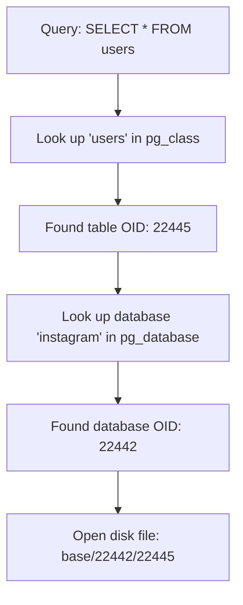

#### System Catalog Quick Reference

| System Catalog | What It Tracks | Key Columns |
| :--- | :--- | :--- |
| `pg_database` | Databases in your cluster | `oid` (folder name), `datname` (database name) |
| `pg_class` | Tables, indexes, and sequences | `oid` (file name), `relname` (table name), `relkind` (type) |

> [!CAUTION]
> Never manually delete, rename, or edit files in your Postgres data folder through your operating system file browser. Doing so will corrupt your database catalog and break your data!

#### Knowledge Check

<details>
<summary><b>Question 1: What command shows the folder path where PostgreSQL saves its data?</b></summary>
<br>
<b>Answer:</b> <code>SHOW data_directory;</code> displays the full folder path on your computer.
</details>

<details>
<summary><b>Question 2: Why does Postgres name database folders with numbers instead of plain text names?</b></summary>
<br>
<b>Answer:</b> It uses unique Object Identifiers (OIDs) to avoid operating system filename conflicts, spaces, or special characters.
</details>

<details>
<summary><b>Question 3: How do you find which physical file corresponds to the "users" table?</b></summary>
<br>
<b>Answer:</b> Query <code>pg_class</code> with <code>SELECT oid, relname FROM pg_class WHERE relname = 'users';</code>. The <code>oid</code> matches the filename on disk.
</details>

<details>
<summary><b>Question 4: What is the purpose of template1?</b></summary>
<br>
<b>Answer:</b> It serves as the base template. When you run <code>CREATE DATABASE</code>, PostgreSQL copies the <code>template1</code> folder to build your new database.
</details>

---

### Heaps, Blocks, and Tuples: The Core Storage Hierarchy

Once PostgreSQL finds the table file on disk (like `22445` for `users`), how does it organize rows inside that file? It breaks the file down into a simple, 3-level hierarchy:

1. **Heap File**: The entire file on disk for a single table.
2. **Blocks (or Pages)**: 8 KB slices that make up the heap file.
3. **Tuples (or Items)**: The individual rows stored inside a block.

#### Jargon Demystified

PostgreSQL internals use specific terms that mean everyday database concepts:

| Postgres Term | Everyday Term | What It Actually Means |
| :--- | :--- | :--- |
| **Heap / Heap File** | Table File | The physical file holding an unordered collection of rows. |
| **Block / Page** | 8 KB Storage Chunk | The fixed-size unit of data Postgres reads into memory at one time. |
| **Tuple / Item** | Row / Record | A single data row with its column values. |

> [!NOTE]
> **Heaps in Postgres vs. Computer Science:** In CS class, a "heap" is a special binary tree used for priority queues. In databases, a "heap file" just means an **unordered pile of records**—PostgreSQL places new rows wherever there is open room.

```text
+-------------------------------------------------------------------------+
|                  HEAP FILE (e.g., file 22445 for users)                 |
|                                                                         |
|  +---------------------+ +---------------------+ +--------------------+ |
|  |       BLOCK 0       | |       BLOCK 1       | |      BLOCK 2       | |
|  |     (8 KB Page)     | |     (8 KB Page)     | |    (8 KB Page)     | |
|  | +-----------------+ | | +-----------------+ | | +----------------+ | |
|  | | Row 1 (Tuple 1) | | | | Row 3 (Tuple 1) | | | | Row 5 (Tuple 1)| | |
|  | +-----------------+ | | +-----------------+ | | +----------------+ | |
|  | | Row 2 (Tuple 2) | | | | Row 4 (Tuple 2) | | | |  [Free Space]  | | |
|  | +-----------------+ | | +-----------------+ | | +----------------+ | |
|  +---------------------+ +---------------------+ +--------------------+ |
+-------------------------------------------------------------------------+
```

#### The Fixed 8 KB Rule

By default, every block in PostgreSQL is exactly **8 kilobytes (8,192 bytes)** in size.

It does not matter whether a block contains 0 rows, 1 large row, or 80 small rows—the block is always allocated as an 8 KB slot on disk.

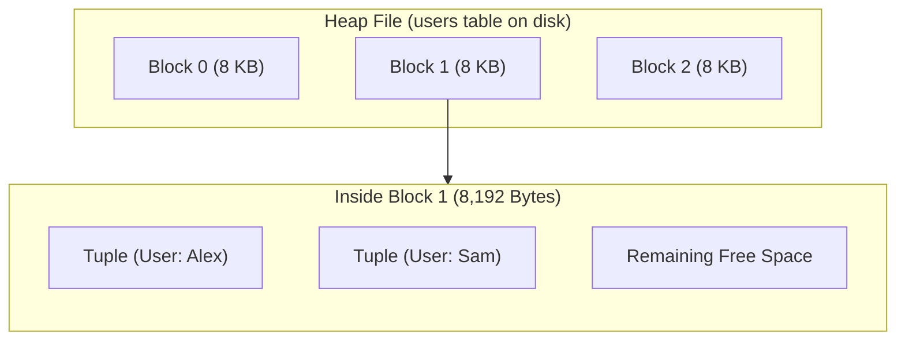

#### Why Fixed 8 KB Blocks?

Why doesn't PostgreSQL just stream rows one after another without blocks?

1. **Matching Operating System Hardware:** Hard drives and operating systems read data in fixed page sizes (typically 4 KB or 8 KB). Using 8 KB blocks keeps disk reads fast and aligned.
2. **Predictable Memory Caching:** PostgreSQL caches tables in RAM (`shared_buffers`). Because all blocks are the same 8 KB size, PostgreSQL can easily swap pages in and out of memory without memory fragmentation.
3. **Targeted Reading:** When looking up one user, PostgreSQL only loads the single 8 KB block containing that user into RAM, rather than reading a 10 GB file.

#### Seeing Physical Locations with the Hidden `ctid` Column

Every table has a hidden system column called `ctid` that tells you the exact physical block and row position of each record:

```sql
-- View the physical block and row position of your records
SELECT 
    ctid, 
    id, 
    username 
FROM users 
LIMIT 5;
```

```text
 ctid  | id  | username  
-------+-----+-----------
 (0,1) |   1 | alexandra
 (0,2) |   2 | bernard
 (0,3) |   3 | claudia
 (1,1) |   4 | dimitri
 (1,2) |   5 | elena
```

- In `(0, 1)`: The `0` is the **block number** (starting from 0). The `1` is the **row number** (tuple index) inside that block.
- In `(1, 1)`: This row is the first tuple inside **Block 1**.

> [!WARNING]
> Never use `ctid` as an ID in your application code! When you update a row in Postgres, it creates a new version of the row and places it in a new location, changing its `ctid`.

#### Knowledge Check

<details>
<summary><b>Question 1: What does "heap file" mean in PostgreSQL?</b></summary>
<br>
<b>Answer:</b> A heap file is the physical file for an unsorted table where rows can be stored in any block that has available space.
</details>

<details>
<summary><b>Question 2: What is the default size of a PostgreSQL block (page)?</b></summary>
<br>
<b>Answer:</b> Exactly 8 kilobytes (8,192 bytes).
</details>

<details>
<summary><b>Question 3: Are "Tuple" and "Item" different from a table row?</b></summary>
<br>
<b>Answer:</b> No. Tuple, Item, and Row are synonyms in PostgreSQL.
</details>

<details>
<summary><b>Question 4: What does ctid = (2, 5) tell you about a row?</b></summary>
<br>
<b>Answer:</b> The row is physically stored in Block 2 at tuple position 5.
</details>

---

### Block Data Layout: Physical Anatomy of an 8 KB Page

If you opened an 8 KB block and inspected its raw binary bytes, how is it organized? PostgreSQL uses a clever **two-ended growth** design so that variable-length rows fit snugly without wasting space.

#### The 4 Regions Inside an 8 KB Block

```text
+-------------------------------------------------------------------------+
|                              PAGE HEADER                                |
|  - 24 bytes fixed size at the top                                       |
|  - Tracks page info and pointers to free space (pd_lower, pd_upper)     |
+-------------------------------------------------------------------------+
|                             LINE POINTERS                               |
|  - Small 4-byte arrows (ItemIdData)                                     |
|  - Point to where each row begins and its length                        |
|  - GROWS DOWNWARD --->                                                  |
+ - - - - - - - - - - - - - - - - - - - - - - - - - - - - - - - - - - - - +
|                                                                         |
|                           UNALLOCATED FREE SPACE                        |
|                     (Empty space ready for new rows)                    |
|                                                                         |
+ - - - - - - - - - - - - - - - - - - - - - - - - - - - - - - - - - - - - +
|                               TUPLE DATA                                |
|  - The actual row contents (headers, text, numbers)                     |
|  - Stored starting at the very bottom of the page                       |
|  - <--- GROWS UPWARD                                                    |
+-------------------------------------------------------------------------+
```

1. **Page Header (Top):**
   - 24 bytes at the start of the block.
   - Stores page health information, transaction tracking (LSN), and two pointers:
     - `pd_lower`: Points to the end of the line pointers (start of free space).
     - `pd_upper`: Points to the start of the newest row data (end of free space).
2. **Line Pointers (Item IDs):**
   - An array of tiny 4-byte pointers right after the header.
   - Each pointer simply says: *"Tuple #1 starts at byte offset 8,100 and is 92 bytes long."*
   - They contain no user data—just directions to where the row lives.
   - **Grows downward** into free space.
3. **Free Space (Middle):**
   - The empty cushion in the middle of the block. It shrinks as you add new rows or pointers.
4. **Tuple Data (Bottom):**
   - The actual row data (user IDs, usernames, text) plus row headers (`t_xmin`, `t_xmax`).
   - Starts at the bottom (offset 8,192) and **grows upward** into free space.

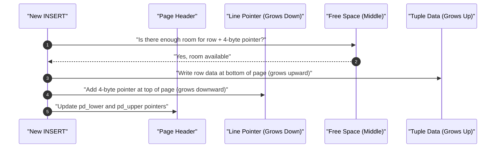

#### Why Use Two-Ended Growth?

Why didn't PostgreSQL put pointers and rows next to each other in one direction?

##### 1. No Wasted Space for Variable-Length Data
In databases, one row might have a short name (3 bytes) and another a long paragraph (500 bytes). With pointers growing from the top and row bytes growing from the bottom, PostgreSQL never has to guess slot sizes in advance. All free space stays in one single chunk in the middle until `pd_lower` meets `pd_upper`.

##### 2. Indexes Never Break When Rows Move
Indexes (like B-trees) point to `ctid` coordinates—which point to the **Line Pointer index** at the top of the block, not the raw byte position at the bottom.
- When PostgreSQL vacuums deleted rows or compacts data, the physical row might shift bytes inside the block.
- PostgreSQL simply updates the 4-byte line pointer offset at the top.
- Because the line pointer number never changed, **every index pointing to that row stays 100% valid**, saving massive reindexing work!

#### Page Layout Summary

| Region | Where It Sits | Size | Growth Direction | What It Holds |
| :--- | :--- | :--- | :--- | :--- |
| **Page Header** | Very top | 24 bytes | Fixed | Metadata, WAL numbers, `pd_lower`, `pd_upper` |
| **Line Pointers** | Below header | 4 bytes per row | Grows **downward** | Byte offset and length of each row |
| **Free Space** | Middle | Variable | Shrinks from both ends | Empty bytes ready for future inserts |
| **Tuple Data** | Very bottom | Variable per row | Grows **upward** | Actual column values and row headers |

> [!TIP]
> You can check how many bytes any individual column value occupies using the `pg_column_size()` function:
> ```sql
> SELECT username, pg_column_size(username) AS byte_size FROM users LIMIT 3;
> ```

#### Knowledge Check

<details>
<summary><b>Question 1: In which direction do Line Pointers grow in a PostgreSQL block?</b></summary>
<br>
<b>Answer:</b> Line pointers grow downward from the top of the page into the middle free space.
</details>

<details>
<summary><b>Question 2: In which direction does the actual row (tuple) data grow?</b></summary>
<br>
<b>Answer:</b> Tuple data is placed at the bottom of the page and grows upward into the middle free space.
</details>

<details>
<summary><b>Question 3: Does a Line Pointer store the actual column values like usernames or email addresses?</b></summary>
<br>
<b>Answer:</b> No. A Line Pointer is only 4 bytes and stores the byte offset and length telling PostgreSQL where the row starts inside the block.
</details>

<details>
<summary><b>Question 4: Why do indexes point to line pointer numbers instead of raw byte offsets?</b></summary>
<br>
<b>Answer:</b> So that rows can be shifted or compacted during maintenance (like VACUUM) without breaking index pointers. Only the internal line pointer offset needs to be updated.
</details>


## Database Indexes and Query Optimization

### Full Table Scans: Execution Mechanics and Performance Costs

#### Understanding the Physical Mechanics of Query Execution

In PostgreSQL, table rows (tuples) are stored on disk inside **heap files**, which are segmented into fixed-size **8 KB blocks** (pages). When a query executes, PostgreSQL cannot evaluate filter conditions on disk in place. Storage hardware (SSDs or HDDs) operates on block storage protocols, meaning the database engine must physically transfer blocks across the storage bus into PostgreSQL's RAM buffer cache before it can inspect a single byte of row data.

```text
+-------------------------------------------------------------------------+
|                              HARD DRIVE                                 |
|                                                                         |
|  Heap File ("users")                                                    |
|  +-----------------------------+     +-------------------------------+  |
|  | Block 0                     |     | Block 1                       |  |
|  | - Nancy (Tuple 1)           |     | - Gia (Tuple 1)               |  |
|  | - Elf   (Tuple 2)           |     | - Ryan (Tuple 2)              |  |
|  +-----------------------------+     +-------------------------------+  |
+-------------------------------------------------------------------------+
                    |                                     |
                    | (1) Read 8 KB Block                 | (2) Read 8 KB Block
                    v                                     v
+-------------------------------------------------------------------------+
|                            SHARED MEMORY (RAM)                          |
|                                                                         |
|  Buffer Cache                                                           |
|  +-----------------------------+     +-------------------------------+  |
|  | Loaded: Block 0             |     | Loaded: Block 1               |  |
|  +-----------------------------+     +-------------------------------+  |
|                 |                                     |                 |
|                 v                                     v                 |
|   Check row 1: Nancy != 'Ryan'          Check row 1: Gia != 'Ryan'      |
|   Check row 2: Elf != 'Ryan'            Check row 2: Ryan == 'Ryan' --> MATCH!
+-------------------------------------------------------------------------+
```

When evaluating a filtered query without an auxiliary search structure:

1. Every block belonging to the table's heap file is loaded sequentially from disk into memory.
2. The database CPU engine loops through every row in every block from start to finish, checking whether each record satisfies the query predicate (e.g., `WHERE username = 'Ryan'`).

This operation is known as a **Full Table Scan** (or **Sequential Scan / Seq Scan** in PostgreSQL execution plans).

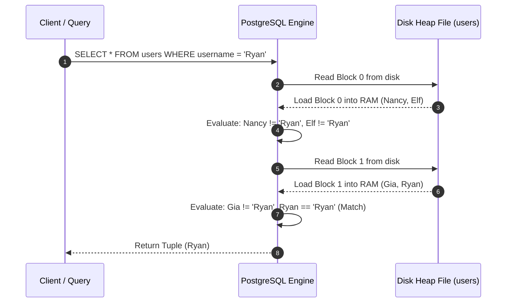

#### The Real Cost of Full Table Scans

A full table scan imposes two distinct performance costs:

1. **Storage Bus & Disk I/O Bottleneck:**
   Transferring megabytes or gigabytes of binary data from storage drives into system RAM is orders of magnitude slower than CPU computation. Loading thousands of 8 KB blocks incurs heavy read throughput and can flush other frequently accessed data out of PostgreSQL's buffer cache.
2. **CPU Scan Overhead:**
   Once blocks are in RAM, the CPU must iterate through every item pointer and deserialize tuple headers to evaluate the `WHERE` condition. For a table with millions of rows, checking every single record creates substantial processor utilization.

#### When Is a Full Table Scan Actually Desirable?

In database optimization circles, full table scans are frequently labeled as slow or inefficient. However, a full table scan is not inherently bad. PostgreSQL's cost-based query optimizer deliberately selects a sequential scan under several valid scenarios:

- **Very Small Tables:** If a table fits into one or two 8 KB blocks, loading the entire table in a single contiguous disk read is faster than reading an index page and then performing random I/O to locate the heap block.
- **High Selectivity Queries (Broad Filters):** When a query requests a large percentage of a table (e.g., `WHERE active = true` matching 80% of rows), reading sequential blocks from disk in bulk is significantly faster than bouncing back and forth between an index and heap blocks via random access.
- **Batch Processing & Aggregations:** Analytical queries that calculate sums, averages, or aggregations over the entire dataset (e.g., `COUNT(*)`) must touch every record regardless.

> [!NOTE]
> Seeing a `Seq Scan` in your query plan is not an automatic error. It simply signals that PostgreSQL inspected every block in the relation. It warrants investigation when you expect a query to return a tiny fraction of a massive table.

#### Query Implementation & Plan Inspection

```sql
-- Query searching for a single record by username
-- Without an index, this triggers a full table scan across all blocks
SELECT
    id,
    username,
    created_at
FROM users
WHERE username = 'Ryan';
```

```text
 id | username |        created_at
----+----------+---------------------------
 42 | Ryan     | 2026-03-15 10:24:00.123456
(1 row)
```

#### Engineering Comparison: Full Table Scan vs. Targeted Search

| Dimension                     | Full Table Scan (Sequential Scan)                                  | Targeted Index Search                         |
| :---------------------------- | :----------------------------------------------------------------- | :-------------------------------------------- |
| **Disk I/O Access Pattern**   | Sequential (reads all blocks from start to end)                    | Random / Pointed (reads only required blocks) |
| **Blocks Transferred to RAM** | 100% of the table's heap blocks                                    | 1-4 index blocks + 1 heap block per match     |
| **CPU Iteration Overhead**    | Inspects every tuple in the relation                               | Inspects only logarithmic tree path nodes     |
| **Best Used When**            | Small tables (< 500 rows) or broad queries returning > 20% of data | Large tables where query returns < 5% of data |
| **Write Impact**              | Zero maintenance cost during INSERT/UPDATE/DELETE                  | Requires continuous updates on every write    |

### Database Indexes: Mental Model and Direct Block Access

#### The Mental Model of an Index

Without an index, finding a row in a heap file is like finding a specific paragraph in an unindexed 1,000-page book by reading every page from page 1 onwards. An **index** is an auxiliary data structure that exists entirely separate from the table's heap file. It acts like the index at the back of a reference book, maintaining an organized list of search keys alongside physical coordinates directing PostgreSQL to the exact block and slot where each row lives.

```text
+------------------------------------+          +-----------------------------------------+
|         INDEX FILE ON DISK         |          |           HEAP FILE ON DISK             |
|                                    |          |                                         |
|  Key (Username)   Pointer (ctid)   |          |  Block 0                                |
|  +--------------+----------------+ |          |  +-----------------------------------+  |
|  | Elf          | Block 0, Idx 2 | |          |  | Tuple 1: Nancy                    |  |
|  | Gia          | Block 1, Idx 1 | |          |  | Tuple 2: Elf                      |  |
|  | Nancy        | Block 0, Idx 1 | |          |  +-----------------------------------+  |
|  | Ryan         | Block 1, Idx 2 |-+--------> |  Block 1                                |
|  +--------------+----------------+ |          |  +-----------------------------------+  |
+------------------------------------+          |  | Tuple 1: Gia                      |  |
                                                |  | Tuple 2: Ryan                     |  |
                                                |  +-----------------------------------+  |
                                                +-----------------------------------------+
```

When a user submits `SELECT * FROM users WHERE username = 'Ryan';`:

1. PostgreSQL queries the auxiliary index structure for the key `'Ryan'`.
2. The index instantly returns the physical tuple coordinates: **Block 1, Index 2**.
3. PostgreSQL bypasses Block 0 entirely and reads only Block 1 into RAM.
4. The database engine extracts Ryan directly using the line pointer at slot 2.

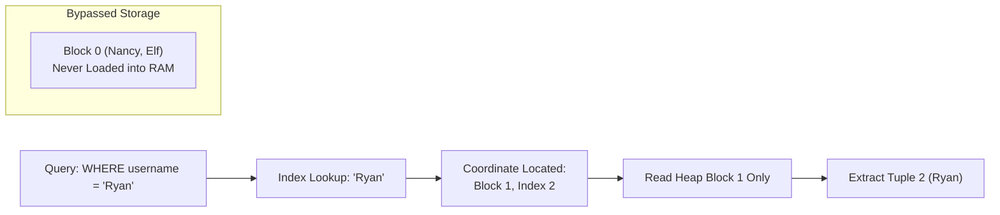

#### Physical Block Access Granularity

A critical architectural detail of relational database engines is that **data retrieval always happens at the block level**.

Even though an index points to a specific tuple offset, PostgreSQL cannot load just a single 50-byte record off the storage drive. Hardware controllers read data in 8 KB pages. Therefore, PostgreSQL loads **the entire 8 KB block containing that tuple** into memory.

The performance gain does not come from loading a microscopic slice of a block; it comes from **avoiding the transfer of hundreds or thousands of other non-relevant blocks** across the disk bus.

> [!IMPORTANT]
> An index is a standalone file that is stored separately from the heap file on disk. It possesses its own Object Identifier (OID) and consumes independent disk storage.

### How an Index Works: Sorting, B-Tree Construction, and CTID Pointers

#### Step-by-Step Assembly of an Index

To understand how an index enables lightning-fast queries, consider how PostgreSQL builds this structure behind the scenes when an index is declared.

##### Step 1: Target Column Selection

The developer identifies which column frequently appears in filter conditions (`WHERE`), join clauses (`ON`), or sort operations (`ORDER BY`). While indexes can span multiple columns (composite indexes), the basic model focuses on a single column (e.g., `username`).

##### Step 2: Extraction of Keys and Physical Coordinates

PostgreSQL scans the table's heap file and extracts only the target column value alongside the physical location where the record was found:

- **Block Number:** The 8 KB page index inside the heap file.
- **Item Offset:** The line pointer slot index on that page.

Non-indexed columns (such as `id`, `email`, `bio`, `password_hash`, or `created_at`) are deliberately excluded to keep index entries compact.

```text
Raw Heap Records:
- Block 0, Tuple 1: Nancy  --> Extracted: ("Nancy", Block 0, Idx 1)
- Block 0, Tuple 2: Elf    --> Extracted: ("Elf",   Block 0, Idx 2)
- Block 1, Tuple 1: Gia    --> Extracted: ("Gia",   Block 0, Idx 1)
- Block 1, Tuple 2: Ryan   --> Extracted: ("Ryan",  Block 1, Idx 2)
```

##### Step 3: Lexicographical Sorting

The extracted key-pointer pairs are sorted in strict ascending (or descending) order:

- Text is sorted alphabetically: `"Elf"`, `"Gia"`, `"Nancy"`, `"Ryan"`.
- Numbers are sorted numerically: least to greatest.
- Dates are sorted chronologically: earliest to latest.

Sorting enables binary search logic and bounded range comparisons.

##### Step 4: Distribution into Leaf Nodes

The sorted pairs are packed into index pages called **leaf nodes**. In a visual tree representation:

- Left Leaf: `["Elf" -> (0,2)]`, `["Gia" -> (1,1)]`
- Right Leaf: `["Nancy" -> (0,1)]`, `["Ryan" -> (1,2)]`

Order is preserved from left to right across all leaves.

##### Step 5: Construction of Upper Routing Nodes (Root & Internal Nodes)

PostgreSQL establishes parent pages (internal nodes and the root node) containing boundary rules and pointers to lower pages. These boundary rules use inequality comparisons to route search keys:

- If `"Elf" <= search_key < "Nancy"` -> Follow pointer to Left Leaf Node.
- If `"Nancy" <= search_key` -> Follow pointer to Right Leaf Node.

```text
+-------------------------------------------------------------------------+
|                               ROOT NODE                                 |
|                                                                         |
|   +-------------------------------+   +-----------------------------+   |
|   |  "Elf" <= Key < "Nancy"       |   |  "Nancy" <= Key             |   |
|   |  Pointer: Leaf Node 1         |   |  Pointer: Leaf Node 2       |   |
|   +-------------------------------+   +-----------------------------+   |
+-------------------------------------------------------------------------+
            |                                           |
            v                                           v
+-----------------------------+             +-----------------------------+
|     LEAF NODE 1 (Page 1)    |             |     LEAF NODE 2 (Page 2)    |
|                             |             |                             |
|  "Elf"   --> Heap (0, 2)    |             |  "Nancy" --> Heap (0, 1)    |
|  "Gia"   --> Heap (1, 1)    |             |  "Ryan"  --> Heap (1, 2)    |
+-----------------------------+             +-----------------------------+
```

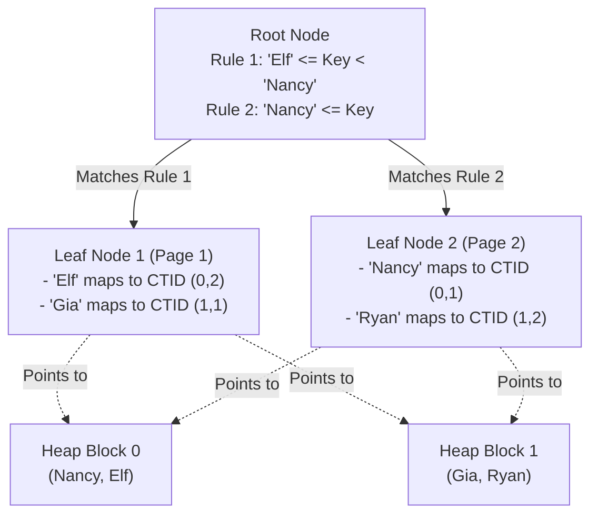

#### Traversing the B-Tree During a Query

When executing `WHERE username = 'Ryan'`:

1. Search initiates at the **Root Node**.
2. Evaluate rule: Is `'Ryan'` between `'Elf'` and `'Nancy'`? No (`'Ryan'` is alphabetically greater than `'Nancy'`).
3. Evaluate next rule: Is `'Ryan' >= 'Nancy'`? Yes. Follow the pointer directly to **Leaf Node 2**.
4. **Branch Pruning:** Leaf Node 1 is never read from disk or examined in memory.
5. In Leaf Node 2, locate `'Ryan'` and read its pointer: `Block 1, Index 2`.
6. Read **Heap Block 1** and retrieve the full row. Heap Block 0 is never touched.

> [!TIP]
> The term **B-Tree** stands for **Balanced Tree**. The tree automatically balances itself so that every leaf node sits at the exact same depth from the root, guaranteeing consistent logarithmic search times.

### Creating, Naming, and Dropping Indexes

#### Creating an Index via SQL

In PostgreSQL, creating an index requires a single SQL statement. The engine automatically parses the heap table, extracts column values, sorts the keys, and builds the physical B-Tree file.

##### Basic Syntax (Automatic Naming)

```sql
-- Create an index on the username column of the users table
-- PostgreSQL will automatically generate an index name
CREATE INDEX ON users (username);
```

```text
CREATE INDEX
Query returned successfully in 184 msec.
```

##### Explicit Naming Syntax

You can specify a custom index name between the `INDEX` and `ON` keywords:

```sql
-- Create an index with an explicit custom name
CREATE INDEX users_username_idx ON users (username);
```

```text
CREATE INDEX
Query returned successfully in 172 msec.
```

#### Standard PostgreSQL Index Naming Conventions

When you do not provide an explicit name, PostgreSQL generates one following a strict template:

$$ ext{Table Name} + ext{"\_"} + ext{Column Name} + ext{"\_"} + ext{"idx"}$$

| Table Name | Column Name  | Generated Index Name    |
| :--------- | :----------- | :---------------------- |
| `users`    | `username`   | `users_username_idx`    |
| `posts`    | `user_id`    | `posts_user_id_idx`     |
| `orders`   | `created_at` | `orders_created_at_idx` |

> [!TIP]
> Always adhere to this naming standard even when naming indexes manually. Following this convention allows you and your team to predict the name of any index during maintenance or migrations without querying system catalogs.

#### Inspecting Indexes in pgAdmin

To view an index inside pgAdmin:

1. In the left-hand Browser panel, expand **Databases** -> your database (e.g., `instagram`).
2. Expand **Schemas** -> **public** -> **Tables**.
3. Expand the target table (e.g., `users`).
4. Click on **Indexes**.
5. If the newly created index does not appear immediately, **right-click on Indexes and select Refresh**.

```text
+-- Databases
    +-- instagram
        +-- Schemas
            +-- public
                +-- Tables
                    +-- users
                        +-- Columns
                        +-- Constraints
                        +-- Indexes
                            +-- users_username_idx  <-- Visible after refresh
```

#### Dropping an Index

When an index is no longer needed, remove it using the `DROP INDEX` statement followed by the index name:

```sql
-- Remove the index from disk
DROP INDEX users_username_idx;
```

```text
DROP INDEX
Query returned successfully in 31 msec.
```

> [!CAUTION]
> Dropping an index immediately removes the physical file from disk. Any active queries relying on that index will revert to full table scans. In production environments with high traffic, use `DROP INDEX CONCURRENTLY` to avoid acquiring exclusive table locks.

### Benchmarking Queries: EXPLAIN ANALYZE and Index Performance

#### Why GUI Elapsed Time Is Misleading

When running a query inside graphical tools like pgAdmin or DBeaver, the status bar displays a metric such as:

```text
Query returned successfully in 42 msec.
```

This elapsed duration is a misleading benchmark for database engine efficiency. It measures total wall-clock transit time, which includes:

- Network socket latency between the client GUI and the database server.
- Query parsing and planning overhead.
- Data serialization and packet transmission over TCP/IP.
- GUI rendering time to display result rows in the visual grid.

To measure actual database engine execution speed, you must isolate server-side processing from client-side network overhead.

```text
+-------------------------------------------------------------------------+
| TOTAL GUI TIME (e.g., 42 ms)                                            |
|                                                                         |
|  +-------------------+  +-----------------------+  +-----------------+  |
|  | Network Transit   |  | DATABASE ENGINE WORK  |  | Network Return  |  |
|  | (pgAdmin -> DB)   |  | EXPLAIN ANALYZE       |  | & UI Rendering  |  |
|  | ~15 ms            |  | Actual: ~0.05 ms      |  | ~26.95 ms       |  |
|  +-------------------+  +-----------------------+  +-----------------+  |
+-------------------------------------------------------------------------+
```

#### Profiling with EXPLAIN ANALYZE

PostgreSQL provides the `EXPLAIN ANALYZE` command to profile query performance accurately.

- `EXPLAIN` alone displays the execution plan chosen by the query planner and estimated operational costs.
- `EXPLAIN ANALYZE` actually **executes the query**, measures true server-side runtimes, and outputs detailed execution statistics without transmitting row payloads back to the client interface.

```sql
-- Benchmark query execution time with an active index
EXPLAIN ANALYZE
SELECT *
FROM users
WHERE username = 'Emil30';
```

```text
                                                        QUERY PLAN
---------------------------------------------------------------------------------------------------------------------------
 Index Scan using users_username_idx on users  (cost=0.28..8.30 rows=1 width=76) (actual time=0.048..0.049 rows=1 loops=1)
   Index Cond: ((username)::text = 'Emil30'::text)
 Planning Time: 0.112 ms
 Execution Time: 0.065 ms
(4 rows)
```

#### Empirical Benchmark: With Index vs. Without Index

To evaluate the real-world impact of the B-Tree index, consider the exact same query benchmarked on a table of users before and after dropping `users_username_idx`:

```sql
-- Step 1: Drop the index to force a sequential scan
DROP INDEX users_username_idx;

-- Step 2: Benchmark query without index
EXPLAIN ANALYZE
SELECT *
FROM users
WHERE username = 'Emil30';
```

```text
                                            QUERY PLAN
---------------------------------------------------------------------------------------------------
 Seq Scan on users  (cost=0.00..155.00 rows=1 width=76) (actual time=0.812..1.245 rows=1 loops=1)
   Filter: ((username)::text = 'Emil30'::text)
   Rows Removed by Filter: 9999
 Planning Time: 0.084 ms
 Execution Time: 1.272 ms
(5 rows)
```

##### Performance Comparison

```text
With Index (Index Scan):      Execution Time = ~0.065 ms
Without Index (Seq Scan):     Execution Time = ~1.272 ms

Speedup Factor = 1.272 ms / 0.065 ms = ~19.5x FASTER!
```

Having the index in place sped up query execution by nearly **20 times**. On larger tables containing millions of rows, this difference frequently spans multiple orders of magnitude (e.g., transforming a 3-second full table scan into a 0.5-millisecond index lookup).

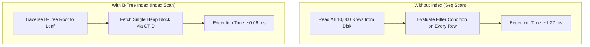

> [!NOTE]
> On the very first run of a query, execution time may be slightly higher due to "cold cache" conditions (loading pages off physical disk). Subsequent runs hit PostgreSQL's shared buffer cache ("warm cache"), stabilizing at peak operational speed.

### The Trade-offs of Indexes: Storage Overhead and Write Latency

#### The Illusion of the "Free Index"

Observing a 20x performance improvement tempts many developers to add indexes to every column of every table. In production engineering, however, every index comes with significant architectural costs.

```text
                               +----------------------------------------+
                               |         THE THREE INDEX COSTS          |
                               +----------------------------------------+
                                              /     |                                                   /      |                                                   /       |                                                   v        v         v
                     +-----------------------+  +-----------------------+  +-----------------------+
                     | 1. Hard Drive Storage |  | 2. Write Degradation  |  | 3. Unused Overhead    |
                     | Every index creates an|  | Every INSERT/UPDATE/   |  | Planner may ignore    |
                     | extra file on disk    |  | DELETE updates every   |  | index if seq scan is  |
                     | costing money.        |  | index on that table.   |  | cheaper.              |
                     +-----------------------+  +-----------------------+  +-----------------------+
```

#### Hard Drive Storage Overhead

An index is not an ephemeral in-memory structure; it is written directly to persistent storage. For every indexed row, the index stores a copy of the column value plus its 6-byte CTID pointer, surrounded by page headers and line pointers.

PostgreSQL provides built-in size inspection functions (`pg_relation_size` and `pg_size_pretty`) to inspect disk consumption:

```sql
-- Check the disk size of the users heap table
SELECT pg_size_pretty(pg_relation_size('users')) AS table_size;

-- Check the disk size of the username index
SELECT pg_size_pretty(pg_relation_size('users_username_idx')) AS index_size;
```

```text
 table_size
------------
 880 kB
(1 row)

 index_size
------------
 184 kB
(1 row)
```

In this sample dataset, the index consumes 184 kB—roughly **21% of the size of the original table**. On an 80 GB table with multiple indexes, auxiliary search structures routinely consume tens of gigabytes of disk space, directly increasing hosting bills on managed cloud platforms.

#### Write Latency (Degraded INSERT, UPDATE, DELETE)

Whenever a row is added, modified, or removed, PostgreSQL must maintain data integrity across all related files.

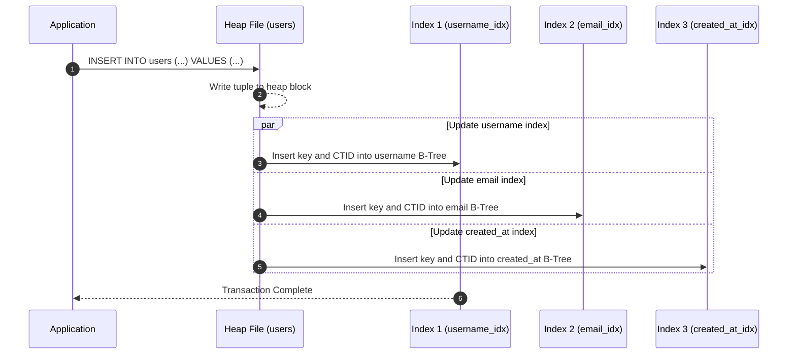

If a table has 5 indexes:

- Every `INSERT` requires **1 heap write + 5 index tree writes**.
- Every `DELETE` requires **1 heap tombstone write + 5 index cleanups**.
- Every `UPDATE` modifying indexed columns requires re-balancing multiple B-Trees.

#### Unused Indexes and Planner Bypass

Creating an index does not guarantee PostgreSQL will use it. The query optimizer calculates estimated costs using table statistics:

- If a query matches a significant portion of a table, PostgreSQL purposefully ignores the index and executes a sequential scan.
- If you build an index on a column that queries rarely filter on, that index sits idle on disk—silently consuming storage and slowing down writes without providing any read benefit.

#### Decision Matrix: When to Index

| Column Type / Use Case                                | Should You Index? | Engineering Rationale                                                  |
| :---------------------------------------------------- | :---------------: | :--------------------------------------------------------------------- |
| **Foreign Keys (`user_id`, `order_id`)**              |      **YES**      | Massively accelerates table joins (`JOIN ... ON`).                     |
| **High-Cardinality Filter Columns (`email`, `slug`)** |      **YES**      | Narrow queries returning 1-5 rows benefit from instant B-Tree lookups. |
| **Frequent Sort / Range Columns (`created_at`)**      |      **YES**      | Allows index-driven `ORDER BY ... LIMIT` without in-memory sorting.    |
| **Low-Cardinality Booleans / Statuses (`is_active`)** |      **NO**       | Optimizer will almost always default to a sequential scan.             |
| **High-Volume Append Tables (Log tables)**            | **NO / MINIMAL**  | Write throughput degradation far outweighs occasional read speedup.    |
| **Small Reference Tables (< 500 rows)**               |      **NO**       | Entire table fits in 1-2 blocks; sequential scan is faster.            |

### PostgreSQL Index Types: B-Tree and Specialized Variants

#### The Universal Default: B-Tree

Whenever you execute `CREATE INDEX` without additional parameters, PostgreSQL constructs a **B-Tree (Balanced Tree)** index:

```sql
-- Both commands produce an identical B-Tree index
CREATE INDEX users_username_idx ON users (username);
CREATE INDEX users_username_idx ON users USING btree (username);
```

B-Tree is the default because it accommodates the vast majority of real-world database access patterns:

- Equality searches: `WHERE username = 'Ryan'`
- Range queries: `WHERE age >= 21 AND age < 65`
- Set inclusions: `WHERE status IN ('active', 'pending')`
- Lexicographical prefix matches: `WHERE username LIKE 'Ali%'`
- Sorting operations: `ORDER BY created_at ASC`

For standard web and API applications, B-Trees satisfy nearly all operational requirements.

```text
+-------------------------------------------------------------------------+
|                      POSTGRESQL INDEX TYPE FAMILY                       |
+-------------------------------------------------------------------------+
    |
    +---> B-Tree (Default)  --> General purpose: =, <, <=, >, >=, ORDER BY
    |
    +---> Hash              --> Strict equality lookups only (=)
    |
    +---> GIN               --> Inverted index for Arrays, JSONB, Full-Text
    |
    +---> GiST              --> Generalized search tree: Geometric, Spatial, GIS
    |
    +---> SP-GiST           --> Space-partitioned: Phone numbers, IP ranges
    |
    +---> BRIN              --> Block range: Gigantic, naturally ordered timeseries
```

#### Overview of Specialized Index Types

While B-Tree is the tool of choice for almost all standard application use cases, PostgreSQL supports additional specialized index structures for niche scenarios:

- **Hash Index (`USING hash`):** Strict equality comparisons only (`=`). Cannot perform range lookups or sort data. B-Trees match or exceed Hash performance in almost all modern workloads.
- **GIN (Generalized Inverted Index) (`USING gin`):** Inverted index designed for multi-valued data such as JSONB documents, PostgreSQL arrays, and full-text search vectors.
- **GiST (Generalized Search Tree) (`USING gist`):** Framework supporting multi-dimensional geographic coordinates (PostGIS), geometric bounding boxes, and range types.
- **SP-GiST (`USING spgist`):** Space-partitioned trees for clustering data with prefix overlap (e.g., phone numbers or IP ranges).
- **BRIN (Block Range Index) (`USING brin`):** Stores summary min/max ranges for physical block clusters. Ideal for massive, append-only time-series tables physically ordered on disk.

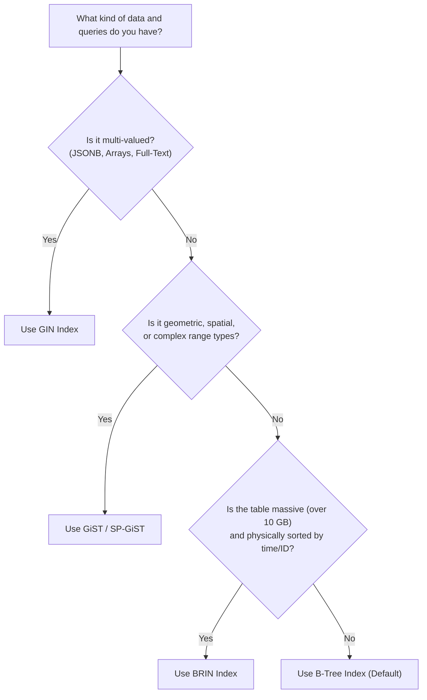

> [!TIP]
> Stick to the default B-Tree index for general application development unless you encounter specific requirements for JSONB attribute indexing (GIN) or geospatial queries (GiST).

### Automatically Generated Indexes: Primary Keys and Unique Constraints

#### The Hidden Indexes in Your Database

Whenever you declare a column as a **`PRIMARY KEY`** or attach a **`UNIQUE` constraint**, PostgreSQL automatically generates a dedicated B-Tree index behind the scenes.

```text
Table Definition:
+-------------------------------------------------------------------------+
| hashtags                                                                |
| - id: SERIAL PRIMARY KEY        --------> Auto-generates: hashtags_pkey |
| - title: VARCHAR UNIQUE         --------> Auto-generates: hashtags_title_key
| - created_at: TIMESTAMP                                                 |
+-------------------------------------------------------------------------+
```

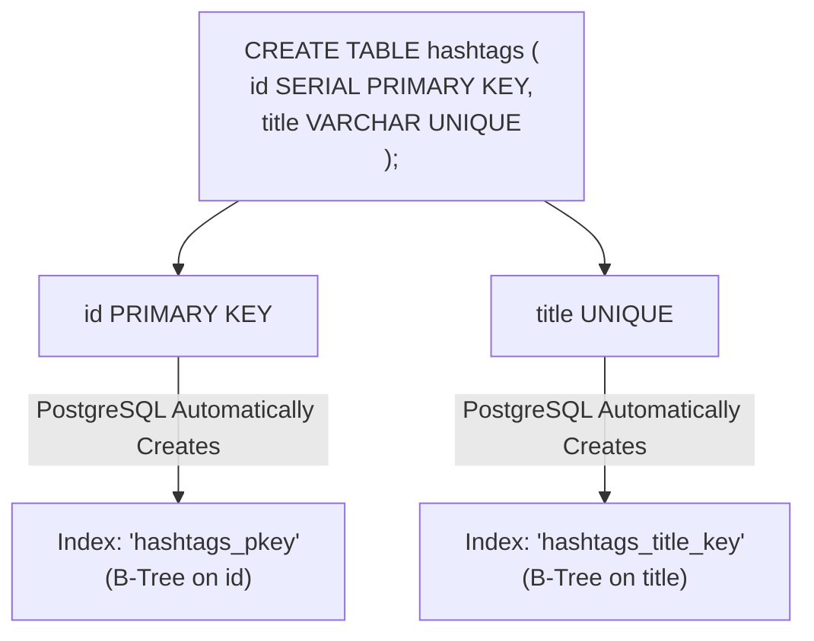

#### Why Constraints Require Indexes

PostgreSQL enforces uniqueness through indexes:

- To verify that a new value does not already exist during an `INSERT` or `UPDATE`, the engine must execute an instantaneous lookup.
- Performing a full table scan on every write to verify uniqueness would bring database performance to a crawl.
- An underlying B-Tree index allows PostgreSQL to verify uniqueness in logarithmic time before committing the row.

Because these indexes exist physically on disk, they double as fully functional query indexes:

- Queries filtering on `id` (e.g., `WHERE id = 42`) automatically use `hashtags_pkey`.
- Queries filtering on `title` (e.g., `WHERE title = '#travel'`) automatically use `hashtags_title_key`.

> [!CAUTION]
> Never run `CREATE INDEX ON table (id);` on a primary key column. The primary key index already exists. Creating a second index wastes disk space and slows down every write by forcing PostgreSQL to update two identical indexes.

#### The pgAdmin Visual Gotcha

A common source of confusion occurs when developers inspect tables in pgAdmin:

- Under **Tables** -> `hashtags` -> **Indexes**, the folder appears completely **empty**.
- Even after refreshing, automatically generated constraint indexes do not appear under the `Indexes` node.
- In pgAdmin's object tree, constraint-driven indexes are grouped under **Constraints**, not `Indexes`.

```text
pgAdmin Object Hierarchy:
+-- Tables
    +-- hashtags
        +-- Constraints  <-- Expand here!
        |   +-- hashtags_pkey (Primary Key Index)
        |   +-- hashtags_title_key (Unique Constraint Index)
        +-- Indexes      <-- Appears EMPTY (only displays manual indexes)
```

#### Revealing the Truth via System Catalogs (pg_class)

To inspect all indexes that physically exist inside your database—including both manual and automatically generated constraint indexes—query the PostgreSQL system catalog `pg_class`.

In `pg_class`, every physical database object has a `relkind` attribute:

- `'r'`: Ordinary heap table
- `'i'`: Index
- `'S'`: Sequence
- `'v'`: View

```sql
-- Query pg_class to reveal all physical indexes in the database
SELECT
    relname AS index_name,
    relkind
FROM pg_class
WHERE relkind = 'i'
ORDER BY relname;
```

```text
       index_name        | relkind
-------------------------+---------
 comments_pkey           | i
 hashtags_pkey           | i
 hashtags_title_key      | i
 likes_pkey              | i
 posts_pkey              | i
 users_pkey              | i
 users_username_idx      | i
(7 rows)
```

This catalog query proves that `hashtags_pkey`, `hashtags_title_key`, and `users_pkey` are physical B-Tree index files residing on your storage volume.

### Deep Dive: Physical Storage and Anatomy of B-Tree Indexes with Pageinspect

#### Physical Storage of an Index on Disk

Just like a heap table, a PostgreSQL B-Tree index is stored on disk as a binary file divided into standard **8 KB pages (blocks)**.

To locate the physical index file on your machine:

```sql
-- 1. Identify the cluster data directory
SHOW data_directory;

-- 2. Find the database folder OID (e.g., 'instagram')
SELECT oid, datname FROM pg_database WHERE datname = 'instagram';

-- 3. Find the physical filename (relfilenode) of the index
SELECT relname, relfilenode FROM pg_class WHERE relname = 'users_username_idx';
```

```text
       data_directory
-----------------------------
 /Library/PostgreSQL/17/data

  oid  |  datname
-------+-----------
 22442 | instagram

      relname       | relfilenode
--------------------+-------------
 users_username_idx |       22713
```

The index file resides at: `/Library/PostgreSQL/17/data/base/22442/22713`.

#### The Anatomy of Pages in an Index File

Unlike a heap file where every page stores generic tuples, pages in a B-Tree index file serve specialized roles:

```text
+-------------------------------------------------------------------------+
|                  PHYSICAL B-TREE INDEX FILE (22713)                     |
+-------------------------------------------------------------------------+
| Page 0: META PAGE                                                       |
| - Fixed metadata: root page pointer, B-Tree version, tree level depth   |
+-------------------------------------------------------------------------+
| Page 1: LEAF PAGE                                                       |
| - First row: Sibling pointer / high key linking to Page 2               |
| - Remaining rows: Sorted keys ("Aaliyah Hintze"...) + Heap CTID (33,43) |
+-------------------------------------------------------------------------+
| Page 2: LEAF PAGE                                                       |
| - First row: Sibling pointer / high key linking to Page 4               |
| - Remaining rows: Sorted keys ("Allison14"...) + Heap CTID (20,7)       |
+-------------------------------------------------------------------------+
| Page 3: ROOT PAGE                                                       |
| - Boundary comparison keys + Pointers to child index pages (1, 2, 4...) |
+-------------------------------------------------------------------------+
```

Every index page uses the same structural zones as heap pages:

1. **Page Header:** 24 bytes storing page metadata, `pd_lower`, and `pd_upper`.
2. **Item ID Pointers (Line Pointers):** 4-byte entries growing downward from the top.
3. **Free Space:** Unallocated bytes in the center.
4. **Index Tuples:** Key bytes and CTID coordinates growing upward from the bottom.

#### Inspecting Internal Index Pages Using pageinspect

PostgreSQL provides a low-level extension called **`pageinspect`** that allows engineers to inspect the raw binary contents of database blocks directly via SQL.

##### Step 1: Install the Extension

```sql
-- Enable low-level block inspection functions
CREATE EXTENSION IF NOT EXISTS pageinspect;
```

```text
CREATE EXTENSION
Query returned successfully in 28 msec.
```

##### Step 2: Inspecting the Meta Page (bt_metap)

The Meta Page (always Page 0) records high-level configuration about the B-Tree:

```sql
-- View metadata for the username index
SELECT * FROM bt_metap('users_username_idx');
```

```text
 magic  | version | root | level | fastroot | fastlevel | oldest_xact | last_cleanup_num_delpages
--------+---------+------+-------+----------+-----------+-------------+---------------------------
 340322 |       4 |    3 |     1 |        3 |         1 |           0 |                         0
(1 row)
```

Key attributes:

- **`root = 3`**: Tells PostgreSQL that the search begins at **Page 3** inside the index file.
- **`level = 1`**: Indicates the tree height above the leaves (level 1 means the root directly references leaf nodes).

##### Step 3: Inspecting the Root Page (bt_page_items)

To examine the routing rules stored in the Root Node (Page 3), call `bt_page_items`:

```sql
-- Inspect routing items on the root page (Page 3)
SELECT
    itemoffset,
    ctid,
    data
FROM bt_page_items('users_username_idx', 3);
```

```text
 itemoffset | ctid  |          data
------------+-------+-------------------------
          1 | (1,0) |
          2 | (2,0) | 19 41 6c 6c 69 73 6f 6e 31 34
          3 | (4,0) | 2b 41 75 73 74 69 6e 2e 4f 6e 64 72 65 6a 6b 61
(3 rows)
```

Interpreting the root items:

- In an internal/root node, the `ctid` column indicates **which index page to descend into**:
  - `(1,0)` -> Descend to **Leaf Page 1**.
  - `(2,0)` -> Descend to **Leaf Page 2**.
  - `(4,0)` -> Descend to **Leaf Page 4**.
- The `data` column contains the hex-encoded boundary string:
  - Hex `41 6c 6c 69 73 6f 6e 31 34` decodes to ASCII: **`Allison14`**.
  - Hex `41 75 73 74 69 6e 2e 4f 6e...` decodes to ASCII: **`Austin.Ondrejka`**.
- Routing Logic:
  - Any search key strictly less than `'Allison14'` routes to **Page 1**.
  - Any search key between `'Allison14'` and `'Austin.Ondrejka'` routes to **Page 2**.
  - Any search key greater than or equal to `'Austin.Ondrejka'` routes to **Page 4**.

##### Step 4: Inspecting a Leaf Page

Next, inspect the items on **Page 1** (a leaf node):

```sql
-- Inspect leaf entries on Page 1
SELECT
    itemoffset,
    ctid,
    data
FROM bt_page_items('users_username_idx', 1)
LIMIT 5;
```

```text
 itemoffset |  ctid   |             data
------------+---------+------------------------------
          1 | (2,0)   | 19 41 6c 6c 69 73 6f 6e 31 34
          2 | (33,43) | 1d 41 61 6c 69 79 61 68 20 48 69 6e 74 7a 65
          3 | (5,4)   | 19 41 6c 69 63 69 61 2e 48 37
          4 | (1,41)  | 1b 41 6c 69 63 69 61 2e 48 37 33
          5 | (89,50) | 1b 41 6c 69 63 69 61 2e 48 36 35
(5 rows)
```

Notice two critical architectural mechanics:

###### The High Key / Sibling Pointer (Item 1)

- The very first item on a leaf page is special: its `ctid` is `(2,0)` and its data is `'Allison14'`.
- This is not a user record in the heap file; it is a **high-key pointer linking directly to the next leaf page (Page 2)**.
- This linked-list architecture allows PostgreSQL to perform lightning-fast **horizontal range scans** (e.g., `WHERE username BETWEEN 'A' AND 'C'`) by hopping from leaf page to leaf page without traversing back up to the root node!

###### Actual Record Pointers (Item 2+)

- `itemoffset = 2`: Hex `41 61 6c 69 79 61 68 20 48 69 6e 74 7a 65` decodes to **`Aaliyah Hintze`**.
- Its `ctid` is **`(33, 43)`**.
- This means the complete record for `'Aaliyah Hintze'` lives in the table's heap file at **Block 33, Line Pointer 43**.

#### Proving Index Accuracy Against the Heap File

We can verify that this index pointer corresponds directly to the physical row by querying PostgreSQL's hidden system attribute `ctid`:

```sql
-- Query the users heap table directly for Aaliyah Hintze and print her physical ctid
SELECT
    ctid,
    id,
    username
FROM users
WHERE username = 'Aaliyah Hintze';
```

```text
  ctid   |  id  |    username
---------+------+----------------
 (33,43) | 1204 | Aaliyah Hintze
(1 row)
```

The heap table confirms that Aaliyah Hintze is physically stored at `(33,43)`. The index pointer matches the heap location with 100% precision.

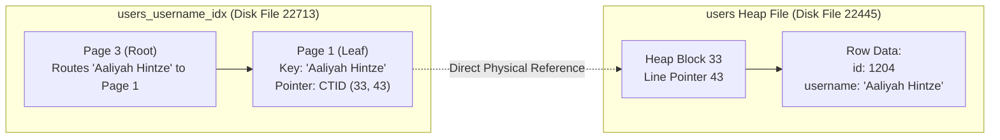

#### Tree Scaling and Multi-Level Hierarchies

In our small dataset (~4,000 users), the B-Tree requires only **2 levels**:

1. **Level 1:** Root Node (Page 3).
2. **Level 0:** Leaf Nodes (Pages 1, 2, 4...).

When a table grows to hundreds of thousands or millions of records (such as a `likes` table with 750,000 rows):

- The number of leaf pages expands into the thousands.
- A single 8 KB root page cannot fit routing pointers for thousands of leaf pages.
- PostgreSQL automatically balances the tree by introducing an intermediate layer of **Internal Parent Nodes**.
- Search traversal becomes: **Root Node -> Internal Node -> Leaf Node -> Heap Block**.
- Because tree height grows logarithmically, even a table with 100 million rows rarely exceeds a B-Tree depth of 4 or 5 levels.

```text
+-------------------------------------------------------------------------+
|                  MULTI-LEVEL B-TREE (e.g., 750,000 ROWS)                |
+-------------------------------------------------------------------------+
                                 [ ROOT NODE ]
                                 /
                   [ INTERNAL NODE 1 ]    [ INTERNAL NODE 2 ]
                     /             \        /                                                      v               v
                [LEAF 1] <-----> [LEAF 2] <-----> [LEAF 3] <-----> [LEAF 4]
                   |                |                |                |
                   v                v                v                v
             [HEAP BLOCK]     [HEAP BLOCK]     [HEAP BLOCK]     [HEAP BLOCK]
```

#### Summary Comparison: Heap Pages vs. B-Tree Pages

| Characteristic          | Heap Page (Table)                               | B-Tree Page (Index)                                 |
| :---------------------- | :---------------------------------------------- | :-------------------------------------------------- |
| **Page Size**           | Fixed 8 KB                                      | Fixed 8 KB                                          |
| **Page Header**         | 24 bytes (`pd_lower`, `pd_upper`)               | 24 bytes (`pd_lower`, `pd_upper`)                   |
| **Page Specialization** | All pages store uniform tuples                  | Distinct roles: Meta Page, Root, Internal, Leaf     |
| **Data Stored**         | Full row tuples (all columns + system fields)   | Only indexed search key + physical CTID coordinates |
| **Ordering**            | Unordered (rows placed in any block with space) | Strictly sorted keys across all leaf nodes          |
| **Inter-Page Links**    | None (independent heap blocks)                  | High-key sibling pointers link leaves horizontally  |

### Core Review & Knowledge Check

<details>
<summary><b>Question 1: Why must PostgreSQL load entire 8 KB blocks into memory during a full table scan rather than checking records directly on disk?</b></summary>
<br>
<b>Answer:</b> Storage devices operate on fixed block boundaries. The database engine cannot inspect individual row bytes directly on disk; it must transfer the entire 8 KB page into its shared memory buffer cache before the CPU can evaluate query filters.
</details>

<details>
<summary><b>Question 2: What two primary pieces of information are stored inside each B-Tree index entry?</b></summary>
<br>
<b>Answer:</b> The indexed column value (the search key) and the physical coordinate pointer (`ctid`: heap block number and item offset) indicating exactly where the full row resides in the table's heap file.
</details>

<details>
<summary><b>Question 3: Why is the execution time reported by `EXPLAIN ANALYZE` vastly more accurate for query optimization than the millisecond counter in pgAdmin's footer?</b></summary>
<br>
<b>Answer:</b> pgAdmin's footer includes network transit latency, query parsing, result serialization, and client GUI rendering. `EXPLAIN ANALYZE` measures the pure server-side execution runtime inside the PostgreSQL engine itself.
</details>

<details>
<summary><b>Question 4: What are the three primary trade-offs of adding an index to a database table?</b></summary>
<br>
<b>Answer:</b> 1) Persistent disk storage overhead for the index file, 2) write degradation (latency on every INSERT, UPDATE, and DELETE because all associated indexes must be updated), and 3) the risk of unused indexes if the query optimizer determines a sequential scan is more efficient.
</details>

<details>
<summary><b>Question 5: Why do primary key and unique columns not require manual `CREATE INDEX` commands?</b></summary>
<br>
<b>Answer:</b> PostgreSQL automatically generates an underlying B-Tree index whenever a `PRIMARY KEY` or `UNIQUE` constraint is defined, in order to enforce uniqueness in logarithmic time. Creating another index manually on the same column creates a redundant duplicate.
</details>

<details>
<summary><b>Question 6: In a B-Tree leaf page, what is the role of the very first item (the high key)?</b></summary>
<br>
<b>Answer:</b> It functions as a horizontal pointer to the next sibling leaf page, forming a linked list across the leaves. This allows PostgreSQL to execute fast range scans (e.g., `BETWEEN` or `ORDER BY`) by traversing horizontally across leaf pages without returning to the root node.
</details>

<details>
<summary><b>Question 7: How do you verify the physical row location corresponding to an index pointer in PostgreSQL?</b></summary>
<br>
<b>Answer:</b> By querying PostgreSQL's hidden system column `ctid` (e.g., `SELECT ctid, * FROM users WHERE username = '...';`), which directly outputs the `(block_number, offset)` matching the index's pointer.
</details>


## Query Tuning Basics

### The Query Processing Pipeline

Understanding how PostgreSQL executes a query is the prerequisite for designing high-performance databases. While indexes are powerful tools to accelerate record retrieval, indexing every single column degrades write performance and consumes significant memory and disk space. To evaluate whether a table or column genuinely needs an index, we must first understand the internal lifecycle a query undergoes from the moment a client sends a SQL string to the moment rows are returned.

Every query submitted to PostgreSQL transitions through four distinct architectural stages: the **Parser**, the **Rewriter**, the **Planner (Optimizer)**, and the **Executor**.

```text
+-----------------------------------------------------------------------------------+
|                        POSTGRESQL QUERY PROCESSING PIPELINE                       |
+-----------------------------------------------------------------------------------+
|                                                                                   |
|   Client Query: "SELECT * FROM users WHERE username = 'Allison.14';"              |
|         |                                                                         |
|         v                                                                         |
|   +---------------+                                                               |
|   | 1. PARSER     |  --> Checks SQL syntax & grammar.                             |
|   +---------------+  --> Generates programmatic Parse Tree / Query Tree.          |
|         |                                                                         |
|         v                                                                         |
|   +---------------+                                                               |
|   | 2. REWRITER   |  --> Applies database rule system.                            |
|   +---------------+  --> Expands views into underlying base queries.              |
|         |                                                                         |
|         v                                                                         |
|   +---------------+                                                               |
|   | 3. PLANNER    |  --> Evaluates execution paths (Index Scan vs. Seq Scan).     |
|   +---------------+  --> Uses table statistics to select the lowest-cost plan.    |
|         |                                                                         |
|         v                                                                         |
|   +---------------+                                                               |
|   | 4. EXECUTOR   |  --> Executes physical plan operations via buffer manager.    |
|   +---------------+  --> Fetches disk pages, evaluates filters, returns tuples.   |
|         |                                                                         |
|         v                                                                         |
|   Result Rows: [ id: 14, username: "Allison.14", email: "allison@example.com" ]   |
|                                                                                   |
+-----------------------------------------------------------------------------------+
```

#### Architectural Stages of Query Processing

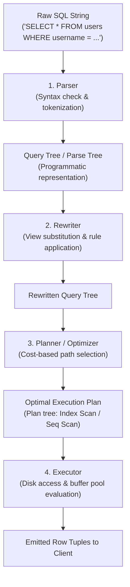

#### Stage 1: The Parser and the Query Tree

When raw SQL text arrives at the PostgreSQL server process, the Parser breaks down the character sequence into lexical tokens (keywords, literals, identifiers, and operators).

The Parser performs two primary duties:

1. **Grammar & Syntax Validation:** It verifies whether the statement complies with valid SQL syntax. If a keyword is misspelled (e.g., `SELEC` instead of `SELECT`) or punctuation is invalid, execution halts immediately with a syntax error.
2. **Query Tree Generation:** It transforms the raw string into an internal structural representation called a **Query Tree** (or Parse Tree).

The Query Tree deconstructs the query into distinct programmatic nodes:

- **Statement Type (`commandType`):** Identifies whether the operation is `SELECT`, `INSERT`, `UPDATE`, or `DELETE`.
- **Target List (`targetList`):** Represents the requested output attributes (e.g., all attributes for `*`, or explicit column references).
- **Range Table (`rangeTable`):** Identifies the target relations (tables) accessed by the query (e.g., the `users` table).
- **Qualification Clause (`qual`):** Contains the boolean filter condition from the `WHERE` clause structured as an operator expression tree (e.g., the equality operator `=` applied between the column identifier `username` and the string constant `'Allison.14'`).

```text
+-------------------------------------------------------------+
|               PROGRAMMATIC QUERY TREE BREAKDOWN             |
+-------------------------------------------------------------+
| SelectStmt                                                  |
|   |-- targetList: [ ResTarget (val: ColumnRef "*") ]        |
|   |-- fromClause: [ RangeVar (relname: "users") ]           |
|   \-- whereClause: A_Expr                                   |
|         |-- kind: AEXPR_OP ("=")                            |
|         |-- lexpr: ColumnRef ("username")                   |
|         \-- rexpr: A_Const ("Allison.14")                   |
+-------------------------------------------------------------+
```

#### Stage 2: The Rewriter and View Expansion

The Rewriter receives the Query Tree from the Parser and applies the PostgreSQL rule system.

Its primary function is **view expansion**:

- Views in relational databases are stored queries rather than physically materialized tables.
- When a query references a view, the Rewriter intercepts the view reference in the Query Tree and substitutes it with the underlying `SELECT` statement that defines the view.
- If no rules or views apply, the Rewriter passes the query tree forward with minor structural adjustments.

> [!TIP]
> Because the Rewriter expands views into subqueries before planning, querying a view incurs virtually no execution overhead compared to writing out the underlying join or filter query by hand. The Planner optimizes the unified tree in a single pass.

#### Stage 3: The Planner (Optimizer) and Path Selection

The Planner is the most critical component for database performance engineering. It takes the rewritten Query Tree and determines the most efficient physical strategy to retrieve the requested records.

A single query can often be answered through several distinct execution strategies:

- **Plan A (Index Scan):** Navigate the `users_username_idx` B-Tree index to locate the specific heap tuple pointer matching `'Allison.14'`, then perform a targeted disk read into the `users` heap file.
- **Plan B (Sequential Scan):** Read every block of the `users` table sequentially from disk, evaluating the string comparison `username = 'Allison.14'` on every individual row.
- **Plan C (Bitmap Index Scan):** Construct a memory bitmap of matching block locations from the index before reading the table blocks in physical sequence.

The Planner calculates an estimated **cost** for each candidate plan based on disk I/O operations and CPU cycle overhead, referencing table statistics maintained in the PostgreSQL system catalogs. The plan with the lowest estimated cost is selected and passed to the Executor.

> [!NOTE]
> Database developers have direct influence over the Planner. By adding indexes, writing clean queries, keeping table statistics up to date, and tuning server configuration parameters, engineers guide the Planner to select optimal execution strategies.

#### Stage 4: The Executor and Storage Retrieval

The Executor accepts the execution plan from the Planner and carries out the actual data retrieval:

1. It traverses the execution plan nodes recursively.
2. It calls into the PostgreSQL buffer manager to read required 8 KB data pages into the shared buffer cache (or fetches them from disk if not cached).
3. It evaluates filtering predicates, performs hash matches or sorts, and projects the final requested columns.
4. It streams the resulting rows back across the client connection.

#### Query Processing Component Comparison

| Component    | Primary Responsibility                 | Input Artifact       | Output Artifact         | Developer Influence                  |
| :----------- | :------------------------------------- | :------------------- | :---------------------- | :----------------------------------- |
| **Parser**   | Syntax validation & lexical analysis   | Raw SQL string       | Query Tree (Parse Tree) | Syntax correctness                   |
| **Rewriter** | Rule transformations & view expansion  | Query Tree           | Rewritten Query Tree    | Schema & view design                 |
| **Planner**  | Cost-based execution path optimization | Rewritten Query Tree | Physical Execution Plan | Indexes, query structure, statistics |
| **Executor** | Physical data retrieval & computation  | Execution Plan       | Emitted Result Tuples   | Hardware, buffer pool sizing         |

#### Practical Demonstration: Syntax Validation in the Parser

When queries are sent to PostgreSQL, the parser validates keyword syntax and structure before any disk reads or table access occurs.

```sql
-- Valid SQL Query: Successfully passes Parser, Rewriter, Planner, and Executor
SELECT id, username, email
FROM users
WHERE username = 'Allison.14';

-- Syntax Error: Caught immediately by the Parser before entering the Planner
SELEC id, username, email
FROM users
WHERE username = 'Allison.14';
```

##### Expected Output Sample

```text
-- Output from the valid query:
 id |  username  |         email
----+------------+-----------------------
 14 | Allison.14 | allison@example.com
(1 row)

-- Output from the malformed query:
ERROR:  syntax error at or near "SELEC"
LINE 1: SELEC id, username, email
        ^
```

### Inspecting Query Plans with EXPLAIN and EXPLAIN ANALYZE

The Planner operates as a cost-based optimization engine, but its decisions are typically hidden from view. To inspect which path the Planner selected, PostgreSQL provides two primary keywords: `EXPLAIN` and `EXPLAIN ANALYZE`.

```text
+-----------------------------------------------------------------------------------+
|                        EXPLAIN vs. EXPLAIN ANALYZE COMPARISON                     |
+-----------------------------------------------------------------------------------+
|                                                                                   |
|  EXPLAIN <query>;                                                                 |
|    - Generates the execution plan using catalog statistics.                       |
|    - DOES NOT execute the query.                                                  |
|    - Safe to run on destructive statements (e.g., DELETE, UPDATE).                |
|    - Outputs ESTIMATED costs, row counts, and byte widths.                        |
|                                                                                   |
|  EXPLAIN ANALYZE <query>;                                                         |
|    - Generates the execution plan AND RUNS the query to completion.               |
|    - Measures REAL runtime performance.                                           |
|    - DANGEROUS on destructive statements (modifications persist!).                |
|    - Outputs ESTIMATED metrics AND ACTUAL metrics (timing, row counts, loops).    |
|                                                                                   |
+-----------------------------------------------------------------------------------+
```

#### EXPLAIN: Static Cost and Cardinality Estimation

Prepending `EXPLAIN` to any SQL statement instructs PostgreSQL to compile the execution plan and output the structural tree along with estimated metrics, **without running the underlying query**.

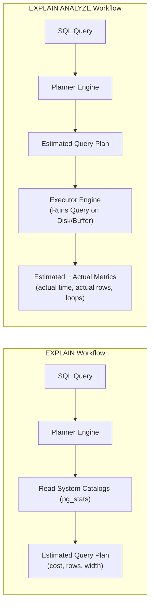

Key characteristics of `EXPLAIN`:

- **Zero I/O Execution:** Because the query does not actually execute, it returns instantaneously even on tables with tens of millions of rows.
- **Hypothetical Estimates:** All reported numbers (`cost`, `rows`, and `width`) are theoretical estimates derived purely from database catalog statistics.
- **Data Suppression:** The database does not return application rows; it outputs a single column containing text lines representing the execution plan.

#### EXPLAIN ANALYZE: Real-World Execution Profiling

Prepending `EXPLAIN ANALYZE` instructs PostgreSQL to generate the plan, **execute the statement in full**, and output both the original estimates alongside the real runtime statistics.

Key characteristics of `EXPLAIN ANALYZE`:

- **Real Execution:** PostgreSQL executes the query from start to finish, reading buffer pages and disk blocks, filtering records, and computing joins.
- **Actual Timing & Counts:** In addition to estimated costs, it provides:
  - `actual time=startup..total`: Real time in milliseconds to retrieve the first row and to complete the node.
  - `actual rows=N`: The exact number of rows produced by that node.
  - `loops=N`: The number of times that specific node was executed.
  - `Planning Time`: Time in milliseconds taken by the Planner to determine the plan.
  - `Execution Time`: Total wall-clock time in milliseconds taken by the Executor.

> [!CAUTION]
> Because `EXPLAIN ANALYZE` actually executes the query, running `EXPLAIN ANALYZE DELETE FROM users;` will permanently delete your data! To profile mutations safely, wrap them in a rolled-back transaction:
>
> ```sql
> BEGIN;
> EXPLAIN ANALYZE DELETE FROM users WHERE created_at < NOW() - INTERVAL '1 year';
> ROLLBACK;
> ```

> [!IMPORTANT]
> Never include `EXPLAIN` or `EXPLAIN ANALYZE` in application production queries. These keywords instruct the PostgreSQL engine to emit plan diagnostics instead of row records, which breaks application data mappers and ORMs.

#### Tooling: pgAdmin Visual Explain vs. psql CLI

PostgreSQL developers profile queries using both terminal-based interfaces (`psql`) and graphical database management clients (`pgAdmin`).

- **pgAdmin Visual Explain Button:** Located beside the standard "Execute" button in the Query Tool toolbar. It displays an interactive graphical tree of operations.
- **pgAdmin Dropdown Options:** Enables configuration toggles for _Costs_, _Buffers_, _Timing_, and _Verbose_.
- **Why CLI Mastery is Essential:** Production database servers are typically accessible only via headless SSH bastion hosts and command-line `psql`. Graphical tools cannot connect directly to locked-down environments, making terminal proficiency mandatory.

#### Diagnostic Tool Comparison

| Diagnostic Tool        | Query Actually Runs? | Side Effects on Data?       | Available Metrics                                                            | Best Use Case                                                 |
| :--------------------- | :------------------- | :-------------------------- | :--------------------------------------------------------------------------- | :------------------------------------------------------------ |
| **`EXPLAIN`**          | No                   | None (100% safe)            | Estimated cost, rows, width                                                  | Production checks, long-running queries, dry runs of DDL/DML  |
| **`EXPLAIN ANALYZE`**  | **Yes**              | **Yes** (Mutations persist) | Estimated costs + actual time (ms), actual rows, loop counts, execution time | Detailed staging profiling, identifying inaccurate statistics |
| **pgAdmin Visualizer** | Depends on toggle    | Yes (if Analyze selected)   | Graphical flow charts, node cost percentages, buffer statistics              | Learning plan hierarchies, visual walkthroughs in development |

#### Practical Walkthrough: Profiling a Relational Join

Consider a relational join retrieving all comments authored by a specific user (`Allison.14`):

```sql
-- Step 1: Standard query fetching records
SELECT username, contents
FROM users
JOIN comments ON comments.user_id = users.id
WHERE username = 'Allison.14';

-- Step 2: Static estimation without running the query
EXPLAIN
SELECT username, contents
FROM users
JOIN comments ON comments.user_id = users.id
WHERE username = 'Allison.14';

-- Step 3: Full execution with real runtime benchmarking
EXPLAIN ANALYZE
SELECT username, contents
FROM users
JOIN comments ON comments.user_id = users.id
WHERE username = 'Allison.14';
```

##### Expected Output Sample: Standard Query

```text
  username  |               contents
------------+--------------------------------------
 Allison.14 | Great explanation of query planning!
 Allison.14 | Indexes really make a huge difference.
(2 rows)
```

##### Expected Output Sample: EXPLAIN (Pure Estimate)

```text
                                        QUERY PLAN
------------------------------------------------------------------------------------------
 Hash Join  (cost=8.30..1765.41 rows=11 width=81)
   Hash Cond: (comments.user_id = users.id)
   ->  Seq Scan on comments  (cost=0.00..1570.00 rows=60000 width=72)
   ->  Hash  (cost=8.29..8.29 rows=1 width=13)
         ->  Index Scan using users_username_idx on users  (cost=0.29..8.29 rows=1 width=13)
               Index Cond: (username = 'Allison.14'::text)
(6 rows)
```

##### Expected Output Sample: EXPLAIN ANALYZE (Actual Runtime Metrics)

```text
                                                       QUERY PLAN
------------------------------------------------------------------------------------------------------------------------
 Hash Join  (cost=8.30..1765.41 rows=11 width=81) (actual time=0.082..12.431 rows=2 loops=1)
   Hash Cond: (comments.user_id = users.id)
   ->  Seq Scan on comments  (cost=0.00..1570.00 rows=60000 width=72) (actual time=0.012..8.140 rows=60000 loops=1)
   ->  Hash  (cost=8.29..8.29 rows=1 width=13) (actual time=0.045..0.046 rows=1 loops=1)
         Buckets: 1024  Batches: 1  Memory Usage: 9kB
         ->  Index Scan using users_username_idx on users  (cost=0.29..8.29 rows=1 width=13) (actual time=0.038..0.039 rows=1 loops=1)
               Index Cond: (username = 'Allison.14'::text)
 Planning Time: 0.285 ms
 Execution Time: 12.488 ms
(9 rows)
```

### Deconstructing Query Plans and Estimations with pg_stats

When reviewing a query plan, a central question arises: **How can PostgreSQL estimate that a query will produce exactly 11 rows with an average width of 81 bytes when running `EXPLAIN` without touching a single table or index page on disk?**

The answer lies in PostgreSQL's internal statistics collector and the `pg_stats` system catalog.

```text
+-----------------------------------------------------------------------------------+
|                        READING QUERY PLAN TREE DATAFLOW                           |
+-----------------------------------------------------------------------------------+
|                                                                                   |
|  Hash Join (cost=8.30..1765.41 rows=11 width=81)                                  |
|    |                                                                              |
|    |  <-- [Emitted User Hash Table]        <-- [Emitted 60,000 Comment Rows]      |
|    |                                                                              |
|    |-- Hash (cost=8.29..8.29 rows=1 width=13)                                     |
|    |     \-- Index Scan using users_username_idx on users                         |
|    |           (Finds 1 matching user tuple and passes to Hash)                   |
|    |                                                                              |
|    \-- Seq Scan on comments (cost=0.00..1570.00 rows=60000 width=72)              |
|          (Scans entire comments table and probes against Hash table)              |
|                                                                                   |
+-----------------------------------------------------------------------------------+
```

#### Reading the Query Plan Tree (Inside-Out Execution Flow)

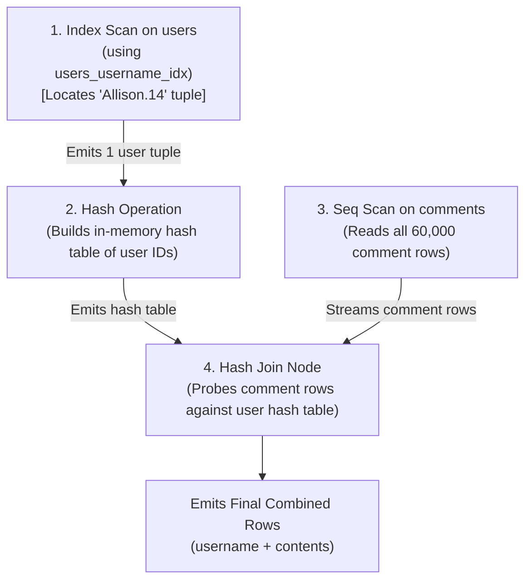

Query plans are structured as trees composed of individual operations called **Query Nodes**:

1. **Node Indicators:** Every line prefixed with an arrow `->` represents an individual processing node. The very top line (e.g., `Hash Join`) is also a query node (the root node).
2. **Indentation and Execution Flow:** The plan is evaluated **from the inside out (deepest indentation first)**:
   - The innermost node—`Index Scan using users_username_idx on users`—executes first.
   - It retrieves the matching tuple from the `users` table and passes it up to its immediate parent node: the `Hash` node.
   - The `Hash` node processes the user record, constructing an in-memory hash table keyed on `users.id`, and makes it available to the `Hash Join` parent node.
   - Concurrently, the `Seq Scan on comments` node reads rows sequentially from the `comments` table and feeds them into the `Hash Join` node.
   - The `Hash Join` node matches `comments.user_id` against the in-memory hash table, emitting joining pairs as the final query result.

#### Anatomy of a Plan Node: Cost, Rows, and Width

Every node header contains four fundamental attributes:

```text
Hash Join  (cost=8.30..1765.41 rows=11 width=81)
^^^^^^^^^   ^^^^^^^^^^^^^^^^^  ^^^^^^^  ^^^^^^^^
  Node         Estimated       Est.     Average
  Type           Cost          Rows      Bytes
```

1. **Node Type (`Hash Join`):** The physical algorithm executed by the database engine (e.g., `Seq Scan`, `Index Scan`, `Hash Join`, `Nested Loop`, `Merge Join`).
2. **Estimated Cost (`cost=8.30..1765.41`):**
   - Expressed in arbitrary cost units relative to the cost of a single sequential page disk read (`seq_page_cost = 1.0`).
   - **Startup Cost (`8.30`):** The cost required before the node emits its very first row.
   - **Total Cost (`1765.41`):** The cumulative cost required to run the node to completion.
3. **Estimated Rows (`rows=11`):** The estimated cardinality (number of rows) this specific node will emit.
4. **Estimated Width (`width=81`):** The average size in bytes of each row emitted by this node.

#### Solving the Estimation Mystery: The pg_stats System View

When running `EXPLAIN` without `ANALYZE`, PostgreSQL does not read table records or traverse index trees. Yet, it accurately predicts row counts and byte widths.

PostgreSQL maintains an internal metadata repository populated by the background `autovacuum` daemon and manual `ANALYZE` commands, exposed via the `pg_stats` system view.

```sql
-- Inspecting column statistics for the users table
SELECT
    attname,
    null_frac,
    avg_width,
    n_distinct,
    most_common_vals,
    most_common_freqs
FROM pg_stats
WHERE tablename = 'users';
```

##### Expected Output Sample: Inspecting pg_stats

```text
 attname  | null_frac | avg_width | n_distinct |    most_common_vals    |     most_common_freqs
----------+-----------+-----------+------------+------------------------+---------------------------
 id       |         0 |         4 |         -1 |                        |
 username |         0 |        13 |         -1 |                        |
 bio      |      0.05 |        45 |      -0.95 |                        |
 status   |         0 |         7 |          2 | {offline,online}       | {0.50133334,0.49866667}
(4 rows)
```

#### Calculating Emitted Tuple Width

In our query plan:

- The requested columns are `users.username` and `comments.contents`.
- Querying `pg_stats` shows that the average byte width (`avg_width`) for `users.username` is **13 bytes**.
- Querying `pg_stats` for `comments.contents` shows an average width of **68 bytes**.
- Combining these two projected attributes ($13 + 68$) yields the **81 bytes** reported as `width=81` on the `Hash Join` node!

#### Decoding Key pg_stats Columns

| Catalog Column                | Description & Meaning                                                                 | How the Planner Uses It                                                                                                                        |
| :---------------------------- | :------------------------------------------------------------------------------------ | :--------------------------------------------------------------------------------------------------------------------------------------------- |
| **`attname`**                 | Name of the table column                                                              | Identifies the column being analyzed.                                                                                                          |
| **`null_frac`**               | Fraction of column values that are `NULL` (e.g., `0.05` = 5%)                         | Adjusts row estimates when queries include `IS NULL` or `IS NOT NULL`.                                                                         |
| **`avg_width`**               | Average width in bytes of non-null column values                                      | Determines memory allocation for work buffers, sorting, and hash tables.                                                                       |
| **`n_distinct`**              | Number of distinct values in the column                                               | If $> 0$: exact distinct count.<br>If $< 0$: negative fraction of total rows (e.g., `-1` indicates unique keys like IDs and unique usernames). |
| **`most_common_vals` (MCV)**  | Array of the most frequent individual values                                          | Provides exact frequency data for non-uniformly distributed data.                                                                              |
| **`most_common_freqs` (MCF)** | Array of decimal frequencies matching the MCV list                                    | Used to calculate selectivity multipliers for equality queries (e.g., `WHERE status = 'offline'`).                                             |
| **`histogram_bounds`**        | Bounding values that divide non-MCV values into equal buckets                         | Used to compute selectivity for range searches (`WHERE age BETWEEN 20 AND 30`).                                                                |
| **`correlation`**             | Statistical correlation between physical disk storage order and logical value sorting | High correlation ($\approx 1.0$) means index scans will read sequential disk blocks, dramatically reducing random I/O costs.                   |

> [!NOTE]
> When statistics are stale after massive data changes, the Planner's estimates drift from reality, causing it to choose inefficient strategies (such as a slow Sequential Scan over an Index Scan). Always refresh statistics with `ANALYZE [table_name];` after bulk operations.

#### Join Algorithm Selection

| Join Strategy   | How It Works                                                                                            | Ideal Scenario                                                                                            | Weakness                                                                                        |
| :-------------- | :------------------------------------------------------------------------------------------------------ | :-------------------------------------------------------------------------------------------------------- | :---------------------------------------------------------------------------------------------- |
| **Hash Join**   | Builds an in-memory hash table from the smaller relation, then scans the larger relation to probe keys. | Joining a small/medium filtered set with a large table without indexes on join keys.                      | Requires sufficient memory (`work_mem`); spills to temporary disk files if memory is exceeded.  |
| **Nested Loop** | For every outer row, searches the inner relation (typically using an index).                            | When the outer relation has very few rows (1 to 100) and the inner relation has an index on the join key. | Performance degrades exponentially if the outer set contains thousands of rows without indexes. |
| **Merge Join**  | Both inputs must be sorted by the join key; streams both inputs in lockstep.                            | Both relations are already sorted (e.g., via B-Tree indexes) or data sets are very large.                 | Requires an upfront sort step if relations are not pre-indexed.                                 |

#### Practical Walkthrough: Querying Statistics and Verifying Estimates

```sql
-- Step 1: Query the statistics table for status column distributions
SELECT attname, n_distinct, most_common_vals, most_common_freqs
FROM pg_stats
WHERE tablename = 'users' AND attname = 'status';

-- Step 2: Run an EXPLAIN query filtering on the most common value
EXPLAIN SELECT * FROM users WHERE status = 'offline';
```

##### Expected Output Sample

```text
-- Step 1 Output:
 attname | n_distinct | most_common_vals |   most_common_freqs
---------+------------+------------------+-----------------------
 status  |          2 | {offline,online} | {0.5013333,0.4986667}
(1 row)

-- Step 2 Output:
                                  QUERY PLAN
------------------------------------------------------------------------------
 Seq Scan on users  (cost=0.00..180.00 rows=5013 width=118)
   Filter: ((status)::text = 'offline'::text)
(2 rows)
```

_Notice how the Planner estimates `rows=5013` out of 10,000 total table rows because `most_common_freqs` specifies that `offline` represents exactly 50.133% of records._

### Review Quiz

<details>
<summary><b>Question 1: What is the primary operational difference between the Parser, Planner, and Executor stages?</b></summary>
<br>
<b>Answer:</b> The <b>Parser</b> checks syntax and builds a programmatic Query Tree; the <b>Planner</b> evaluates candidate access paths (Index Scan vs. Seq Scan) and uses statistics to choose the lowest-cost plan; and the <b>Executor</b> runs the chosen physical plan against disk and buffer cache to return rows.
</details>

<details>
<summary><b>Question 2: What is the fundamental difference between EXPLAIN and EXPLAIN ANALYZE?</b></summary>
<br>
<b>Answer:</b> <code>EXPLAIN</code> generates the plan and cost estimates using catalog statistics without running the query. <code>EXPLAIN ANALYZE</code> generates the plan and <b>actually executes the query</b>, reporting real runtime duration, actual row counts, and loop statistics.
</details>

<details>
<summary><b>Question 3: How should an engineer safely run EXPLAIN ANALYZE on a destructive query (such as DELETE or UPDATE)?</b></summary>
<br>
<b>Answer:</b> Execute it within an explicit transaction block and roll it back immediately:
<pre><code>BEGIN;
EXPLAIN ANALYZE DELETE FROM ...;
ROLLBACK;</code></pre>
</details>

<details>
<summary><b>Question 4: In what order are execution plan node trees evaluated?</b></summary>
<br>
<b>Answer:</b> Plan trees are evaluated <b>bottom-up and inside-out</b>. The deepest indented child nodes execute first and pass their emitted data tuples upward to their parent nodes.
</details>

<details>
<summary><b>Question 5: How does PostgreSQL accurately estimate row count and byte width in an EXPLAIN command without reading table data?</b></summary>
<br>
<b>Answer:</b> It consults the <b><code>pg_stats</code></b> system catalog view. PostgreSQL maintains precomputed statistics (such as <code>avg_width</code>, <code>n_distinct</code>, and <code>most_common_freqs</code>) that allow the Planner to estimate tuple sizes and cardinalities prior to physical execution.
</details>


## Advanced Query Tuning

### Query Planner Mental Model: Sequential Scan vs. Index Scan

When a SQL query is submitted to PostgreSQL, it does not immediately execute. Instead, it passes through an internal query pipeline: parsing, rewriting, planning, and execution. The most critical component of this pipeline is the **Query Planner** (or Query Optimizer).

The planner's primary responsibility is to evaluate alternative execution strategies and choose the most efficient path—called a **Query Plan**—without actually running the query.

```text
+-----------------------------------------------------------------------+
|                       POSTGRESQL QUERY PIPELINE                       |
+-----------------------------------------------------------------------+
                                    |
                                    v
                             +-------------+
                             |  SQL Query  |
                             +-------------+
                                    |
                                    v
                             +-------------+
                             |   Parser    |
                             +-------------+
                                    |
                                    v
                             +-------------+
                             |  Rewriter   |
                             +-------------+
                                    |
                                    v
                       +-------------------------+
                       |     Query Planner       |
                       |  (Generates candidate   |
                       |   plans & scores cost)  |
                       +-------------------------+
                                    |
                                    v
                       +-------------------------+
                       |    Executor Engine      |
                       |  (Runs winning plan)    |
                       +-------------------------+
```

#### What Is Query "Cost"?

In query optimization, **cost** is not measured in seconds, milliseconds, or CPU cycles. Instead, cost is an **arbitrary, unitless numerical score** calculated by PostgreSQL to estimate the total processing effort and disk I/O required to execute a specific plan or node.

Because physical execution time depends heavily on concurrent server load, hardware speed, and operating system caching, runtime cannot be predicted deterministically. Cost provides an internal metric allowing PostgreSQL to rank candidate plans relative to each other.

#### Evaluating Candidate Plans: Index Scan vs. Sequential Scan

Consider a query searching for a specific user:

```sql
SELECT * FROM users WHERE username = 'Alison';
```

The planner identifies two primary execution candidates:

1. **Candidate Plan A (Index Scan):**
   - Access the B-Tree index on `username`.
   - Read the index root node, follow child pointers to the appropriate leaf node containing `'Alison'`.
   - Extract the physical heap pointer (`Block Number`, `Offset/Index`).
   - Open the table heap file, jump directly to that specific block, and load the record.
   - _Total disk I/O:_ Fetching approximately 2 random pages (1 index leaf page + 1 heap data block).

2. **Candidate Plan B (Sequential Scan):**
   - Open the table heap file directly.
   - Read the file block by block, starting at Block 0 through the end of the file.
   - For every block, inspect every tuple to check if `username = 'Alison'`.
   - _Total disk I/O:_ Reading every single block in the table heap file sequentially. If the table has 110 pages, it reads 110 pages.

```text
+-----------------------------------------------------------------------------+
|                     SEQUENTIAL SCAN VS. RANDOM ACCESS I/O                   |
+-----------------------------------------------------------------------------+

Plan A: Random Index Lookup (Jump to target block)
Disk Blocks:  [ Block 0 ]   [ Block 1 ]   [ Block 2 ] ... [ Block 109 ]
                                 ^
                                 |  (Direct seek to Block 1, Item 2)
                            [Leaf Node]

Plan B: Sequential Scan (Continuous reading from start to finish)
Disk Blocks:  [ Block 0 ] -> [ Block 1 ] -> [ Block 2 ] -> ... -> [ Block 109 ]
              =========> sequential streaming read (low per-page cost) =======>
```

#### The Physics of Disk I/O: Sequential vs. Random Access

At first glance, reading 2 pages versus 110 pages makes the index scan appear 55 times cheaper. However, disk access physics introduces a crucial nuance:

- **Sequential Access:** Reading consecutive disk blocks allows storage controllers and operating systems to stream data efficiently and use read-ahead caching.
- **Random Access:** Jumping between non-contiguous blocks on disk requires seek time and separate I/O operations, incurring a performance penalty.

To model this real-world hardware behavior, PostgreSQL assumes that loading a page at random is significantly more expensive than loading pages sequentially. By default, PostgreSQL assigns a baseline score of `1.0` to sequential page reads and a penalty factor of `4.0` to random page reads.

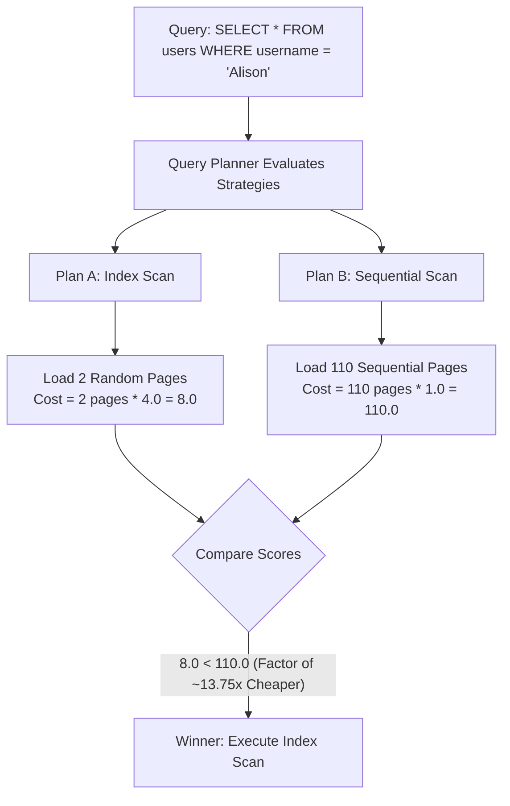

Applying these cost factors:

- **Index Scan Score:** $2 \text{ random pages} \times 4.0 = 8.0$
- **Sequential Scan Score:** $110 \text{ sequential pages} \times 1.0 = 110.0$

Even with the $4\times$ random access penalty, the index scan score of $8.0$ is dramatically lower than $110.0$ (roughly $13.75\times$ cheaper). Therefore, the planner selects the index scan.

### Calculating Query Cost by Hand: Deconstructing the Math

To understand how PostgreSQL generates the numbers displayed in `EXPLAIN` output, we can calculate the exact cost of an individual execution node by hand.

Consider an isolated sequential scan on a `comments` table:

```sql
-- Retrieve the execution plan for reading all comments
EXPLAIN SELECT * FROM comments;
```

#### Table Metrics

From PostgreSQL table metadata, we extract the physical dimensions of the `comments` table:

- **Total Rows (`reltuples`):** $60,410$ rows
- **Total Disk Pages (`relpages`):** $985$ blocks ($8\text{ KB}$ each)

#### Breaking Down the Workload

Executing a sequential scan involves two distinct types of resource consumption:

1. **Disk I/O Effort:** Fetching all 985 blocks from storage into shared memory buffers sequentially.
2. **CPU Processing Effort:** Inspecting each of the 60,410 rows in memory, parsing row headers, and validating column attributes.

Processing a row in memory is purely CPU-bound and is significantly cheaper than fetching a physical disk block. PostgreSQL estimates that processing one row consumes approximately $1\%$ ($0.01$) of the effort required to read a single sequential page off disk. In other words, inspecting $100$ rows in memory equals the cost of reading $1$ disk page sequentially.

#### The Cost Calculation

Using sequential page reads as the baseline unit ($1.0$):

$$\text{Total Cost} = (\text{Pages Read Sequentially} \times 1.0) + (\text{Rows Processed} \times 0.01)$$

Substituting the table metrics:

$$\text{Disk Cost} = 985 \times 1.0 = 985.0$$
$$\text{CPU Cost} = 60,410 \times 0.01 = 604.10$$
$$\text{Total Cost} = 985.0 + 604.10 = 1589.10$$

#### Verification with PostgreSQL EXPLAIN

Running `EXPLAIN` against the database confirms this exact mathematical result:

```sql
EXPLAIN SELECT * FROM comments;
```

Expected output:

```text
                         QUERY PLAN
------------------------------------------------------------
 Seq Scan on comments  (cost=0.00..1589.10 rows=60410 width=84)
```

The computed value of $1589.10$ matches PostgreSQL's estimated total cost to the decimal point.

> [!NOTE]
> The cost value $1589.10$ has no physical unit. It simply communicates that reading the entire `comments` table is roughly $1589$ times more computationally expensive than reading a single $8\text{ KB}$ page sequentially from disk.

### PostgreSQL Planner Cost Constants and Formulas

PostgreSQL does not hardcode cost estimates with magic numbers. All cost derivations stem from configurable planner cost constants defined in the server configuration.

#### The Core Cost Constants

| Parameter              | Default Value | Description                                                                       |
| :--------------------- | :------------ | :-------------------------------------------------------------------------------- |
| `seq_page_cost`        | `1.0`         | Baseline unit: estimated cost of a sequential disk page fetch.                    |
| `random_page_cost`     | `4.0`         | Cost of fetching a disk page non-sequentially (random seek).                      |
| `cpu_tuple_cost`       | `0.01`        | CPU effort required to process each row (tuple) in memory.                        |
| `cpu_index_tuple_cost` | `0.005`       | CPU effort required to process an index entry during an index scan.               |
| `cpu_operator_cost`    | `0.0025`      | CPU effort to evaluate an operator or function (e.g., `WHERE`, `JOIN` condition). |
| `parallel_setup_cost`  | `1000.0`      | Fixed cost of launching parallel worker processes.                                |
| `parallel_tuple_cost`  | `0.1`         | Cost of transferring a tuple from a parallel worker to the leader process.        |

All constants are calibrated relative to `seq_page_cost = 1.0`. For instance:

- `random_page_cost = 4.0` means random I/O is modeled as $4\times$ more expensive than sequential I/O.
- `cpu_tuple_cost = 0.01` means processing a row in CPU is $100\times$ cheaper than reading a page from disk.
- `cpu_index_tuple_cost = 0.005` means evaluating an index entry is half the cost of processing a table tuple ($0.005$ vs $0.01$).
- `cpu_operator_cost = 0.0025` means evaluating a standard comparison operator (such as `<`, `=`, `+`) is half the cost of an index entry check.

#### The Comprehensive Cost Formula

For any query execution node, the complete cost equation balances sequential I/O, random I/O, CPU tuple overhead, index traversal, and operator evaluations:

```text
+----------------------------------------------------------------------------------------------------+
|                                  THE COMPREHENSIVE COST FORMULA                                    |
+----------------------------------------------------------------------------------------------------+
|                                                                                                    |
|    Total Cost =  ( pages_read_sequentially  *  seq_page_cost [1.0] )                               |
|                + ( pages_read_at_random     *  random_page_cost [4.0] )                            |
|                + ( rows_scanned             *  cpu_tuple_cost [0.01] )                             |
|                + ( index_entries_scanned    *  cpu_index_tuple_cost [0.005] )                      |
|                + ( operators_evaluated      *  cpu_operator_cost [0.0025] )                        |
|                                                                                                    |
+----------------------------------------------------------------------------------------------------+
```

Plain text formulation:

```text
Total Cost = (pages_seq * seq_page_cost) + (pages_rnd * random_page_cost) + (rows * cpu_tuple_cost) + (index_rows * cpu_index_tuple_cost) + (operators * cpu_operator_cost)
```

Where:

- `pages_seq`: Number of disk blocks fetched sequentially.
- `pages_rnd`: Number of disk blocks fetched at random (seek operations).
- `rows`: Number of table rows (tuples) inspected in memory.
- `index_rows`: Number of index leaf entries inspected during an index scan.
- `operators`: Number of filter operators, joins, or functions evaluated in the `WHERE` clause.

#### Why Documentation Often Shows an Abbreviated Formula

In many documentation articles and tutorials, the formula is condensed to:

```text
Total Cost = (pages * 1.0) + (rows * 0.01)
```

This simplification applies specifically to simple sequential scans without complex `WHERE` clause filters:

- No random pages are accessed (`pages_rnd = 0`).
- No index entries are touched (`index_rows = 0`).
- No custom operators are evaluated (`operators = 0`).

When these zero terms drop out, only sequential disk I/O and CPU tuple processing remain.

> [!TIP]
> **Hardware Tuning for Modern NVMe SSDs:**
> The default `random_page_cost = 4.0` was established when spinning mechanical hard drives (HDDs) dominated database servers. Mechanical drives suffer high seek latencies because read/write heads must physically reposition across spinning platters.
>
> On modern Solid State Drives (SSDs) and NVMe storage, random access latencies are nearly identical to sequential throughput. In production environments utilizing enterprise SSDs, database administrators frequently reduce `random_page_cost` to `1.1`–`1.5` (or even `1.0` if using battery-backed shared RAM caches). This encourages PostgreSQL to prefer index scans over sequential table scans when selective lookups are executed.

### Startup Cost vs. Total Cost: Streaming vs. Batching

In PostgreSQL `EXPLAIN` output, cost is always represented as a pair of floating-point numbers separated by two dots:

```text
(cost=startup_cost..total_cost rows=N width=W)
```

These two numbers do not represent a confidence interval or a range of possible values. Each number has a distinct engineering meaning:

- **Startup Cost (First Number):** The estimated computational effort required for a node to initialize, fetch its dependencies, and output its **very first row**.
- **Total Cost (Second Number):** The estimated cumulative computational effort required for the node to process and output **all rows** expected by the query.

```text
+-----------------------------------------------------------------------------+
|                     STARTUP COST VS. TOTAL COST DYNAMICS                    |
+-----------------------------------------------------------------------------+

1. STREAMING / PIPELINED NODE (e.g., Sequential Scan)
   Time/Cost: 0.00 ............................................... 1589.10
              ^                                                         ^
              |-- Emits Row 1 immediately                               |-- Finishes all rows
              (Startup Cost = 0.00)                                     (Total Cost = 1589.10)

2. BATCH / STOP-AND-WAIT NODE (e.g., Hash Materialization)
   Time/Cost: 0.00 ----------------------------------------> 8.30
                                                              ^
                                                              |-- Hash table fully built;
                                                                  Emits Row 1 & finishes!
                                                                  (Startup Cost = Total Cost = 8.30)
```

#### Streaming Nodes vs. Batching Nodes

The gap between startup cost and total cost reveals how an execution node processes data:

##### Streaming (Pipelined) Nodes

Nodes such as `Seq Scan` and `Index Scan` can begin streaming rows immediately to their parent nodes:

- When a sequential scan opens the first $8\text{ KB}$ block of a table, it processes the very first row and immediately passes it up the execution tree to the consumer.
- PostgreSQL assigns sequential scans a startup cost of `0.00`. While opening the file and reading the first page technically requires some work, PostgreSQL treats the initial pipeline startup overhead as zero because row streaming begins without pre-aggregating or sorting data.
- The node continues yielding records row-by-row while upstream nodes process them concurrently.

##### Batching (Stop-and-Wait) Nodes

Nodes such as `Hash`, `Sort`, or `Materialize` cannot emit any output until they have processed their entire input dataset:

- For a `Hash` node building an in-memory hash table for a hash join, every single row from the underlying child scan must be ingested and inserted into hash buckets before probe matching can begin.
- Because row 1 cannot be emitted until the entire hash table is complete, the startup cost is equal to the total cost (e.g., `cost=8.30..8.30`).

#### Why Startup Cost Matters in Query Optimization

Understanding startup cost explains optimizer decisions for queries with `LIMIT` clauses:

```sql
SELECT * FROM comments ORDER BY created_at LIMIT 1;
```

- If PostgreSQL uses a sequential scan followed by a full sort, the sort node must absorb all 60,410 rows before returning row 1, resulting in a high startup cost.
- If an index exists on `created_at`, an index scan can read the very first leaf pointer and return row 1 almost instantly (near-zero startup cost).
- Even if the index scan has a higher _total_ cost for reading the entire table, the query planner chooses the index scan because the `LIMIT 1` clause only requires the startup phase to complete.

### Hierarchical Cost Flow in Query Execution Plans

PostgreSQL executes queries using tree-structured query plans. In these trees, execution costs flow **upward** from leaf nodes to parent nodes.

Consider a multi-table query combining users and comments via a hash join:

```sql
EXPLAIN SELECT users.username, comments.body
FROM users
JOIN comments ON comments.user_id = users.id
WHERE users.username = 'Alison';
```

A representative execution plan for this query appears as follows:

```text
                                  QUERY PLAN
-------------------------------------------------------------------------------
 Hash Join  (cost=8.31..1600.41 rows=10 width=116)
   Hash Cond: (comments.user_id = users.id)
   ->  Seq Scan on comments  (cost=0.00..1589.10 rows=60410 width=84)
   ->  Hash  (cost=8.30..8.30 rows=1 width=36)
         ->  Index Scan using users_username_idx on users  (cost=0.00..8.30 rows=1 width=36)
               Index Cond: (username = 'Alison'::text)
```

#### How Parent Costs Accumulate

A parent node's cost is computed by adding the costs of all its direct child nodes to the parent node's own intrinsic operational overhead:

$$\text{Parent Total Cost} = \sum (\text{Child Total Costs}) + \text{Node's Intrinsic Processing Cost}$$

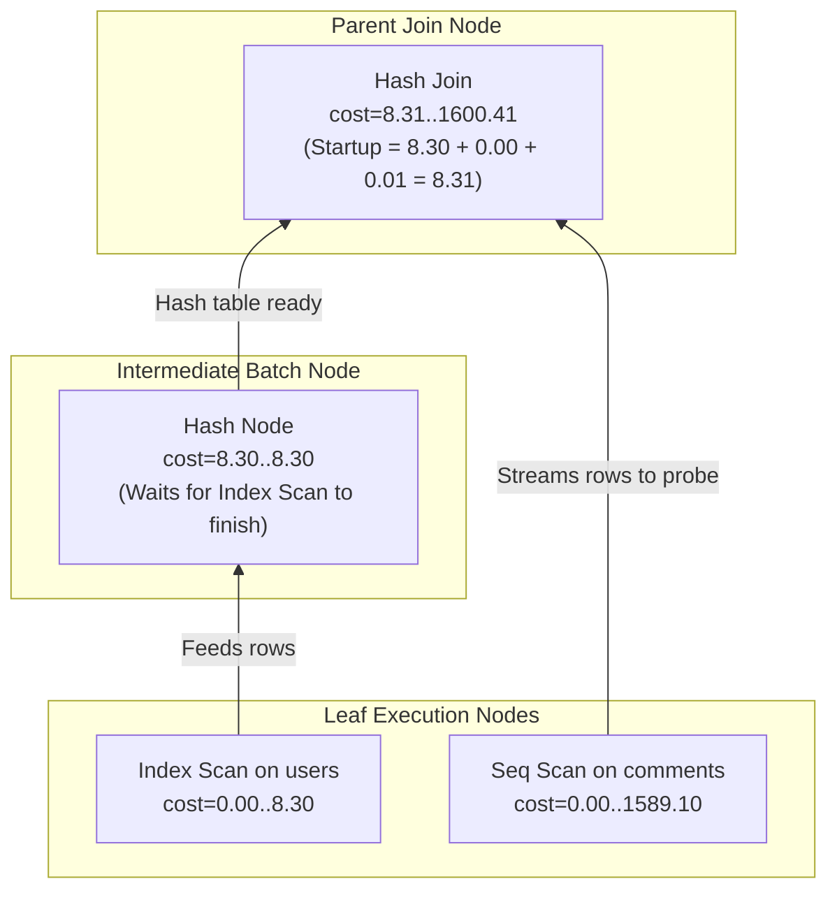

#### Step-by-Step Breakdown of Cost Propagation

1. **Index Scan on `users` (`cost=0.00..8.30`):**
   - The index scan searches for `'Alison'`, incurring a total cost of $8.30$.
2. **Hash Node (`cost=8.30..8.30`):**
   - The hash node consumes the single record from the index scan and hashes it in memory.
   - Because it must wait for the index scan to complete, its startup cost is $8.30$ and its total cost is $8.30$.
3. **Sequential Scan on `comments` (`cost=0.00..1589.10`):**
   - The sequential scan has a startup cost of $0.00$ because it streams comments immediately.
   - Its total cost is $1589.10$.
4. **Hash Join (`cost=8.31..1600.41`):**
   - **Startup Cost ($8.31$):** To produce its first joined row, the Hash Join requires the inner hash table to be fully constructed ($8.30$) and the outer sequential scan to supply its first record ($0.00$), plus a negligible intrinsic setup cost ($0.01$):
     $$\text{Startup Cost} = 8.30 + 0.00 + 0.01 = 8.31$$
   - **Total Cost ($1600.41$):** The total cost includes the sequential scan ($1589.10$), the hash table preparation ($8.30$), and the CPU cost of probing the hash table and joining tuples ($~3.01$):
     $$\text{Total Cost} = 1589.10 + 8.30 + 3.01 = 1600.41$$

Costs consistently propagate from the bottom leaves upward to the root node of the query plan.

### Index Selection Mechanics and the "Use My Index!" Dilemma

A common misconception among database developers is that creating an index guarantees PostgreSQL will use it for queries filtering on that column. In reality, the query planner frequently bypasses existing indexes in favor of sequential scans.

#### Anatomy of a Multi-Level B-Tree Index

When a table grows large, a B-Tree index expands into multiple hierarchical levels:

```text
+-----------------------------------------------------------------------------+
|                    MULTI-LEVEL B-TREE INDEX ARCHITECTURE                    |
+-----------------------------------------------------------------------------+

                             [ Root Node Page ]
                                /          \
                               /            \
          [ Parent / Branch Page 1 ]     [ Parent / Branch Page 2 ]
               /            \                 /            \
        [ Leaf Page 1 ] [ Leaf Page 2 ] [ Leaf Page 3 ] [ Leaf Page 4 ]
             |               |               |               |
             +---------------+---------------+---------------+
                             |
                   Tuple Pointers (Block ID, Offset)
                             |
                             v
           +-----------------------------------+
           |         Table Heap File           |
           |  [ Block 0 ] [ Block 1 ] ...      |
           +-----------------------------------+
```

- **Root Node:** Directs searches to appropriate branch nodes based on key ranges.
- **Parent / Branch Nodes:** Provide intermediate routing for large key spaces.
- **Leaf Nodes:** Store indexed keys in sorted order alongside physical tuple pointers (`ctid`: Block ID and Item Offset) pointing to rows inside table heap pages.

#### Case Study: The `likes` Table

Consider a `likes` table tracking user engagement:

- Total rows in `likes`: $750,000$
- Column indexed: `created_at` (timestamp)

```sql
-- Create an explicit B-Tree index on created_at
CREATE INDEX likes_created_at_idx ON likes (created_at);
```

#### Scenario 1: High Selectivity Query (Small Result Set)

We query for likes created before January 1, 2013:

```sql
EXPLAIN SELECT * FROM likes WHERE created_at < '2013-01-01';
```

- **Matching Rows:** $63,000$ out of $750,000$ (~$8.4\%$ of the table).
- **Execution Plan:**
  ```text
                               QUERY PLAN
  -------------------------------------------------------------------------
   Bitmap Heap Scan on likes  (cost=1214.20..14890.30 rows=63000 width=24)
     Recheck Cond: (created_at < '2013-01-01'::timestamp)
     ->  Bitmap Index Scan on likes_created_at_idx  (cost=0.00..1198.45 rows=63000 width=0)
           Index Cond: (created_at < '2013-01-01'::timestamp)
  ```

Because only $8.4\%$ of rows match, PostgreSQL utilizes the index. It performs a **Bitmap Index Scan** (building a memory bitmap of target block locations from index leaves) followed by a **Bitmap Heap Scan** (reading target heap blocks in physical block order to minimize random seeking).

#### Scenario 2: Low Selectivity Query (Large Result Set)

Now invert the comparison operator from `<` to `>`:

```sql
EXPLAIN SELECT * FROM likes WHERE created_at > '2013-01-01';
```

- **Matching Rows:** $688,000$ out of $750,000$ (~$91.7\%$ of the table).
- **Execution Plan:**
  ```text
                             QUERY PLAN
  ------------------------------------------------------------------
   Seq Scan on likes  (cost=0.00..15240.00 rows=688000 width=24)
     Filter: (created_at > '2013-01-01'::timestamp)
  ```

Despite the index on `created_at`, PostgreSQL chooses a sequential scan.

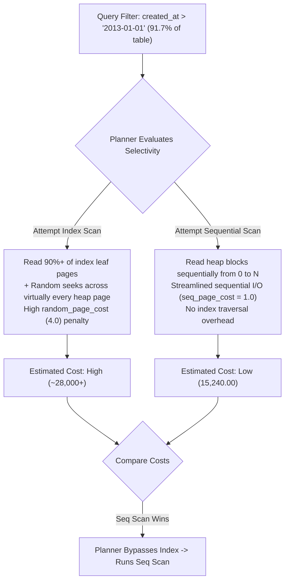

#### Why PostgreSQL Bypasses the Index

When retrieving $91.7\%$ of a table:

1. **Index Overhead:** PostgreSQL would have to traverse the index tree and read over $90\%$ of its leaf pages.
2. **Random Heap I/O:** Each pointer in the leaf pages directs PostgreSQL to a heap block. Because nearly every physical heap page contains at least one matching row, PostgreSQL would end up loading almost every block in the table anyway.
3. **Random Access Penalty:** Accessing those heap pages via index pointers causes out-of-order, random page reads ($4.0$ cost factor per page) rather than efficient sequential reads ($1.0$ cost factor).

Reading the entire heap sequentially from start to finish is significantly faster than reading the index first and then jumping randomly across all heap blocks.

#### Trade-off Matrix: Scan Strategies

| Scan Method           | Best Used When                                                | Primary Advantage                                                    | Major Bottleneck                                    |
| :-------------------- | :------------------------------------------------------------ | :------------------------------------------------------------------- | :-------------------------------------------------- |
| **Index Scan**        | High selectivity (< 5% of rows).                              | Fetches only matching tuples; minimal disk reads.                    | Random disk seeks on heap lookups.                  |
| **Bitmap Index Scan** | Moderate selectivity (5% - 20% of rows).                      | Sorts pointers into a block bitmap; visits heap blocks sequentially. | In-memory bitmap construction overhead.             |
| **Sequential Scan**   | Low selectivity (> 20% of rows) or small tables (< 50 pages). | Optimal sequential streaming I/O; zero index traversal.              | Reads every page in table regardless of match rate. |

> [!CAUTION]
> **Do Not Attempt to Force Index Usage:**
> A common question among engineers is _"Why isn't Postgres using my index, and how can I force it?"_
>
> PostgreSQL allows disabling sequential scans during debugging (`SET enable_seqscan = off;`), but forcing an index in production when the planner prefers a sequential scan will degrade performance. The planner has evaluated the I/O mathematics; when it selects a sequential scan over an index, sequential scanning is genuinely faster for that data distribution.

> [!IMPORTANT]
> **Index Hygiene and Dead Indexes:**
> If a query consistently accesses a high percentage of rows, an index on that column provides no read benefit. Unused indexes continue to incur write penalties: every `INSERT`, `UPDATE`, and `DELETE` must write to the index tree, and the index consumes disk space and buffer memory.
>
> Always inspect execution plans with `EXPLAIN`. If an index is never selected by production query workloads, drop it:
>
> ```sql
> DROP INDEX likes_created_at_idx;
> ```

### Interactive Knowledge Check Quiz

<details>
<summary><b>Question 1: Why is PostgreSQL query cost unitless rather than measured in seconds or milliseconds?</b></summary>
<br>
<b>Answer:</b> Execution time varies constantly based on concurrent server load, CPU frequency, disk controller latency, and whether pages reside in memory cache or physical storage. Because wall-clock time cannot be predicted deterministically without executing the query, PostgreSQL uses a unitless score calibrated against a baseline (where fetching one 8 KB disk page sequentially equals 1.0) to compare candidate plans relative to each other.
</details>

<details>
<summary><b>Question 2: In an EXPLAIN output like <code>Seq Scan on comments (cost=0.00..1589.10 rows=60410)</code>, why is the startup cost listed as 0.00?</b></summary>
<br>
<b>Answer:</b> A sequential scan is a streaming (pipelined) node. Once the query engine opens the first disk block, it can immediately process and emit the very first matching row to the parent node without waiting to read the rest of the table. PostgreSQL models this immediate start as a 0.00 startup cost, unlike batch nodes (such as Hash or Sort) which must consume all input rows before emitting their first output row.
</details>

<details>
<summary><b>Question 3: Why does a Hash node have identical startup and total costs (e.g., <code>cost=8.30..8.30</code>)?</b></summary>
<br>
<b>Answer:</b> A Hash node is a "stop-and-wait" (batching) operation. It cannot construct a partial hash table and emit rows; it must ingest, hash, and store 100% of the tuples from its child scan before any probe or join operation can begin. Because emitting the very first row requires completing the entire hash table, its startup cost equals its total cost.
</details>

<details>
<summary><b>Question 4: Given a table with 985 sequential pages and 60,410 rows, explain how PostgreSQL calculates the total cost of 1589.10 for a sequential scan without filters.</b></summary>
<br>
<b>Answer:</b> PostgreSQL sums the disk I/O cost and CPU processing cost using its default planner constants:
<br><br>
$$\text{Disk I/O Cost} = 985 \text{ pages} \times 1.0\ (\text{seq\_page\_cost}) = 985.0$$
$$\text{CPU Cost} = 60,410 \text{ rows} \times 0.01\ (\text{cpu\_tuple\_cost}) = 604.10$$
$$\text{Total Cost} = 985.0 + 604.10 = 1589.10$$
</details>

<details>
<summary><b>Question 5: Why does PostgreSQL ignore an existing B-Tree index and revert to a sequential scan when a query's filter matches 90% of the rows in a table?</b></summary>
<br>
<b>Answer:</b> When a query matches a high percentage of rows, an index scan would require reading almost all index leaf pages and then executing random disk lookups for virtually every heap data block in the table. Because random disk access carries a steep penalty factor (<code>random_page_cost = 4.0</code>), navigating the index and seeking heap blocks randomly is far more expensive than simply reading the entire heap file sequentially from start to finish at <code>seq_page_cost = 1.0</code>.
</details>


## Recursive Common Table Expressions (CTEs)

### The Big Picture: What is a Recursive CTE?

In SQL, a normal Common Table Expression (CTE) created with the `WITH` keyword is just a handy way to write a temporary query and give it a name, like an alias or a helper view.

A **Recursive CTE** (written with `WITH RECURSIVE`) is completely different. **Think of a recursive CTE as a loop inside SQL.** It takes a starting row, runs an operation on it, takes the result, runs the operation again, and keeps repeating until there is nothing left to process.

> [!NOTE]
> Recursive CTEs are widely considered one of the most challenging topics in SQL. You do **not** need to memorize how to write them from scratch right away. Your main goal right now is simply to understand **what they do** and recognize **when to use one** (such as when working with hierarchies or recommendations).

```text
+-----------------------------------------------------------------------------+
|                     THE 3 PARTS OF A RECURSIVE CTE                          |
|                                                                             |
|  WITH RECURSIVE my_cte(columns) AS (                                        |
|      -- 1. THE STARTING QUERY (Non-Recursive)                               |
|      SELECT ...                                                             |
|      (Runs once at the very start to give us our initial rows)              |
|                                                                             |
|      UNION                                                                  |
|      (Glues all our rounds of results together)                             |
|                                                                             |
|      -- 2. THE REPEAT QUERY (Recursive)                                     |
|      SELECT ... FROM my_cte WHERE ...                                       |
|      (Runs over and over on the latest rows until a condition stops it)     |
|  )                                                                          |
|  -- 3. THE FINAL QUERY (Outer Query)                                        |
|  SELECT * FROM my_cte;                                                      |
|  (Reads and displays the final collected results)                           |
+-----------------------------------------------------------------------------+
```

Every recursive CTE always has these three parts:

1. **Initial (Non-Recursive) Query:** The starting point located above the `UNION`. It runs only once to give the loop its initial data.
2. **The `UNION` Keyword:** Every recursive CTE must have a `UNION` keyword to combine each round's results into one list.
3. **Recursive Query:** The repeat step located below the `UNION`. It refers back to the CTE name and keeps generating new rows until it finds 0 rows.

### How PostgreSQL Runs It: The Two Secret Tables

When PostgreSQL executes a recursive CTE, you don't have to worry about complex recursion stacks. Behind the scenes, Postgres simply creates **two temporary secret tables**:

1. **The Results Table (The Storage Box):** This table holds _everything_ collected so far. Every time a new round finishes, its rows get added here.
2. **The Working Table (The Current Batch):** This table only holds the rows from the _very last round_. The repeat query reads directly from this table.

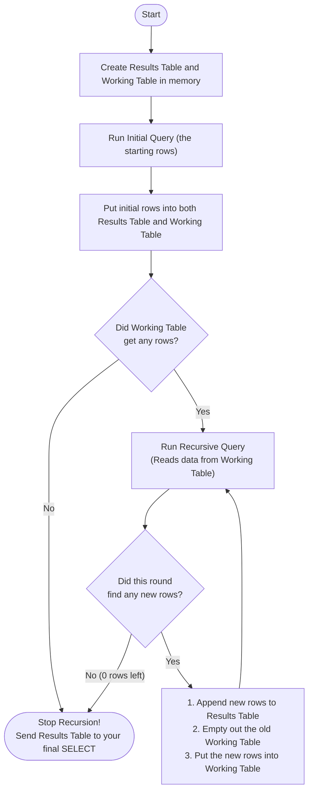

#### The Golden Rule to Remember

Whenever you see the CTE name inside the recursive query (e.g., `FROM countdown`), **mentally read it as `FROM working_table`**. It only looks at the batch from the last step, not everything that came before!

### Your First Example: The Countdown Query

The simplest way to see this loop in action is to count down numbers from 3 to 1.

#### The SQL Code

```sql
-- Create a recursive CTE called 'countdown' with one column named 'val'
WITH RECURSIVE countdown(val) AS (
    -- 1. Initial Query: Start our counter at 3
    SELECT 3 AS val

    UNION

    -- 2. Recursive Query: Take the current number in the working table and subtract 1
    SELECT val - 1
    FROM countdown
    WHERE val > 1 -- Stopping Rule: Stop once val drops to 1
)
-- 3. Outer Query: Show the whole collected list
SELECT val
FROM countdown;
```

#### What Happens Step by Step

```text
+-----------+-------------------------+-------------------------+-----------------------------+
| Round     | Working Table (Input)   | What Recursive Query Does| Results Table (Accumulator) |
+-----------+-------------------------+-------------------------+-----------------------------+
| Start     | [ 3 ]                   | Runs initial query      | [ 3 ]                       |
| Round 1   | [ 3 ]                   | 3 - 1 = [ 2 ]           | [ 3, 2 ]                    |
| Round 2   | [ 2 ]                   | 2 - 1 = [ 1 ]           | [ 3, 2, 1 ]                 |
| Round 3   | [ 1 ]                   | 1 > 1 is False (0 rows) | [ 3, 2, 1 ] -> Finished!    |
+-----------+-------------------------+-------------------------+-----------------------------+
```

#### Expected Output

```text
 val
-----
   3
   2
   1
(3 rows)
```

> [!TIP]
> If you change `SELECT 3 AS val` to `SELECT 10 AS val`, it counts down from 10 to 1. If you forget the `WHERE val > 1` clause, the query will count down into negative numbers forever until your database runs out of memory or cancels the query!

### Why Do We Need This? Trees, Hierarchies, and Friends-of-Friends

Why would anyone need a loop in SQL? Couldn't we just use regular `JOIN` statements?

Imagine you run an app like Instagram, and you want to build a **"Who to Follow"** suggestion box:

```text
+-----------------------------------------------------------------------------+
|                     HOW INSTAGRAM SUGGESTIONS WORK                          |
|                                                                             |
|      [ You: Haley ]                                                         |
|           |                                                                 |
|           +-----------------------+                                         |
|           |                       |                                         |
|      ( The Rock )           ( Kevin Hart )      <- Level 1: People you follow|
|           |                       |                                         |
|           |                       +--------------------+                    |
|           |                       |                    |                    |
|    ( Justin Bieber )      ( Jennifer Lopez )     ( Snoop Dogg )             |
|           |                       |                    |                    |
|           +-----------------------+--------------------+                    |
|                                   |                                         |
|                      Level 2: Friends of friends                            |
|                 (These are your follow suggestions!)                        |
+-----------------------------------------------------------------------------+
```

#### The Problem with Regular `JOIN`s

- To find who **Haley** follows: 1 simple `SELECT`.
- To find who **they** follow (2nd degree): 1 `JOIN`.
- What if Haley scrolls down and exhausts all suggestions? To find who _those_ people follow (3rd degree): you have to write a second `JOIN`.
- What if you need to go 4 or 5 levels deep? Your SQL query becomes a giant, messy mountain of hard-coded joins!

Even worse, you have to know in advance exactly how many levels deep you want to go. If your data is an organizational chart (CEO $\rightarrow$ VP $\rightarrow$ Manager $\rightarrow$ Employee) or a category list with arbitrary subcategories, you don't know the depth beforehand.

**A recursive CTE solves this by doing the next join automatically, level by level, until it reaches the end or your chosen limit.**

### Real-World Project: Building Instagram Follow Suggestions

Let's write a real query to generate follow suggestions for a user.

#### The Tables We Are Working With

1. **`users` table:** has `id` and `username`.
2. **`followers` table:** has `leader_id` (the person being followed) and `follower_id` (the person doing the following).

#### The SQL Query

```sql
-- Search through the network for user 1000's suggestions
WITH RECURSIVE suggestions(leader_id, follower_id, depth) AS (
    -- 1. Initial Query: Find everyone that user 1000 directly follows
    SELECT
        leader_id,
        follower_id,
        1 AS depth -- We start at depth level 1
    FROM followers
    WHERE follower_id = 1000

    UNION

    -- 2. Recursive Query: Find who those leaders are following
    SELECT
        followers.leader_id,
        followers.follower_id,
        suggestions.depth + 1 -- Move to the next level (depth 2, depth 3, etc.)
    FROM followers
    JOIN suggestions ON suggestions.leader_id = followers.follower_id
    WHERE suggestions.depth < 3 -- Safety limit: Don't go deeper than level 2
)
-- 3. Outer Query: Show usernames, but hide direct follows
SELECT DISTINCT
    users.id,
    users.username
FROM suggestions
JOIN users ON users.id = suggestions.leader_id
WHERE suggestions.depth > 1 -- Don't suggest people user 1000 already follows!
LIMIT 30; -- Only show up to 30 suggestions
```

#### Key Things to Notice in This Query

- **`1 AS depth` and `depth + 1`:** Flat database tables don't store "levels". We create our own helper counter called `depth` so we can track how far away a person is from our starting user.
- **`WHERE suggestions.depth < 3`:** This stops our loop after finding 2nd-degree connections. Without this, on a real social network with millions of accounts, the query would explode in size.
- **`WHERE suggestions.depth > 1`:** Depth 1 are the people user 1000 already follows directly (e.g., The Rock and Kevin Hart). We filter them out so we only suggest _new_ people.
- **`SELECT DISTINCT`:** If both The Rock and Kevin Hart follow the same person, `DISTINCT` makes sure that person is only suggested once.

### Step-by-Step Walkthrough: What Happens Behind the Scenes

Let's trace this query with a tiny example dataset where **Haley (`id = 1`)** is our starting user.

#### The Small Test Dataset

- **Haley (1)** follows **The Rock (5)** and **Kevin Hart (4)**.
- **The Rock (5)** follows **Justin Bieber (6)**.
- **Kevin Hart (4)** follows **Jennifer Lopez (2)** and **Snoop Dogg (3)**.

```text
+-----------------------------------------------------------------------------------------+
|                              HOW POSTGRES EXECUTES THIS                                 |
|                                                                                         |
|  [STEP 1: INITIAL QUERY]                                                                |
|  Find all rows where follower_id = 1 (Haley):                                           |
|  - The Rock (leader: 5, depth: 1)                                                       |
|  - Kevin Hart (leader: 4, depth: 1)                                                     |
|  -> Copied into both the Results Table and Working Table.                               |
|                                                                                         |
|  [STEP 2: ROUND 1 (RECURSIVE QUERY)]                                                    |
|  Postgres checks: Who do leaders 5 and 4 follow?                                        |
|  - Leader 5 (The Rock) follows Leader 6 (Justin Bieber)       -> New row: (6, depth: 2) |
|  - Leader 4 (Kevin Hart) follows Leader 2 (J. Lo) & 3 (Snoop) -> New rows: (2, depth: 2)|
|                                                                      (3, depth: 2)      |
|  Are these depths < 2? Yes! (depth was 1).                                              |
|  -> Added to Results Table.                                                             |
|  -> Old Working Table is cleared; replaced with [6, 2, 3].                              |
|                                                                                         |
|  [STEP 3: ROUND 2 (RECURSIVE QUERY)]                                                    |
|  Postgres looks at the Working Table: Who do 6, 2, and 3 follow?                        |
|  The current rows have depth = 2.                                                       |
|  The rule says WHERE depth < 2.                                                         |
|  Since 2 is not less than 2, the check fails -> 0 rows returned!                        |
|  -> Working Table is empty. The loop immediately stops!                                 |
|                                                                                         |
|  [STEP 4: FINAL CLEANUP (OUTER QUERY)]                                                  |
|  1. Filter out depth = 1 (removes The Rock and Kevin Hart).                             |
|  2. Match remaining IDs [6, 2, 3] against the users table.                             |
|  3. Output: Justin Bieber, Jennifer Lopez, Snoop Dogg!                                  |
+-----------------------------------------------------------------------------------------+
```

#### Final Output

```text
 id |   username
----+----------------
  2 | jennifer_lopez
  3 | snoop_dogg
  6 | justin_bieber
(3 rows)
```

### Quick Comparison & Safety Tips

#### When to Use What

| Technique                        | When to Use It                                                                       | Pros                                                                     | Cons / Watch Out                                                  |
| :------------------------------- | :----------------------------------------------------------------------------------- | :----------------------------------------------------------------------- | :---------------------------------------------------------------- |
| **Simple `JOIN`**                | You know the exact depth (e.g., direct friends or 1 level of categories).            | Very fast and easy to read.                                              | Cannot handle unknown or dynamic depths.                          |
| **Recursive CTE**                | You have hierarchical data (org charts, tree folders, networks, friends-of-friends). | Runs entirely in the database; handles any number of levels dynamically. | Can cause infinite loops if you forget a stopping condition.      |
| **Application Loop (Python/JS)** | Doing a query inside a code loop (`for` / `while`).                                  | Familiar to general programmers.                                         | Very slow! Requires dozens of network roundtrips to the database. |

> [!CAUTION]
> **The Infinite Loop Trap:** In social networks, people follow each other in circles (User A follows User B, and User B follows User A). If you do not include a depth limit (like `WHERE depth < 3`), your query will loop back and forth between them forever! Always include a depth limit or an explicit stopping rule.

### Knowledge Check

<details>
<summary><b>Question 1: In plain English, what is the main purpose of a Recursive CTE?</b></summary>
<br>
<b>Answer:</b> It allows you to run a loop directly inside SQL to walk through hierarchical or tree-like data (such as org charts, category trees, or social network connections) without having to write multiple hard-coded JOIN statements.
</details>

<details>
<summary><b>Question 2: What is the difference between the Results Table and the Working Table during execution?</b></summary>
<br>
<b>Answer:</b> The Results Table accumulates all the rows found across every round from start to finish. The Working Table is a temporary scratchpad that only holds the rows from the single most recent round so the recursive query knows what to process next.
</details>

<details>
<summary><b>Question 3: Why did we add a helper column like `1 AS depth` to our Instagram query?</b></summary>
<br>
<b>Answer:</b> Because the raw database tables don't keep track of how many levels away a user is. Adding a depth counter lets us stop the recursion at a safe level (like `WHERE depth < 3`) and filter out direct friends in the final output (with `WHERE depth > 1`).
</details>

<details>
<summary><b>Question 4: What tells PostgreSQL that it is time to stop the recursion?</b></summary>
<br>
<b>Answer:</b> PostgreSQL automatically stops the loop when the recursive query produces 0 rows (an empty result). Once that happens, it sends the full Results Table to the outer query.
</details>


## Simplifying Queries with Views

### The Real-World Scenario: A Common Database Design Mistake

When software engineers first design a relational database schema, it is very common to split data into separate tables based on small differences in attributes.

Imagine building an Instagram-like photo sharing app. Users can be tagged in two different places:

1. **Inside an image:** Tagging a specific coordinate on the photo (requires `x` and `y` pixel coordinates).
2. **Inside a caption:** Mentioning someone in text (does not have coordinates).

An engineer might decide to create two separate tables:

- `users`: Standard user profiles (`id`, `username`, `created_at`, `updated_at`).
- `photo_tags`: Stores image tags (`id`, `created_at`, `updated_at`, `user_id`, `post_id`, `x`, `y`).
- `caption_tags`: Stores caption tags (`id`, `created_at`, `updated_at`, `user_id`, `post_id`).

#### Why This Becomes a Headache

At first glance, this separation looks clean because `caption_tags` does not need the unused `x` and `y` columns. However, in day-to-day software engineering, product managers rarely ask for "just photo tags" or "just caption tags". They ask questions like:

- _"Who are our most active users?"_
- _"How many times was this user tagged across the whole platform?"_
- _"Show me all posts where Alice was tagged."_

Because the tags are split into two physical tables, every single feature or backend endpoint querying "tags" is forced to manually combine both tables together before doing any real work.

### Step-by-Step Problem: Finding the Most Popular Users

Let's look at a concrete task: **Find the most popular users on the platform**, defined as the users tagged the highest number of times across both photos and captions.

#### The Mental Model for the Query

To answer this question, our SQL query needs to execute four logical steps:

1. **Combine:** Pull all `user_id` records from `photo_tags` and all `user_id` records from `caption_tags` into a single combined list.
2. **Join:** Connect that combined tag list to the `users` table so we know each user's username.
3. **Group & Count:** Group by the username and count how many times each user appears in the combined list.
4. **Sort:** Order the counts from highest to lowest so the most popular users appear at the top.

```text
+---------------------------------------------------------------------------------+
|                       MOST POPULAR USERS QUERY PIPELINE                         |
+---------------------------------------------------------------------------------+
|                                                                                 |
|   Step 1: Pull tag user_ids from both physical tables                           |
|   +-------------------+          +--------------------+                         |
|   |    photo_tags     |          |    caption_tags    |                         |
|   |  user_id: 1, 2, 1 |          |  user_id: 1, 3, 2  |                         |
|   +---------+---------+          +---------+----------+                         |
|             \                              /                                    |
|              \                            /                                     |
|               --> [ UNION ALL Subquery ] <--                                    |
|               (Preserves every single tag)                                      |
|                           |                                                     |
|                           v                                                     |
|              +-------------------------+                                        |
|              | tags (derived subquery) |                                        |
|              |  user_id: 1, 2, 1,      | (User 1 has 3 tags,                    |
|              |           1, 3, 2       |  User 2 has 2 tags,                    |
|              +------------+------------+  User 3 has 1 tag)                     |
|                           |                                                     |
|   Step 2: Match to Users  | JOIN on users.id = tags.user_id                     |
|   +-------------------+   |                                                     |
|   |       users       |<--+                                                     |
|   |  id=1 -> Bonita96 |                                                         |
|   |  id=2 -> Emilio   |                                                         |
|   +---------+---------+                                                         |
|             |                                                                   |
|             v                                                                   |
|   Step 3: Aggregate                                                             |
|   +-------------------+                                                         |
|   | GROUP BY username | -> Bonita96: 3, Emilio: 2, Alex: 1                      |
|   +---------+---------+                                                         |
|             |                                                                   |
|             v                                                                   |
|   Step 4: Rank                                                                  |
|   +-------------------+                                                         |
|   |  ORDER BY COUNT   | -> Highest tag counts returned first                    |
|   +-------------------+                                                         |
+---------------------------------------------------------------------------------+
```

#### SQL Implementation with Subquery and UNION ALL

Here is how we write this in SQL using a nested subquery:

```sql
-- Calculate user popularity by joining users against a combined tags subquery
SELECT
  users.username,
  COUNT(*) AS tag_count
FROM users
JOIN (
  -- Subquery: Pull user_id from both tables and stack them together
  -- Note: We use UNION ALL so duplicate tags are NOT removed
  SELECT user_id FROM photo_tags
  UNION ALL
  SELECT user_id FROM caption_tags
) AS tags ON tags.user_id = users.id
GROUP BY users.username
ORDER BY tag_count DESC;
```

#### Expected Output Sample

Running this query in pgAdmin returns the ranked list of users:

```text
  username   | tag_count
-------------+-----------
 Bonita96    |        21
 Emilio.Moore|        17
 Kimber_Wild |        16
 Alexandro_G |        14
 Darrick_B   |        12
(5 rows)
```

> [!IMPORTANT]
> **Why `UNION ALL` instead of `UNION`?**
> A standard `UNION` runs an automatic deduplication step to remove identical rows. If user `Bonita96` is tagged in 15 different photos, `UNION` would collapse all 15 entries into just **one** row! Because we want to count total tags, we must use `UNION ALL` to keep every single occurrence.

### Attempted Fix 1: The Trap of Physical Table Merging

Seeing that we constantly have to combine `photo_tags` and `caption_tags`, a junior engineer's first instinct is often:

> _"Let's just merge them into one single `tags` table and delete the old tables!"_

Let's trace how that would work, and more importantly, why it is dangerous in production.

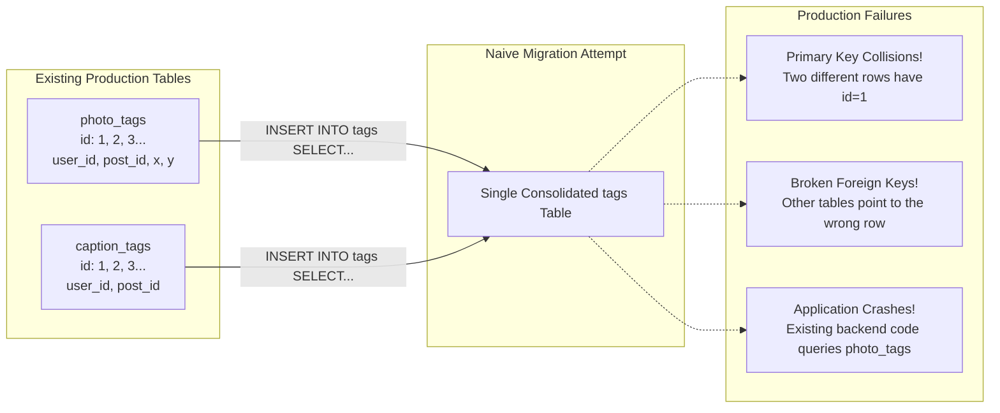

#### How the Physical Merge Looks in SQL

```sql
-- Step 1: Create a unified physical table
CREATE TABLE tags (
  id SERIAL PRIMARY KEY,
  created_at TIMESTAMP WITH TIME ZONE DEFAULT CURRENT_TIMESTAMP,
  updated_at TIMESTAMP WITH TIME ZONE DEFAULT CURRENT_TIMESTAMP,
  user_id INTEGER REFERENCES users(id),
  post_id INTEGER REFERENCES posts(id),
  x INTEGER,
  y INTEGER
);

-- Step 2: Copy rows from photo_tags
INSERT INTO tags (created_at, updated_at, user_id, post_id, x, y)
SELECT created_at, updated_at, user_id, post_id, x, y
FROM photo_tags;

-- Step 3: Copy rows from caption_tags
INSERT INTO tags (created_at, updated_at, user_id, post_id)
SELECT created_at, updated_at, user_id, post_id
FROM caption_tags;

-- Step 4: Drop old tables (DANGEROUS IN PRODUCTION!)
-- DROP TABLE photo_tags;
-- DROP TABLE caption_tags;
```

#### Why This Breaks in Real-World Systems

1. **The ID Collision Dilemma:**
   Both `photo_tags` and `caption_tags` used `SERIAL` (auto-incrementing integer) primary keys. This means `photo_tags` has an `id = 1`, and `caption_tags` ALSO has an `id = 1`.
   - Think of two separate ticket counters at a train station, both handing out ticket numbers starting at 1. If you merge both lines into one room, you now have two people holding Ticket #1.
   - If other tables in your database reference `photo_tags.id` as a foreign key, those foreign key pointers will either break or point to the completely wrong record.
2. **Breaking Existing Application Code:**
   If you drop `photo_tags` and `caption_tags`, any existing backend microservice, API endpoint, or cron job running a query like `SELECT * FROM photo_tags WHERE post_id = $1` will immediately crash with a `relation does not exist` error.

> [!CAUTION]
> In production environments, never hastily drop physical tables. Modifying database tables that are actively written to or referenced by foreign keys requires careful planning, data migrations, and backward compatibility.

### Attempted Fix 2: Virtual Tables with PostgreSQL Views

Instead of moving data around and breaking foreign keys, PostgreSQL gives us an elegant architectural solution: **Database Views**.

#### What is a View? (The Beginner Mental Model)

Think of a **View** as a **saved bookmark or virtual window**:

- It looks like a real table.
- You can query it like a real table (`SELECT * FROM my_view WHERE ...`).
- You can join it with other tables just like a real table.
- **Crucial difference:** It does NOT store any data on disk. It is simply a named query stored in PostgreSQL's catalog. Whenever you run a query against a view, PostgreSQL automatically runs the underlying query behind the scenes.

```text
+---------------------------------------------------------------------------------+
|                         POSTGRESQL VIEW ARCHITECTURE                            |
+---------------------------------------------------------------------------------+
|                                                                                 |
|   Your Backend API or Query:                                                    |
|   SELECT * FROM tags WHERE user_id = 5;                                         |
|                           |                                                     |
|                           v                                                     |
|   +-------------------------------------------------------------------------+   |
|   | The View: "tags" (Virtual Table / Saved Query)                          |   |
|   |                                                                         |   |
|   |   SELECT id, created_at, user_id, post_id, 'photo_tag' AS type          |   |
|   |   FROM photo_tags                                                       |   |
|   |   UNION ALL                                                             |   |
|   |   SELECT id, created_at, user_id, post_id, 'caption_tag' AS type        |   |
|   |   FROM caption_tags                                                     |   |
|   +------------------------------------+------------------------------------+   |
|                                        |                                        |
|                    +-------------------+-------------------+                    |
|                    | On demand, queries original physical tables            |                    |
|                    v                                       v                    |
|        +-----------------------+               +-----------------------+        |
|        | Physical: photo_tags  |               | Physical: caption_tags|        |
|        | (Zero Data Moved)     |               | (Zero Data Moved)     |        |
|        +-----------------------+               +-----------------------+        |
+---------------------------------------------------------------------------------+
```

#### Creating the Unified Tags View

When we create the view, we can also add a helper column called `type`. By adding the literal string `'photo_tag'` and `'caption_tag'`, anyone querying the view can easily tell where the tag originally came from:

```sql
-- Create a virtual view named 'tags' that wraps the UNION ALL logic
CREATE VIEW tags AS (
  SELECT
    id,
    created_at,
    user_id,
    post_id,
    'photo_tag' AS type
  FROM photo_tags
  UNION ALL
  SELECT
    id,
    created_at,
    user_id,
    post_id,
    'caption_tag' AS type
  FROM caption_tags
);
```

#### Expected Output Sample

```text
CREATE VIEW
```

#### Querying the View Just Like a Normal Table

Now you can run standard SQL queries against `tags` as if it were a physical table:

```sql
-- Query the view for caption tags only
SELECT id, user_id, post_id, type
FROM tags
WHERE type = 'caption_tag'
LIMIT 5;
```

#### Expected Output Sample

```text
 id | user_id | post_id |    type
----+---------+---------+-------------
  1 |       4 |      12 | caption_tag
  2 |      19 |      44 | caption_tag
  3 |       2 |      19 | caption_tag
  4 |      31 |      88 | caption_tag
  5 |      14 |      55 | caption_tag
(5 rows)
```

#### Refactoring the Most Popular Users Query

Look at how clean our query becomes now! We no longer need that messy nested subquery. We just join directly against `tags`:

```sql
-- Clean, readable query using our new virtual view
SELECT
  users.username,
  COUNT(*) AS tag_count
FROM users
JOIN tags ON tags.user_id = users.id
GROUP BY users.username
ORDER BY tag_count DESC;
```

#### Expected Output Sample

```text
  username   | tag_count
-------------+-----------
 Bonita96    |        21
 Emilio.Moore|        17
 Kimber_Wild |        16
 Alexandro_G |        14
 Darrick_B   |        12
(5 rows)
```

> [!TIP]
> **Why this is a big win for software teams:**
>
> 1. **Zero disk duplication:** We did not copy or duplicate a single megabyte of data.
> 2. **Zero breaking changes:** Existing services can continue reading and writing to `photo_tags` and `caption_tags`.
> 3. **Clean code:** New services can simply query `tags` and write clean, readable SQL.

### Views vs. Common Table Expressions (CTEs): How to Choose

Earlier, you might have learned about **Common Table Expressions (CTEs)** using the `WITH` keyword. A common question junior engineers ask is:

> _"How is a View different from a CTE? Both let me give a name to a query!"_

Here is the key difference:

```text
+-----------------------------------+---------------------------------------------+
|    Common Table Expression (CTE)  |               PostgreSQL View               |
+-----------------------------------+---------------------------------------------+
| - Scope: One single query         | - Scope: Entire database & all connections  |
| - Like a local variable in code   | - Like a shared library function            |
| - Must be rewritten every time    | - Defined once; used by anyone, anytime     |
| - Disappears immediately after run| - Persists in database catalog until dropped|
+-----------------------------------+---------------------------------------------+
```

#### Example Comparison in Code

```sql
-- CTE approach: Works ONLY for this single query!
-- If another developer wants this data tomorrow, they have to copy-paste this block.
WITH tags_cte AS (
  SELECT user_id FROM photo_tags
  UNION ALL
  SELECT user_id FROM caption_tags
)
SELECT users.username, COUNT(*)
FROM users
JOIN tags_cte ON tags_cte.user_id = users.id
GROUP BY users.username;

-- View approach: Defined once ahead of time!
-- Any developer, API endpoint, or reporting dashboard can run this anytime:
SELECT users.username, COUNT(*)
FROM users
JOIN tags ON tags.user_id = users.id
GROUP BY users.username;
```

**Rule of thumb:**

- Use a **CTE** when you are writing a one-off complex query and want to break it down into readable helper steps.
- Use a **View** when multiple queries, services, or teammates need access to the same combined or transformed dataset over and over again.

### Practical View Pattern: Reusable Query Slices (Recent Posts)

Views aren't just for combining tables with `UNION ALL`. Another popular use case is isolating **frequently used slices of data**.

Imagine your product team is building several features centered around the **10 most recent posts**:

1. Showing who authored the latest posts on the home feed.
2. Displaying how many likes the latest posts received.
3. Listing which users were tagged in the latest posts.
4. Analyzing the hashtags used in the latest posts.
5. Calculating the average comment count on the latest posts.

Without a view, all five features would repeatedly write:
`SELECT * FROM posts ORDER BY created_at DESC LIMIT 10`

#### Creating the `recent_posts` View

Instead of duplicating that logic across 5 backend services, define it once in PostgreSQL:

```sql
-- Create a reusable view that always returns the 10 most recent posts
CREATE VIEW recent_posts AS (
  SELECT *
  FROM posts
  ORDER BY created_at DESC
  LIMIT 10
);
```

#### Expected Output Sample

```text
CREATE VIEW
```

#### Querying Recent Posts with Joins

Now, whenever a backend endpoint needs information about the latest posts and their authors, it's as simple as joining two tables:

```sql
-- Easily join our 10 recent posts view with users to get author names
SELECT
  users.username,
  recent_posts.id AS post_id,
  recent_posts.created_at
FROM recent_posts
JOIN users ON users.id = recent_posts.user_id;
```

#### Expected Output Sample

```text
    username    | post_id |         created_at
----------------+---------+----------------------------
 Rey.Deckow     |     142 | 2019-12-31 18:22:45.102-08
 Vernice_Nienow |     138 | 2019-12-30 09:14:12.301-08
 Laron.Kovacek  |     135 | 2019-12-29 21:05:59.882-08
 Kiarra.Hansen  |     130 | 2019-12-28 11:42:01.449-08
(4 of 10 rows shown)
```

If the definition of a "recent post" ever changes in the future (for example, filtering out archived posts), you update it in **one place** (the view) instead of updating 5 different backend repositories.

### Managing View Lifecycles: Updating and Dropping Views Safely

As software requirements evolve, your views will need to change. PostgreSQL provides straightforward commands for modifying and deleting views.

#### Modifying a View: `CREATE OR REPLACE VIEW`

Suppose product requirements change: the mobile app feed now needs to show the **15 most recent posts** instead of 10.

Instead of deleting the view and recreating it, you can update its definition in-place using `CREATE OR REPLACE VIEW`:

```sql
-- Update the existing recent_posts view to fetch 15 records
CREATE OR REPLACE VIEW recent_posts AS (
  SELECT *
  FROM posts
  ORDER BY created_at DESC
  LIMIT 15
);
```

#### Expected Output Sample

```text
CREATE OR REPLACE VIEW
```

Verify that the view now returns 15 rows:

```sql
-- Check row count of the updated view
SELECT COUNT(*) FROM recent_posts;
```

#### Expected Output Sample

```text
 count
-------
    15
(1 row)
```

> [!NOTE]
> **PostgreSQL Restriction with `CREATE OR REPLACE VIEW`:**
> You can change the query logic and you can append new columns to the end of the output. However, PostgreSQL will not allow you to change the names, data types, or ordering of existing columns using `CREATE OR REPLACE VIEW`. If you need to fundamentally restructure existing columns, you must drop the view first and create it fresh.

#### Deleting a View: `DROP VIEW`

If a view is no longer needed, remove it with `DROP VIEW`:

```sql
-- Delete the view definition
DROP VIEW recent_posts;
```

#### Expected Output Sample

```text
DROP VIEW
```

If you try to query it after dropping, PostgreSQL confirms it is gone:

```sql
SELECT * FROM recent_posts;
```

#### Expected Output Sample

```text
ERROR:  relation "recent_posts" does not exist
LINE 1: SELECT * FROM recent_posts;
                      ^
```

> [!IMPORTANT]
> **Does `DROP VIEW` delete any table data?**
> **No!** Deleting a view is like deleting a shortcut icon on your computer desktop. The underlying physical tables (`posts`, `users`, `photo_tags`, etc.) and all their records remain completely safe and untouched.

### Visualizing Views in pgAdmin 4

Because views are first-class database objects, database administration tools like pgAdmin 4 treat them with equal importance to tables:

1. In the left-hand navigation tree, expand your database.
2. Go to: **Schemas** -> **public** -> **Views**.
3. You will see your created views (`tags`, `recent_posts`) listed right there.
4. **pgAdmin Refresh Tip:** If you run a `CREATE VIEW` or `DROP VIEW` script in the query tool and don't immediately see the changes in the sidebar, right-click on the **Views** folder and select **Refresh**.

### Engineering Trade-off Matrix: Physical Tables vs. CTEs vs. Views

To help you decide which approach to use when designing software systems, here is how the three strategies compare:

| Consideration              | Physical Table Consolidation                                | Common Table Expression (CTE)                       | PostgreSQL View (`CREATE VIEW`)                      |
| :------------------------- | :---------------------------------------------------------- | :-------------------------------------------------- | :--------------------------------------------------- |
| **Disk Space**             | Duplicates disk storage or requires risky data migrations   | Zero disk space (computed on the fly)               | Zero disk space (stored query metadata only)         |
| **Data Freshness**         | Must sync changes between tables via triggers or batch jobs | Always 100% real-time from source tables            | Always 100% real-time from source tables             |
| **Primary & Foreign Keys** | High risk of ID collisions and breaking existing FKs        | Underlying keys remain intact and unchanged         | Fully non-destructive; underlying keys remain intact |
| **Code Reusability**       | Creates a single table, breaks existing queries             | Limited to one single query execution               | Shared across the entire codebase and all users      |
| **Maintenance Impact**     | High risk, complex migration script required                | Medium; logic is duplicated across multiple queries | Low; centralized definition in the database          |

### Interactive Knowledge Check

Test your understanding of PostgreSQL views with these review questions:

<details>
<summary><b>Question 1: Why must we use `UNION ALL` instead of `UNION` when combining `photo_tags` and `caption_tags` to calculate user popularity?</b></summary><br>
<b>Answer:</b> Standard `UNION` automatically eliminates duplicate rows. If a user was tagged 10 times in photos and 5 times in captions, `UNION` would collapse identical user IDs down to a single row, reporting a count of 1 instead of 15. `UNION ALL` retains every single tag row, allowing `COUNT(*)` to calculate the true popularity.
</details>

<details>
<summary><b>Question 2: Why would physically merging two tables that both use `SERIAL` primary keys cause problems for other tables in the database?</b></summary><br>
<b>Answer:</b> Both tables independently generate auto-incrementing IDs starting from 1 (e.g. Photo Tag #1 and Caption Tag #1). Copying them into one table creates ID collisions unless new IDs are generated. If other tables have foreign keys pointing to the original IDs, those relationships will break or point to the wrong row.
</details>

<details>
<summary><b>Question 3: If both a CTE (`WITH ... AS`) and a View (`CREATE VIEW ... AS`) allow you to name a query, when should you choose a View?</b></summary><br>
<b>Answer:</b> Choose a View when the query logic needs to be reused across multiple queries, different backend services, or multiple developers. A CTE is strictly local and disappears as soon as that single SQL query finishes executing, whereas a View is saved permanently in the database catalog.
</details>

<details>
<summary><b>Question 4: What happens to the underlying rows in `posts` when a developer runs `DROP VIEW recent_posts;`?</b></summary><br>
<b>Answer:</b> Absolutely nothing happens to the data. A view is simply a stored query definition in the database catalog with no physical data of its own. Dropping the view deletes the virtual wrapper, while the underlying physical table and its rows remain 100% intact.
</details>

## Materialized Views and Query Caching

### Conceptual Overview: Standard Views vs. Materialized Views

In PostgreSQL, a **View** is essentially a query that we package up so we can refer back to it in the future. However, whenever we query a standard view, PostgreSQL executes the underlying query stored inside it every single time.

A **Materialized View** is a variation on a view that solves the problem of expensive queries:

- It packages an underlying query, but executes it only at specific times.
- PostgreSQL takes the query results, saves them on disk, and lets us refer back to those saved results without rerunning the query.
- It is designed for expensive queries that take multiple seconds, minutes, or even hours to run.

```text
STANDARD VIEW (Virtual Query):
Client Query ──> [ View Definition ] ──> Re-runs Query ──> Base Tables ──> Results
(Re-executes the query on every request; heavy runtime on large tables)

MATERIALIZED VIEW (Saved Result Set):
1. Creation / Refresh:
   Underlying Query ──> Scans Base Tables ──> Saves Results to Disk

2. Client Query:
   Client Query ──> [ Saved Results on Disk ] ──> Results
   (Reads precomputed results directly; runs in milliseconds without re-running the query)
```

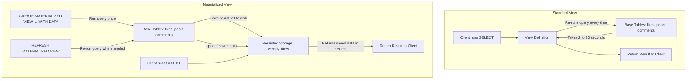

> [!NOTE]
> **Parallel with Common Table Expressions (CTEs):**
> There is a direct parallel here to the world of CTEs:
>
> - **Simple CTEs and Standard Views** are convenience tools that make queries easier to read and organize.
> - **Recursive CTEs and Materialized Views** add major functionality that allows us to perform operations we otherwise could not do.

### The Analytical Problem: Aggregating Weekly Engagement Across Posts and Comments

Consider an application with three tables: `posts`, `comments`, and `likes`.

In this schema, users can like either a post or a comment:

- A like for a post has `post_id` populated, and `comment_id` is `NULL`.
- A like for a comment has `comment_id` populated, and `post_id` is `NULL`.

#### Goal of the Query

1. Show every sequential week of the application, starting from the date of the very first post up to the last post.
2. Assign each post and comment to the **week it was created**.
3. For each week, count the **number of likes that posts received** and the **number of likes that comments received**.

Notice that likes are grouped by when the _post or comment was created_, not when the like itself was added.

```text
Timeline:
2010-01-01 (Week 1)                        2010-01-08 (Week 2)
├──────────────────────────────────────────┼──────────────────────────────────────────┤
│ Content created this week:               │ Content created this week:               │
│  - Posts: Post 1, Post 2                 │  - Posts: None                           │
│  - Comments: Comment 1                   │  - Comments: Comment 2, Comment 3        │
│                                          │                                          │
│ Likes assigned to this content:          │ Likes assigned to this content:          │
│  - Post 2 receives 3 likes               │  - Comment 2 receives 1 like             │
│  - Comment 1 receives 1 like             │  - Comment 3 receives 1 like             │
│                                          │                                          │
│ Tabulated Output:                        │ Tabulated Output:                        │
│  week: 2010-01-01                        │  week: 2010-01-08                        │
│  likes_for_posts: 3                      │  likes_for_posts: 0                      │
│  likes_for_comments: 1                   │  likes_for_comments: 2                   │
```

### Preserving Disjoint Records with Multi-Table LEFT JOINs

To combine likes, posts, and comments into a single dataset, we must perform a three-way join starting from `likes`.

#### The Inner Join Pitfall

By default, writing `JOIN` implies an `INNER JOIN`. An inner join only retains rows that find matching records across all joined tables.

Because every row in `likes` has either `post_id` as `NULL` or `comment_id` as `NULL`, no single row matches both `posts` and `comments` at the same time:

```sql
-- PITFALL: Running an inner join produces an empty result set!
SELECT *
FROM likes
JOIN posts ON posts.id = likes.post_id
JOIN comments ON comments.id = likes.comment_id;
```

```text
Expected Output:
(0 rows)
```

If an analytical query returns completely empty results, check the join type. An inner join drops rows whenever an association is absent.

#### Why We Use LEFT JOIN

A `LEFT JOIN` ensures all rows from the left-hand table (`likes`) are retained. If there is no corresponding row in `posts` or `comments`, PostgreSQL fills those columns with `NULL`:

```text
likes table:
+----+---------+------------+
| id | post_id | comment_id |
+----+---------+------------+
| 1  | 2       | NULL       | ──> Matches post 2       ──> comment columns are NULL
| 2  | NULL    | 3          | ──> post columns are NULL ──> Matches comment 3
| 3  | NULL    | 2          | ──> post columns are NULL ──> Matches comment 2
| 4  | 2       | NULL       | ──> Matches post 2       ──> comment columns are NULL
| 5  | 2       | NULL       | ──> Matches post 2       ──> comment columns are NULL
| 6  | NULL    | 1          | ──> post columns are NULL ──> Matches comment 1
+----+---------+------------+
```

```sql
-- Three-way LEFT JOIN preserves all likes
SELECT *
FROM likes
LEFT JOIN posts ON posts.id = likes.post_id
LEFT JOIN comments ON comments.id = likes.comment_id;
```

```text
Expected Output (Sample Rows):
 id |     created_at      | user_id | post_id | comment_id | id |     created_at      | url     | user_id | id |     created_at      | contents | user_id | post_id
----+---------------------+---------+---------+------------+----+---------------------+---------+---------+----+---------------------+----------+---------+---------
  1 | 2010-02-15 08:12:00 |      14 |       2 |            |  2 | 2010-01-11 14:22:00 | img.jpg |       5 |    |                     |          |         |
  2 | 2010-02-18 10:45:00 |       8 |         |          3 |    |                     |         |         |  3 | 2010-01-18 09:15:00 | nice!    |      12 |       1
  3 | 2010-02-19 12:00:00 |      21 |         |          2 |    |                     |         |         |  2 | 2010-01-18 11:30:00 | cool pic |       4 |       1
(3 rows shown)
```

### Time-Bucket Aggregations: Using date_trunc and COALESCE

After joining, each row has a timestamp from either `posts.created_at` or `comments.created_at`. We must extract that timestamp and bucket it into calendar weeks.

#### Handling NULLs with COALESCE

Since one of the two `created_at` values is always `NULL`, we pass them into `COALESCE`:

```sql
COALESCE(posts.created_at, comments.created_at)
```

`COALESCE` takes a list of arguments and returns the first argument that is not `NULL`. If `posts.created_at` is defined, it uses that; otherwise, it falls back to `comments.created_at`.

#### Rounding Down with date_trunc

To group timestamps into weeks, we use PostgreSQL's built-in `date_trunc` function:

```sql
date_trunc('week', COALESCE(posts.created_at, comments.created_at)) AS week
```

`date_trunc` extracts a specific interval from a timestamp and automatically rounds it down to the beginning of that unit. Passing `'week'` rounds the timestamp down to the start of that week (Monday at 00:00:00).

```sql
SELECT
    date_trunc('week', COALESCE(posts.created_at, comments.created_at)) AS week
FROM likes
LEFT JOIN posts ON posts.id = likes.post_id
LEFT JOIN comments ON comments.id = likes.comment_id
ORDER BY week;
```

```text
Expected Output:
          week
------------------------
 2010-01-11 00:00:00+00
 2010-01-11 00:00:00+00
 2010-01-18 00:00:00+00
 2010-01-25 00:00:00+00
(4 rows shown)
```

### Constructing the Full Analytical Query

Next, we add `GROUP BY week` and count the likes for posts and comments.

#### How COUNT Ignores NULL Values

In SQL, `COUNT(column_name)` counts only non-null values:

- `COUNT(posts.id)` counts rows where a post was liked (ignoring rows where `posts.id` is `NULL`).
- `COUNT(comments.id)` counts rows where a comment was liked (ignoring rows where `comments.id` is `NULL`).

We alias these columns as `likes_for_posts` and `likes_for_comments` to clearly describe the metric:

```sql
SELECT
    date_trunc('week', COALESCE(posts.created_at, comments.created_at)) AS week,
    COUNT(posts.id) AS likes_for_posts,
    COUNT(comments.id) AS likes_for_comments
FROM likes
LEFT JOIN posts ON posts.id = likes.post_id
LEFT JOIN comments ON comments.id = likes.comment_id
GROUP BY week
ORDER BY week;
```

```text
Expected Output:
          week          | likes_for_posts | likes_for_comments
------------------------+-----------------+--------------------
 2010-01-11 00:00:00+00 |              29 |                  0
 2010-01-18 00:00:00+00 |              31 |                  3
 2010-01-25 00:00:00+00 |              45 |                 12
 2010-02-01 00:00:00+00 |              50 |                 19
(4 rows shown)
```

#### Why This Query Is Slow

This query scans multiple large tables, evaluates joins and date functions on every row, and performs group-by aggregations.

On modern computers, this query takes **2 to 3 seconds** to run; on older hardware or larger datasets, it can easily take **10 to 30 seconds**. Running a query this slow repeatedly would place an unacceptable load on the database.

### Creating and Querying the Materialized View

To avoid rerunning this expensive query every time, we save its output in a materialized view.

#### Syntax: CREATE MATERIALIZED VIEW

Wrap the query inside parentheses, name the view `weekly_likes`, and append `WITH DATA`:

```sql
CREATE MATERIALIZED VIEW weekly_likes AS (
    SELECT
        date_trunc('week', COALESCE(posts.created_at, comments.created_at)) AS week,
        COUNT(posts.id) AS likes_for_posts,
        COUNT(comments.id) AS likes_for_comments
    FROM likes
    LEFT JOIN posts ON posts.id = likes.post_id
    LEFT JOIN comments ON comments.id = likes.comment_id
    GROUP BY week
    ORDER BY week
) WITH DATA;
```

```text
Expected Output:
SELECT 48
Query returned successfully in 2.84 secs.
```

> [!IMPORTANT]
>
> - **`WITH DATA`:** Instructs PostgreSQL to immediately execute the query one time and save the results when creating the materialized view.
> - **Semicolon Placement:** Place the semicolon outside the closing parenthesis, not inside.

#### Querying the Saved Results

We can now query `weekly_likes` just like a regular table:

```sql
SELECT * FROM weekly_likes;
```

```text
Expected Output:
          week          | likes_for_posts | likes_for_comments
------------------------+-----------------+--------------------
 2010-01-11 00:00:00+00 |              29 |                  0
 2010-01-18 00:00:00+00 |              31 |                  3
 2010-01-25 00:00:00+00 |              45 |                 12
 2010-02-01 00:00:00+00 |              50 |                 19
Query returned successfully in 59 ms.
```

Execution speed drops from **2 to 3 seconds down to 59 milliseconds** because PostgreSQL reads precomputed results directly from disk without re-executing the heavy query. We can also filter, sort, or select specific columns from it freely.

### Managing Data Staleness and Refreshing

The primary trade-off of a materialized view is that it does **not** automatically update when the underlying data changes.

#### Demonstrating Stale Data

If we delete all posts created during January 2010:

```sql
DELETE FROM posts
WHERE created_at < '2010-02-01';
```

```text
Expected Output:
DELETE 60
```

When we query `weekly_likes` again, the January weeks and like counts still appear:

```sql
SELECT * FROM weekly_likes;
```

```text
Expected Output (Stale Results):
          week          | likes_for_posts | likes_for_comments
------------------------+-----------------+--------------------
 2010-01-11 00:00:00+00 |              29 |                  0
 2010-01-18 00:00:00+00 |              31 |                  3
```

Because the underlying data changed, PostgreSQL is now returning saved results that are out of date.

#### Updating with REFRESH MATERIALIZED VIEW

To update the saved results, we tell PostgreSQL to rerun the underlying query and save the new output:

```sql
REFRESH MATERIALIZED VIEW weekly_likes;
```

```text
Expected Output:
REFRESH MATERIALIZED VIEW
Query returned successfully in 2.15 secs.
```

Now, querying `weekly_likes` returns the updated data without the deleted January records:

```sql
SELECT * FROM weekly_likes;
```

```text
Expected Output (Updated Results):
          week          | likes_for_posts | likes_for_comments
------------------------+-----------------+--------------------
 2010-02-01 00:00:00+00 |              50 |                 19
 2010-02-08 00:00:00+00 |              62 |                 28
```

```mermaid
sequenceDiagram
    autonumber
    participant App as Application
    participant MV as Materialized View (weekly_likes)
    participant DB as Postgres Base Tables

    Note over App,DB: Initial Creation
    App->>DB: CREATE MATERIALIZED VIEW weekly_likes ... WITH DATA
    DB->>DB: Runs query and saves result set to disk

    Note over App,DB: Fast Reads
    App->>MV: SELECT * FROM weekly_likes
    MV-->>App: Returns saved results (~59ms)

    Note over App,DB: Underlying Data Changes
    App->>DB: DELETE FROM posts WHERE created_at is in January
    App->>MV: SELECT * FROM weekly_likes
    MV-->>App: Returns out-of-date results (cache not updated)

    Note over App,DB: Refreshing Cache
    App->>DB: REFRESH MATERIALIZED VIEW weekly_likes
    DB->>DB: Re-runs query and updates saved results
    App->>MV: SELECT * FROM weekly_likes
    MV-->>App: Returns updated results
```

### When to Use Materialized Views

Because materialized views require manual refreshing, they are best suited for calculating values that do **not change very often**.

Weekly like aggregations are an ideal use case:

- Once a week passes, its historical post and comment counts rarely change.
- The view does not need to be refreshed continuously; refreshing it once a day, once an hour, or once a week is often sufficient.

#### Comparison of Approaches

| Approach                                                    | Execution Behavior                       | Query Speed                                              | Data Freshness                 | When to Use                                                                  |
| :---------------------------------------------------------- | :--------------------------------------- | :------------------------------------------------------- | :----------------------------- | :--------------------------------------------------------------------------- |
| **Direct Query / Standard View**                            | Reruns query on every call               | Slow (2–30s)                                             | Always 100% current            | Data that changes constantly or simple queries.                              |
| **Adding Indexes (on `likes.post_id`, `likes.comment_id`)** | Speeds up join operations on base tables | Faster than unindexed, but still recalculates aggregates | Always 100% current            | When query speed must improve while retaining real-time data accuracy.       |
| **Materialized View**                                       | Runs query once; saves results to disk   | Very fast (~59ms)                                        | Stale until manually refreshed | Heavy analytical reports and historical aggregates that change infrequently. |

### Review Quiz

<details><summary><b>Question 1: Why does using INNER JOIN instead of LEFT JOIN return zero rows when querying likes?</b></summary><br><b>Answer:</b> Each like record is associated with either a post or a comment, meaning one foreign key is always <code>NULL</code>. An <code>INNER JOIN</code> requires matching records across all joined tables simultaneously. Because no like belongs to both a post and a comment at the same time, an inner join eliminates every row. A <code>LEFT JOIN</code> keeps all rows from <code>likes</code> and inserts <code>NULL</code> for unmatched columns.</details>

<details><summary><b>Question 2: What is the main difference between a standard View and a Materialized View?</b></summary><br><b>Answer:</b> A standard view does not store data on disk; it re-executes its underlying query every time it is queried. A materialized view executes its query and persists the result set on disk, allowing subsequent reads to return precomputed data in milliseconds without rerunning the query.</details>

<details><summary><b>Question 3: What does the WITH DATA clause do when creating a materialized view?</b></summary><br><b>Answer:</b> <code>WITH DATA</code> tells PostgreSQL to execute the query immediately upon creation and populate the materialized view with data so it is ready to be queried.</details>

<details><summary><b>Question 4: What happens to a materialized view when underlying records are deleted, and how do you fix it?</b></summary><br><b>Answer:</b> The materialized view does not automatically update; it continues to serve the old saved results (stale data). To synchronize it with the base tables, you must run <code>REFRESH MATERIALIZED VIEW [view_name];</code> to re-run the query and update the saved data.</details>
