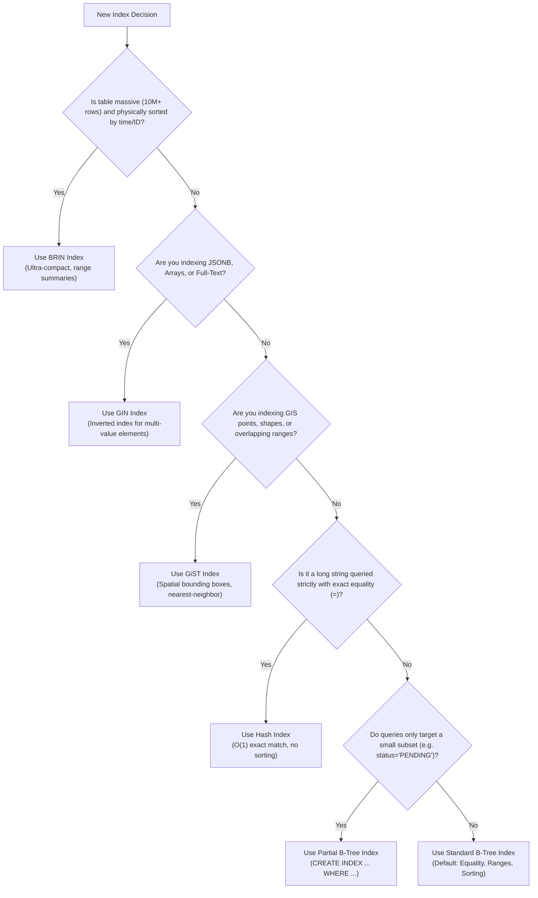

# PostgreSQL Index Types: Architectural Guide and Decision Framework

Indexes speed up query performance in PostgreSQL by allowing the database engine to locate target rows directly without scanning an entire table from disk (a full sequential scan).

However, PostgreSQL provides several specialized index types. Choosing the wrong index type can waste disk space, degrade write performance, or be completely ignored by the query planner.

- [PostgreSQL Index Types: Architectural Guide and Decision Framework](#postgresql-index-types-architectural-guide-and-decision-framework)
   * [B-Tree Indexes (Balanced Tree)](#b-tree-indexes-balanced-tree)
      + [The Real-World Analogy](#the-real-world-analogy)
      + [How B-Trees Work Internally](#how-b-trees-work-internally)
      + [Supported Operators](#supported-operators)
      + [Practical Code Example](#practical-code-example)
         - [Exact Match Lookup](#exact-match-lookup)
         - [Range and Sorting Lookup](#range-and-sorting-lookup)
      + [When to Choose B-Tree](#when-to-choose-b-tree)
   * [Hash Indexes](#hash-indexes)
      + [The Real-World Analogy](#the-real-world-analogy-1)
      + [How Hash Indexes Work Internally](#how-hash-indexes-work-internally)
      + [Supported Operators](#supported-operators-1)
      + [Practical Code Example](#practical-code-example-1)
         - [Query: Exact Equality](#query-exact-equality)
      + [When to Choose Hash Indexes](#when-to-choose-hash-indexes)
   * [GiST Indexes (Generalized Search Tree)](#gist-indexes-generalized-search-tree)
      + [The Real-World Analogy](#the-real-world-analogy-2)
      + [How GiST Indexes Work Internally](#how-gist-indexes-work-internally)
      + [Supported Operators](#supported-operators-2)
      + [Practical Code Example](#practical-code-example-2)
         - [Nearest Neighbor Search (k-NN)](#nearest-neighbor-search-k-nn)
         - [Preventing Double Bookings (Exclusion Constraint)](#preventing-double-bookings-exclusion-constraint)
      + [When to Choose GiST](#when-to-choose-gist)
   * [GIN Indexes (Generalized Inverted Index)](#gin-indexes-generalized-inverted-index)
      + [The Real-World Analogy](#the-real-world-analogy-3)
      + [How GIN Indexes Work Internally](#how-gin-indexes-work-internally)
      + [Supported Operators](#supported-operators-3)
      + [Practical Code Example](#practical-code-example-3)
         - [Array Containment Search](#array-containment-search)
         - [JSONB Path Filtering](#jsonb-path-filtering)
      + [When to Choose GIN](#when-to-choose-gin)
   * [BRIN Indexes (Block Range Index)](#brin-indexes-block-range-index)
      + [The Real-World Analogy](#the-real-world-analogy-4)
      + [How BRIN Indexes Work Internally](#how-brin-indexes-work-internally)
      + [Supported Operators](#supported-operators-4)
      + [Practical Code Example](#practical-code-example-4)
         - [Comparing Storage Size: B-Tree vs. BRIN](#comparing-storage-size-b-tree-vs-brin)
         - [Query: Date Range Scan](#query-date-range-scan)
      + [When to Choose BRIN](#when-to-choose-brin)
   * [Advanced Indexing Strategies](#advanced-indexing-strategies)
      + [Multicolumn Indexes (Composite B-Tree)](#multicolumn-indexes-composite-b-tree)
         - [The Real-World Analogy](#the-real-world-analogy-5)
      + [Partial Indexes](#partial-indexes)
         - [The Real-World Analogy](#the-real-world-analogy-6)
      + [Expression / Functional Indexes](#expression-functional-indexes)
         - [The Real-World Analogy](#the-real-world-analogy-7)
   * [When NOT to Add an Index (Anti-Patterns and Traps)](#when-not-to-add-an-index-anti-patterns-and-traps)
      + [Avoid Adding an Index in These Scenarios:](#avoid-adding-an-index-in-these-scenarios)
   * [Decision Flowchart: Which Index Should You Choose?](#decision-flowchart-which-index-should-you-choose)
   * [Master Index Comparison Table](#master-index-comparison-table)


## B-Tree Indexes (Balanced Tree)

### The Real-World Analogy

> **Analogy:** _A printed phone directory or dictionary._
>
> Words are arranged alphabetically in balanced alphabetical sections. If you want to find "Smith", you jump to the middle ("M"), see that "S" comes after, jump forward, and narrow it down in a few quick flips.
> Because words are sorted, it works equally well for:
>
> 1. An exact lookup: `"Find 'Smith, John'"`
> 2. A range search: `"Find everyone whose last name is between 'Miller' and 'Nelson'"`

### How B-Trees Work Internally

A B-Tree (Balanced Tree) index organizes column values in a multi-level hierarchical tree structure. All leaf nodes reside at the exact same depth from the root, guaranteeing predictable $O(\log N)$ search time.

```text
+--------------------------------------------------------------------------+
|                        B-TREE INTERNAL STRUCTURE                         |
+--------------------------------------------------------------------------+
|                              [ ROOT NODE ]                               |
|                              | Keys: 20, 50 |                            |
|                             /       |       \                            |
|               ┌────────────┘        |        └────────────┐              |
|               v                     v                     v              |
|      [ INTERNAL NODE ]      [ INTERNAL NODE ]      [ INTERNAL NODE ]     |
|      | Keys: 5, 10, 15 |    | Keys: 30, 40 |       | Keys: 60, 70, 80 |  |
|         /    |    \                                                      |
|        v     v     v                                                     |
|      [ LEAF PAGE ] <─────── Doubly-Linked Pointers ───────> [ LEAF PAGE ]|
|   ┌───────────────────┐                                 ┌───────────────┐|
|   │ Key: 5  -> Row TID│                                 │ Key: 20 -> TID│|
|   │ Key: 10 -> Row TID│                                 │ Key: 30 -> TID│|
|   └───────────────────┘                                 └───────────────┘|
|             │                                                            |
|             └─────── Points directly to Physical Heap Disk Page ─────────┘|
+--------------------------------------------------------------------------+
```

### Supported Operators

B-Tree indexes support any data type that can be sorted into a deterministic order using the standard comparison operators:

- Equality: `=`, `IN`
- Range comparisons: `<`, `<=`, `>`, `>=`
- Pattern prefixes: `LIKE 'prefix%'`, `ILIKE 'prefix%'` (with appropriate collation)
- Sorting: `ORDER BY col ASC/DESC`
- Null lookups: `IS NULL`, `IS NOT NULL`

### Practical Code Example

```sql
CREATE TABLE users (
    id BIGINT GENERATED ALWAYS AS IDENTITY PRIMARY KEY,
    username VARCHAR(50) NOT NULL,
    email VARCHAR(100) NOT NULL,
    created_at TIMESTAMPTZ DEFAULT CURRENT_TIMESTAMP
);

-- B-Tree is the default index type in PostgreSQL (USING btree is optional):
CREATE INDEX idx_users_username ON users USING btree (username);
CREATE INDEX idx_users_created_at ON users (created_at);

-- Populate sample data:
INSERT INTO users (username, email, created_at)
SELECT
    'user_' || seq,
    'user_' || seq || '@example.com',
    CURRENT_TIMESTAMP - (seq || ' minutes')::interval
FROM generate_series(1, 10000) AS seq;
```

#### Exact Match Lookup

```sql
EXPLAIN ANALYZE
SELECT * FROM users WHERE username = 'user_4200';
```

**Output:**

```text
Index Scan using idx_users_username on users  (cost=0.29..8.30 rows=1 width=57) (actual time=0.038..0.039 rows=1 loops=1)
  Index Cond: ((username)::text = 'user_4200'::text)
Planning Time: 0.125 ms
Execution Time: 0.054 ms
```

#### Range and Sorting Lookup

```sql
EXPLAIN ANALYZE
SELECT id, username, created_at
FROM users
WHERE created_at >= CURRENT_TIMESTAMP - interval '2 hours'
ORDER BY created_at DESC;
```

**Output:**

```text
Index Scan Backward using idx_users_created_at on users  (cost=0.29..14.35 rows=120 width=36) (actual time=0.021..0.045 rows=120 loops=1)
  Index Cond: (created_at >= (CURRENT_TIMESTAMP - '02:00:00'::interval))
Planning Time: 0.110 ms
Execution Time: 0.065 ms
```

### When to Choose B-Tree

- **Default choice:** Use for 95% of standard primary keys, foreign keys, status columns, names, dates, and timestamps.
- Whenever queries require inequality (`<`, `>`, `<=`, `>=`), `BETWEEN`, or `ORDER BY`.

## Hash Indexes

### The Real-World Analogy

> **Analogy:** _A gym coat check with numbered cubbies._
>
> You hand over your coat (email address), a function computes your cubby number (cubby #42), and the clerk hands you ticket #42.
> When you return, the clerk doesn't search through any coats; they walk directly to cubby #42 in $O(1)$ constant time.
> **The Catch:** If you ask the clerk: _"Give me all coats between cubby #40 and #50"_, they cannot help you because coats are scattered randomly by their hash number, not organized alphabetically or chronologically.

### How Hash Indexes Work Internally

A Hash index runs the column's value through an internal 32-bit hash function, maps the resulting hash value to a bucket, and stores a pointer to the physical row.

```text
+--------------------------------------------------------------------------+
|                       HASH INDEX LOOKUP MECHANISM                        |
+--------------------------------------------------------------------------+
|  Input Value: "john@example.com"                                         |
|         │                                                                |
|         v                                                                |
|  [ Hash Function ] ──> Hash Code: 0x8F3A129D                             |
|                              │                                           |
|                              v                                           |
|  [ Bucket Directory ] ──> Bucket #142                                    |
|                              │                                           |
|                              v                                           |
|  [ Bucket Page #142 ] ──> Stores: { Hash: 0x8F3A129D, TID: (Page 4, Item 2) }
|                              │                                           |
|                              v                                           |
|  [ Table Heap ]      ──> Row retrieved directly in O(1) time!            |
+--------------------------------------------------------------------------+
```

### Supported Operators

- **Equality only:** `=`
- **Unsupported:** `<`, `>`, `<=`, `>=`, `BETWEEN`, `ORDER BY`, `LIKE 'prefix%'`.

### Practical Code Example

```sql
-- Create a Hash index explicitly on the email column:
CREATE INDEX idx_users_email_hash ON users USING hash (email);
```

#### Query: Exact Equality

```sql
EXPLAIN ANALYZE
SELECT id, username, email
FROM users
WHERE email = 'user_500@example.com';
```

**Output:**

```text
Index Scan using idx_users_email_hash on users  (cost=0.00..8.02 rows=1 width=57) (actual time=0.015..0.016 rows=1 loops=1)
  Index Cond: ((email)::text = 'user_500@example.com'::text)
Planning Time: 0.082 ms
Execution Time: 0.029 ms
```

### When to Choose Hash Indexes

- **Long strings with exact equality searches:** Long URLs, UUIDs (as text), cryptographic signatures, or API access keys where queries **only ever do exact `=` comparisons**.
- **Smaller index footprint on long strings:** A B-Tree index stores the full string in the index page; a Hash index only stores the 4-byte hash code, saving significant RAM for long keys.
- **Never choose Hash indexes** if you ever need `ORDER BY`, range scans, prefix pattern matching, or multi-column composite indexing.

## GiST Indexes (Generalized Search Tree)

### The Real-World Analogy

> **Analogy:** _Nested Russian Matryoshka dolls or zooming into a map._
>
> "Is the restaurant you are looking for in North America? Yes. Inside the USA? Yes. Inside New York State? Yes. Inside Manhattan? Yes."
> Instead of ordering items along a 1-dimensional line (like numbers 1, 2, 3), GiST organizes multidimensional geometric shapes, GPS points, network IP subnets, and date ranges into **overlapping bounding boxes**.

### How GiST Indexes Work Internally

A GiST index is a tree where each node represents a bounding box (or geometric bounding area). Every child node represents a smaller area completely contained within the parent's area.

```text
+--------------------------------------------------------------------------+
|                     GiST BOUNDING BOX HIERARCHY                          |
+--------------------------------------------------------------------------+
|  ROOT BOX [World / Entire City]                                          |
|  ┌────────────────────────────────────────────────────────────────────┐  |
|  │  CHILD BOX A [Manhattan]             CHILD BOX B [Brooklyn]        │  |
|  │  ┌──────────────────────────────┐    ┌──────────────────────────┐  │  |
|  │  │ Point 1 (Times Square)       │    │ Point 3 (Prospect Park)  │  │  |
|  │  │ Point 2 (Empire State)       │    │ Point 4 (DUMBO)          │  │  |
|  │  └──────────────────────────────┘    └──────────────────────────┘  │  |
|  └────────────────────────────────────────────────────────────────────┘  |
|                                                                          |
|  Query: "Find points within 1 km of Central Park"                        |
|  GiST checks: Does the search circle overlap Box A? YES. Overlap Box B? NO|
|  PostgreSQL completely discards Box B without inspecting any rows!       |
+--------------------------------------------------------------------------+
```

### Supported Operators

- **Geometric / Spatial:** Overlaps (`&&`), Strictly Left (`<<`), Strictly Right (`>>`), Contains (`@>`), Contained By (`<@`)
- **Nearest Neighbor (k-NN distance):** `<->` (Find closest points ordered by distance)
- **Range Types:** Overlaps (`&&`), Adjacent (`-|-`), Contains (`@>`)
- **Exclusion Constraints:** `EXCLUDE USING gist (...)` to prevent double-booking room reservations.

### Practical Code Example

```sql
-- Enable PostGIS for geospatial coordinates (or use native geometric types):
CREATE TABLE restaurant_locations (
    id BIGINT GENERATED ALWAYS AS IDENTITY PRIMARY KEY,
    name TEXT NOT NULL,
    coordinates POINT NOT NULL
);

-- Create GiST index on 2D coordinates:
CREATE INDEX idx_restaurants_geo ON restaurant_locations USING gist (coordinates);

-- Insert sample coordinate points (x = longitude, y = latitude):
INSERT INTO restaurant_locations (name, coordinates) VALUES
    ('Downtown Diner', POINT(40.7128, -74.0060)),
    ('Uptown Bistro',  POINT(40.7829, -73.9654)),
    ('Brooklyn Pizza', POINT(40.6782, -73.9442));
```

#### Nearest Neighbor Search (k-NN)

```sql
-- Find the 2 closest restaurants to coordinate (40.7100, -74.0000):
EXPLAIN ANALYZE
SELECT name, coordinates <-> POINT(40.7100, -74.0000) AS distance
FROM restaurant_locations
ORDER BY coordinates <-> POINT(40.7100, -74.0000)
LIMIT 2;
```

**Output:**

```text
Limit  (cost=0.15..0.28 rows=2 width=44) (actual time=0.035..0.038 rows=2 loops=1)
  ->  Index Scan using idx_restaurants_geo on restaurant_locations  (cost=0.15..0.35 rows=3 width=44) (actual time=0.034..0.036 rows=2 loops=1)
        Order By: (coordinates <-> '(40.71,-74)'::point)
Planning Time: 0.089 ms
Execution Time: 0.052 ms
```

#### Preventing Double Bookings (Exclusion Constraint)

```sql
CREATE EXTENSION IF NOT EXISTS btree_gist;

CREATE TABLE hotel_reservations (
    room_number INT NOT NULL,
    booking_period TSRANGE NOT NULL,
    -- Prevent overlapping bookings for the exact same room:
    EXCLUDE USING gist (room_number WITH =, booking_period WITH &&)
);
```

### When to Choose GiST

- **Geographic Information Systems (GIS):** GPS points, polygons, lines, routes, and boundary areas.
- **Nearest-Neighbor searches:** "Find the 5 closest drivers to this rider" (`ORDER BY geo <-> target LIMIT 5`).
- **Date/Time Range Overlaps:** Checking if date ranges collide using PostgreSQL `tsrange` or `daterange`.

## GIN Indexes (Generalized Inverted Index)

### The Real-World Analogy

> **Analogy:** _The index at the very back of a thick textbook._
>
> Instead of reading through 500 pages to find where "PostgreSQL" is mentioned, you turn to the back of the book under the letter "P":
>
> - `PostgreSQL`: Pages 12, 45, 180, 320
> - `Index`: Pages 45, 60, 95
>
> A regular database index points **Row ➔ Value**.
> An **Inverted Index** reverses this: it points **Each Individual Keyword/Element ➔ List of Rows that contain it**.

### How GIN Indexes Work Internally

A GIN index splits every composite item (arrays, JSONB documents, or text paragraphs) into individual component elements, stores those elements in a sorted B-Tree, and attaches a posting list of matching row IDs to each element.

```text
+--------------------------------------------------------------------------+
|                  GIN INVERTED INDEX INTERNAL ARCHITECTURE                |
+--------------------------------------------------------------------------+
|  TABLE DATA:                                                             |
|  Row #1: tags = ['electronics', 'mobile']                                |
|  Row #2: tags = ['electronics', 'laptop']                                |
|  Row #3: tags = ['audio', 'accessories']                                 |
|                                                                          |
|  GIN INVERTED INDEX (Posting Lists):                                     |
|  ┌──────────────────┬─────────────────────────────────────────────────┐  |
|  │ ELEMENT (KEY)    │ POSTING LIST (ROW IDs)                          │  |
|  ├──────────────────┼─────────────────────────────────────────────────┤  |
|  │ 'accessories'    │ ──> [ Row 3 ]                                   │  |
|  │ 'audio'          │ ──> [ Row 3 ]                                   │  |
|  │ 'electronics'    │ ──> [ Row 1, Row 2 ]                            │  |
|  │ 'laptop'         │ ──> [ Row 2 ]                                   │  |
|  │ 'mobile'         │ ──> [ Row 1 ]                                   │  |
|  └──────────────────┴─────────────────────────────────────────────────┘  |
|                                                                          |
|  Query: WHERE tags @> ARRAY['electronics', 'mobile']                     |
|  GIN takes list for 'electronics' [1, 2] and intersects it with          |
|  list for 'mobile' [1] ──> Match = Row 1 in microseconds!                |
+--------------------------------------------------------------------------+
```

### Supported Operators

- **Arrays:** Contains (`@>`), Contained by (`<@`), Overlaps / Any (`&&`), Equals (`=`)
- **JSONB:** Key exists (`?`), Any key exists (`?|`), All keys exist (`?&`), Contains JSON path (`@>`)
- **Full-Text Search:** Match text query (`@@`) using `tsvector`

### Practical Code Example

```sql
CREATE TABLE product_catalog (
    id BIGINT GENERATED ALWAYS AS IDENTITY PRIMARY KEY,
    title TEXT NOT NULL,
    tags TEXT[] NOT NULL,
    attributes JSONB NOT NULL
);

-- 1. GIN index on standard PostgreSQL array:
CREATE INDEX idx_products_tags ON product_catalog USING gin (tags);

-- 2. GIN index on arbitrary nested JSONB documents:
CREATE INDEX idx_products_attributes ON product_catalog USING gin (attributes);

-- Populate sample data:
INSERT INTO product_catalog (title, tags, attributes) VALUES
    ('Pro Laptop', ARRAY['electronics', 'work', 'portable'], '{"specs": {"ram": 32, "cpu": "m3"}}'::jsonb),
    ('Gaming Desktop', ARRAY['electronics', 'gaming', 'desktop'], '{"specs": {"ram": 64, "gpu": "rtx4090"}}'::jsonb),
    ('Wireless Earbuds', ARRAY['electronics', 'audio', 'portable'], '{"specs": {"battery_hours": 24}}'::jsonb);
```

#### Array Containment Search

```sql
EXPLAIN ANALYZE
SELECT title FROM product_catalog WHERE tags @> ARRAY['electronics', 'portable'];
```

**Output:**

```text
Bitmap Heap Scan on product_catalog  (cost=8.02..12.29 rows=1 width=32) (actual time=0.038..0.040 rows=2 loops=1)
  Recheck Cond: (tags @> '{electronics,portable}'::text[])
  ->  Bitmap Index Scan on idx_products_tags  (cost=0.00..8.02 rows=1 width=0) (actual time=0.024..0.024 rows=2 loops=1)
        Index Cond: (tags @> '{electronics,portable}'::text[])
Planning Time: 0.088 ms
Execution Time: 0.061 ms
```

#### JSONB Path Filtering

```sql
EXPLAIN ANALYZE
SELECT title FROM product_catalog WHERE attributes @> '{"specs": {"ram": 32}}'::jsonb;
```

**Output:**

```text
Bitmap Heap Scan on product_catalog  (cost=8.02..12.29 rows=1 width=32) (actual time=0.032..0.033 rows=1 loops=1)
  Recheck Cond: (attributes @> '{"specs": {"ram": 32}}'::jsonb)
  ->  Bitmap Index Scan on idx_products_attributes  (cost=0.00..8.02 rows=1 width=0) (actual time=0.021..0.021 rows=1 loops=1)
        Index Cond: (attributes @> '{"specs": {"ram": 32}}'::jsonb)
Planning Time: 0.082 ms
Execution Time: 0.051 ms
```

### When to Choose GIN

- **JSONB Documents:** When users filter by dynamic keys or nested JSON attributes.
- **Array Columns:** When searching for tags, categories, or permissions.
- **Full-Text Search:** Searching keywords across articles or product descriptions using `to_tsvector()`.
- **Trade-off:** GIN indexes are slower to update during writes because inserting 1 row with 10 tags updates 10 entries in the GIN posting tree.

## BRIN Indexes (Block Range Index)

### The Real-World Analogy

> **Analogy:** _Labels on the outside of warehouse storage aisles or filing cabinet drawers._
>
> "Drawer 1 contains invoices #1 to #5,000. Drawer 2 contains invoices #5,001 to #10,000."
> You do **not** create an individual index card for every single invoice. You only write the minimum and maximum values on the outside of each drawer.
> If an auditor asks for Invoice #7,412, you immediately skip Drawer 1, open Drawer 2, and quickly browse through it.

### How BRIN Indexes Work Internally

A BRIN index does not store individual row pointers. Instead, it groups physical disk blocks (by default, 128 table pages = ~1 MB of data) into ranges and records only two numbers per range: **Minimum Value** and **Maximum Value**.

```text
+--------------------------------------------------------------------------+
|                  BRIN INDEX DISK BLOCK RANGE STRUCTURE                   |
+--------------------------------------------------------------------------+
|  TABLE ON DISK (10,000,000 Rows ordered by created_at):                  |
|                                                                          |
|  [ Pages 0-127 ]   ──> Physical rows inserted in Jan 2024                |
|  [ Pages 128-255 ] ──> Physical rows inserted in Feb 2024                |
|  [ Pages 256-383 ] ──> Physical rows inserted in Mar 2024                |
|                                                                          |
|  BRIN INDEX SUMMARY (Tiny in-memory table: ~64 KB!):                     |
|  ┌──────────────────┬──────────────────────────┬──────────────────────┐  |
|  │ BLOCK RANGE      │ MIN VALUE                │ MAX VALUE            │  |
|  ├──────────────────┼──────────────────────────┼──────────────────────┤  |
|  │ Blocks 0-127     │ 2024-01-01 00:00:00      │ 2024-01-31 23:59:59  │  |
|  │ Blocks 128-255   │ 2024-02-01 00:00:00      │ 2024-02-28 23:59:59  │  |
|  │ Blocks 256-383   │ 2024-03-01 00:00:00      │ 2024-03-31 23:59:59  │  |
|  └──────────────────┴──────────────────────────┴──────────────────────┘  |
|                                                                          |
|  Query: WHERE created_at BETWEEN '2024-03-10' AND '2024-03-15'           |
|  BRIN skips Blocks 0-255 completely! Only reads Blocks 256-383 from disk.|
+--------------------------------------------------------------------------+
```

### Supported Operators

- Comparison and range operators: `=`, `<`, `<=`, `>`, `>=`, `BETWEEN` on naturally ordered data.

### Practical Code Example

```sql
CREATE TABLE audit_logs (
    id BIGINT GENERATED ALWAYS AS IDENTITY,
    service_name TEXT NOT NULL,
    log_message TEXT NOT NULL,
    created_at TIMESTAMPTZ DEFAULT CURRENT_TIMESTAMP
);

-- Insert 1,000,000 append-only timestamped rows:
INSERT INTO audit_logs (service_name, log_message, created_at)
SELECT
    'auth_service',
    'User authenticated successfully session_' || seq,
    TIMESTAMPTZ '2024-01-01 00:00:00' + (seq || ' seconds')::interval
FROM generate_series(1, 1000000) AS seq;

-- Create BRIN index:
CREATE INDEX idx_audit_logs_brin_created_at ON audit_logs USING brin (created_at);
```

#### Comparing Storage Size: B-Tree vs. BRIN

```sql
-- Compare index sizes:
CREATE INDEX idx_audit_logs_btree_created_at ON audit_logs USING btree (created_at);

SELECT
    pg_size_pretty(pg_relation_size('idx_audit_logs_btree_created_at')) AS btree_size,
    pg_size_pretty(pg_relation_size('idx_audit_logs_brin_created_at'))  AS brin_size;
```

**Output:**

```text
 btree_size | brin_size
------------+-----------
 21 MB      | 64 kB
(1 row)
```

> [!NOTE]
> The BRIN index is **over 300 times smaller** (64 KB vs 21 MB) while providing near-identical query response times for date range scans!

#### Query: Date Range Scan

```sql
EXPLAIN ANALYZE
SELECT count(*)
FROM audit_logs
WHERE created_at BETWEEN '2024-01-05 00:00:00' AND '2024-01-05 23:59:59';
```

**Output:**

```text
Aggregate  (cost=1240.50..1240.51 rows=1 width=8) (actual time=3.120..3.121 rows=1 loops=1)
  ->  Bitmap Heap Scan on audit_logs  (cost=24.50..1218.00 rows=9000 width=0) (actual time=0.245..2.450 rows=86400 loops=1)
        Recheck Cond: ((created_at >= '2024-01-05 00:00:00+00'::timestamptz) AND (created_at <= '2024-01-05 23:59:59+00'::timestamptz))
        Rows Removed by Index Recheck: 1200
        ->  Bitmap Index Scan on idx_audit_logs_brin_created_at  (cost=0.00..22.25 rows=9000 width=0) (actual time=0.210..0.210 rows=128 loops=1)
              Index Cond: ((created_at >= '2024-01-05 00:00:00+00'::timestamptz) AND (created_at <= '2024-01-05 23:59:59+00'::timestamptz))
Execution Time: 3.205 ms
```

### When to Choose BRIN

- **Massive tables (10M to billions of rows):** IoT sensor data, time-series metrics, append-only financial ledgers, web server audit logs.
- **Physical correlation is high:** Data must be physically inserted in chronological or sequential order (e.g., auto-incrementing `id` or `created_at`).
- **Never choose BRIN** if rows are heavily updated, deleted, or inserted out-of-order, as the min/max values for block ranges will widen and degrade scan efficiency.

## Advanced Indexing Strategies

### Multicolumn Indexes (Composite B-Tree)

#### The Real-World Analogy

> **Analogy:** _A phone book sorted by `(Last Name, First Name)`._
>
> You can easily find `"Smith, Alice"` (both columns specified).
> You can also easily find everyone named `"Smith"` (leftmost column specified).
> But you **cannot** use this phone book to find everyone whose first name is `"Alice"`, because people named Alice are scattered under Adams, Baker, Clark, and Smith.

```text
+--------------------------------------------------------------------------+
|                  THE LEADING COLUMN RULE (LEFT-TO-RIGHT)                 |
+--------------------------------------------------------------------------+
|  Index defined on: (tenant_id, created_at)                               |
|                                                                          |
|  Query 1: WHERE tenant_id = 42 AND created_at > '2024-01-01'  ──>  ✅ FAST
|  Query 2: WHERE tenant_id = 42                                 ──>  ✅ FAST
|  Query 3: WHERE created_at > '2024-01-01'                      ──>  ❌ NO!
|           (B-Tree cannot skip the first column; falls back to Seq Scan)  |
+--------------------------------------------------------------------------+
```

```sql
CREATE INDEX idx_tenant_orders ON orders (tenant_id, created_at DESC);

-- Fast Index Scan (uses both columns):
SELECT * FROM orders WHERE tenant_id = 10 AND created_at >= '2024-01-01';

-- Fast Index Scan (uses leading column):
SELECT * FROM orders WHERE tenant_id = 10;
```

### Partial Indexes

#### The Real-World Analogy

> **Analogy:** _A VIP guest list instead of a list of all 80,000 stadium ticket holders._
>
> If 99% of orders in your database are `"COMPLETED"`, and your background workers only ever query for `"PENDING"` orders (1% of the table), why index the 99%? A partial index only includes rows that meet a `WHERE` condition.

```text
+--------------------------------------------------------------------------+
|                              PARTIAL INDEX                               |
+--------------------------------------------------------------------------+
|  Table: 10,000,000 Orders                                                |
|  ├── 9,900,000 rows: status = 'COMPLETED' (Ignored! 0 index bytes used)  |
|  └──   100,000 rows: status = 'PENDING'   (Indexed in tiny fast B-Tree)  |
+--------------------------------------------------------------------------+
```

```sql
CREATE TABLE orders (
    id BIGINT GENERATED ALWAYS AS IDENTITY PRIMARY KEY,
    customer_id BIGINT NOT NULL,
    status TEXT NOT NULL,
    total_amount NUMERIC(10,2) NOT NULL
);

-- Partial index covering ONLY pending orders:
CREATE INDEX idx_orders_pending ON orders (customer_id)
WHERE status = 'PENDING';

-- Uses index:
SELECT * FROM orders WHERE customer_id = 500 AND status = 'PENDING';

-- Does NOT use index (falls back to table scan or other indexes):
SELECT * FROM orders WHERE customer_id = 500 AND status = 'COMPLETED';
```

- **Benefits:** Massive disk and memory savings (often 90%+ smaller) and zero write penalty when updating completed orders.

### Expression / Functional Indexes

#### The Real-World Analogy

> **Analogy:** _Pre-translating names so you don't translate them on every lookup._
>
> If users type `"Alice@Example.Com"`, `"alice@example.com"`, or `"ALICE@EXAMPLE.COM"`, running `WHERE LOWER(email) = 'alice@example.com'` requires PostgreSQL to calculate `LOWER()` on all 10 million rows. An expression index pre-calculates the lowercase values into the index tree.

```sql
-- Create an index on the evaluated expression:
CREATE INDEX idx_users_lower_email ON users (LOWER(email));

-- Fast Index Scan:
EXPLAIN ANALYZE
SELECT * FROM users WHERE LOWER(email) = 'john_doe@example.com';
```

**Output:**

```text
Index Scan using idx_users_lower_email on users  (cost=0.29..8.30 rows=1 width=57) (actual time=0.032..0.033 rows=1 loops=1)
  Index Cond: (lower((email)::text) = 'john_doe@example.com'::text)
Planning Time: 0.110 ms
Execution Time: 0.048 ms
```

## When NOT to Add an Index (Anti-Patterns and Traps)

Indexes are not free. Every index adds overhead that must be balanced against query performance.

```text
+--------------------------------------------------------------------------+
|                         THE COST OF AN INDEX                             |
+--------------------------------------------------------------------------+
|  1. Write Amplification: Every INSERT, UPDATE, or DELETE on the table    |
|     must also write to and rebalance every single index on that table.   |
|  2. Memory Consumption: Unused indexes compete with active tables for    |
|     valuable RAM in PostgreSQL's shared_buffers cache.                   |
|  3. Disk Storage: On write-heavy tables, index storage can easily exceed |
|     the physical size of the table itself!                               |
+--------------------------------------------------------------------------+
```

### Avoid Adding an Index in These Scenarios:

1. **Small Tables (< a few thousand rows):**
   - If a table has only 500 rows, a sequential scan reads 3 or 4 disk pages consecutively. Traversing an index requires reading root, branch, leaf, and heap pages. Sequential scans are actually **faster** than index scans on small tables.
2. **Low-Cardinality Columns (e.g., Boolean `is_active`, `gender`):**
   - If a column has only 2 distinct values (50% `true`, 50% `false`), reading half the table via an index creates random disk I/O, which is slower than a linear sequential sweep. (Exception: Use a **Partial Index** if 99% are `true` and you only query the 1% `false`).
3. **Write-Heavy / Ingestion Tables with Rare Reads:**
   - Tables logging clickstreams, raw metrics, or ingest buffers where records are inserted at 10,000 rows/sec but queries only run once a night in a bulk batch.
4. **Columns Never Used in Filtering, Joining, or Sorting:**
   - Avoid indexing columns that only appear in the `SELECT` list (unless building a specific covering index with the `INCLUDE` clause).
5. **Redundant Duplicate Indexes:**
   - If you already have a composite index on `(tenant_id, created_at)`, creating a standalone index on `(tenant_id)` is 100% redundant and wastes RAM and write I/O.

## Decision Flowchart: Which Index Should You Choose?

```text
                                  [ Index Decision Tree ]
                                             │
                          What type of data and query are you running?
                                             │
      ┌────────────────────────┬─────────────┴────────────┬────────────────────────┐
      │                        │                          │                        │
      v                        v                          v                        v
[ Numbers / Dates /      [ Multi-Value Elements:    [ Spatial / GIS /      [ Huge Append-Only
  Strings / Foreign Keys ] Arrays, JSONB, Text ]     Overlap Ranges ]       Time-Series Table ]
      │                        │                          │                        │
  Does it require range,       │                      Does it require              │
  sorting, or equality?        v                      nearest neighbor or          │
      │                  [ GIN INDEX ]                geometric overlap?           v
      │                  • jsonb @> '{"id":1}'             │                 [ BRIN INDEX ]
      │                  • tags @> ARRAY['web']            v                 • 10M+ rows
      │                  • Full-text search (tsvector) [ GiST INDEX ]        • Sequential timestamps
      │                                                • PostGIS points      • Tiny RAM footprint (64KB)
      ├────────────────────────┐                       • Range overlaps
      │                        │                         (tsrange &&)
      v                        v
[ B-TREE INDEX ]        [ HASH INDEX ]
(Default choice for     (Rare: Only if column
 95% of queries)         is long string AND
• Equality (=)           queries ONLY use =)
• Range (<, >, BETWEEN)
• ORDER BY sorting
• Pattern (LIKE 'abc%')
```



## Master Index Comparison Table

| Index Type     | Underlying Algorithm    | Supported Operators                                                | Best Use Cases                                                 | Trade-offs & Limitations                               |
| :------------- | :---------------------- | :----------------------------------------------------------------- | :------------------------------------------------------------- | :----------------------------------------------------- |
| **B-Tree**     | Balanced Tree           | `=`, `<`, `<=`, `>`, `>=`, `BETWEEN`, `LIKE 'prefix%'`, `ORDER BY` | Primary keys, foreign keys, dates, names, general filtering    | Larger disk size than BRIN; moderate write overhead    |
| **Hash**       | 32-bit Hash Table       | `=` only                                                           | Exact match on long strings, UUIDs, or hashes                  | No range support, no sorting, cannot be composite      |
| **GiST**       | Generalized Search Tree | Overlaps (`&&`), Contains (`@>`), Distance (`<->`), Geometric      | PostGIS spatial queries, nearest neighbor, calendar ranges     | Slower build and update times than B-Tree              |
| **GIN**        | Inverted Index          | Contains (`@>`), Overlaps (`&&`), Key exists (`?`), Text (`@@`)    | JSONB documents, tag arrays, document full-text search         | High write overhead; larger disk size                  |
| **BRIN**       | Block Range Min/Max     | `=`, `<`, `<=`, `>`, `>=`, `BETWEEN`                               | Giant append-only tables (10M+ rows), audit logs, sensor pings | Ineffective if data is not physically ordered on disk  |
| **Partial**    | Filtered B-Tree         | Same as underlying type                                            | Skewed data (e.g. 99% inactive, 1% active)                     | Only speeds up queries matching the `WHERE` clause     |
| **Expression** | Computed B-Tree         | Same as underlying type                                            | Case-insensitive search (`LOWER()`), dates (`DATE_TRUNC`)      | Write penalty when computing expressions during insert |
